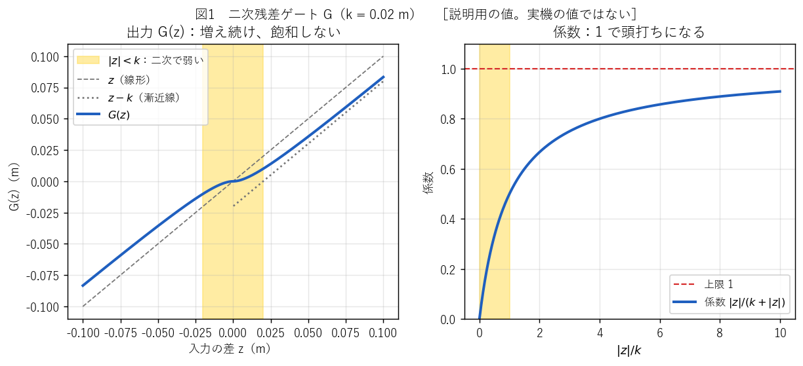

<!-- ファイル名: NRA-IDE_補助式A・B系列_導出と使い方(2026_1120_1141).md | 作成: 2026_1120_1141 JST -->

# NRA-IDE 補助式 A・B 系列 — 導出の経過・記号・使い方

同じ非線形の応答関数 $G$ を、二つの異なる経路で使う。**系列Aは、同じ時刻の参照との差に応じて計算モデルに補助加速度を加える。系列Bは、過去位置を参照した変位に逆らう方向へ実機を動かす制御の案である。** 使い分けるときは、差を取る二つの値と、計算結果をどこへ渡すかを先に決める。

| 系列 | 何を比較するか | 何を変えるか |
|---|---|---|
| A | 対象・時刻を揃えた参照状態と計算状態 | モデルの加速度を補い、その後の速度・位置を更新する |
| B | 現在の位置と速度で一歩先を見込んだ位置と、過去に測った位置 | 実機への加速度指令を出し、指令後の動きをセンサーで観測する |

本書は技術解説である。系列Aは [FORMULA.md §5](../../FORMULA.md) に定義される領域別の補完モデルを扱う。系列Bは非正典の応用案である。以下の数値は式の働きを読むための説明用で、実機の測定値や設計値を表さない。

## 1. 共通の部品　差から応答を作る

$$
G(z)
=
\underbrace{z}_{\text{差の向きと大きさ}}\,
\underbrace{\frac{|z|}{k+|z|}}_{\text{差に応じた重み}},
\qquad k>0
$$

$k$ は応答の尺度となる値で、$z$ と同じ単位を持つ。出力 $G(z)$ も $z$ と同じ単位を持ち、$z\ne0$ ならその符号を保つ。

| 差の大きさ | 応答の読み方 |
|---|---|
| $\lvert z\rvert\ll k$ | $G(z)\approx z\lvert z\rvert/k$。原点近くでは差の二乗に応じて弱く応答する |
| $\lvert z\rvert=k$ | $G(z)=z/2$。二次応答から漸近線形応答へ移る途中の目安になる |
| $\lvert z\rvert\gg k$ | $G(z)/z$ が $1$ に近づく。出力の大きさは増え続ける |

非ゼロの小さな差にも出力がある。大入力側で $1$ に近づくのは重みである。出力の上限が必要な場合は別に定める。 [FORMULA.md §5.3〜5.5](../../FORMULA.md#53-小残差領域)

## 2. 系列A　計算状態を参照値で補う

### 2.1 同じ時刻の値から補助加速度を作る

$$
\xi_n
=
\underbrace{x_{\mathrm{exact},n}}_{\text{同じ時刻の独立した参照}}
-
\underbrace{x_n}_{\text{モデルの計算状態}}
$$

$x_{\mathrm{exact},n}$ は由来と不確かさを記録した事前定義の参照値である。例えば校正済みの距離計を使うなら、値が表す時刻と取得した時刻を記録する。遅れて届いた観測で予測誤差を求める場合は、同じ対象時刻の保存済み予測と照合する。

$$
\begin{aligned}
\ddot{x}_n
&=
\underbrace{F_{\mathrm{IDE}}(x_n)}_{\text{領域の基礎加速度}}
+
\underbrace{G(\xi_n)\Phi(x_n)}_{\text{参照との差による補助加速度}}
-
\underbrace{\gamma v_n}_{\text{モデルの速度減衰}}
\\[4pt]
v_{n+1}
&=
v_n+\ddot{x}_n\Delta t
\\[4pt]
x_{n+1}
&=
x_n+\underbrace{v_{n+1}\Delta t}_{\text{更新した速度による変位}}
\end{aligned}
$$

$F_{\mathrm{IDE}}$ はこの領域の基礎動力学である。$\gamma\ge0$ の単位は $\mathrm{s}^{-1}$、$\Phi$ の単位は $\mathrm{s}^{-2}$ である。位置をメートルで表すと、$G(\xi_n)\Phi(x_n)$ は加速度の単位になる。上の位置更新は、速度を先に更新する半陰的オイラー法を用いた一例である。 [FORMULA.md §5.1〜5.2](../../FORMULA.md#51-変数定義)

### 2.2 散布機ブームの高さモデルで一歩を計算する

ブーム先端の高さを $x_n=0.56\ \mathrm{m}$、上向きの速度を $v_n=0.10\ \mathrm{m/s}$ とする。基礎加速度には $F_{\mathrm{IDE}}(x)=-\pi^2(x-0.50)$ を使う。これは固有振動数を $0.5\ \mathrm{Hz}$ と置いた説明用のモデルである。距離計の不確かさを $\pm0.002\ \mathrm{m}$ と仮定し、$\gamma=0.5\ \mathrm{s}^{-1}$、$\Phi=4.0\ \mathrm{s}^{-2}$、$k=0.02\ \mathrm{m}$、$\Delta t=0.01\ \mathrm{s}$ を固定する。倍精度で一歩だけ計算し、表示値を丸める。

| 量 | A-1 | A-2 | 補助項なし |
|---|---:|---:|---:|
| 参照位置 $x_{\mathrm{exact},n}$（m） | 0.520000 | 0.556000 | — |
| 差 $\xi_n$（m） | −0.040000 | −0.004000 | — |
| 応答 $G(\xi_n)$（m） | −0.026667 | −0.000667 | — |
| 重み $G(\xi_n)/\xi_n$ | 0.667 | 0.167 | — |
| 補助加速度 $G(\xi_n)\Phi$（m/s²） | −0.106667 | −0.002667 | 0.000000 |
| 合計加速度 $\ddot{x}_n$（m/s²） | −0.748843 | −0.644843 | −0.642176 |
| 更新後の速度（m/s） | 0.092512 | 0.093552 | 0.093578 |
| 更新後の位置（m） | 0.560925116 | 0.560935516 | 0.560935782 |

A-1では参照値が計算状態より低いため、正の $\Phi$ を通じて下向きの補助加速度が加わる。更新後も速度は上向きで、位置は上がる。補助項なしに比べると、上昇幅は A-1 で約 $10.67\ \mathrm{\mu m}$、A-2 で約 $0.27\ \mathrm{\mu m}$ 小さい。A-2にも補助加速度があり、差への重みが小さくなっている。

この一歩で比べたのは補助項を入れたときの軌道の変化である。**予測精度を評価するには、次の対象時刻の独立参照を用意し、補助項あり・なしの誤差を同じ条件で比べる。** 積分法、初期値、時間刻み、反復回数、丸め、発散と非有限値の処理は計算前に固定する。 [FORMULA.md §5.6〜5.8](../../FORMULA.md#56-初期条件)

## 3. 系列B　過去からの変位に逆らう指令を出す

### 3.1 何を計算しているか

$$
\underbrace{r_n}_{\text{遅延参照残差}}
=
\underbrace{\widetilde{x}_{n+1}-x_{n-d}}_{\text{暫定位置と過去位置の差}}
=
\underbrace{(x_n-x_{n-d})}_{\text{過去から今までの変位}}
+
\underbrace{v_n\Delta t}_{\text{現在速度で見込む一歩の変位}}
$$

$x_n$ は現在測った位置、$x_{n-d}$ は $d$ ステップ前に測った位置である。$v_n$ は現在の速度の測定値、または時刻と算出方法を固定した推定値である。$\widetilde{x}_{n+1}=x_n+v_n\Delta t$ は現在の情報で置いた暫定位置で、$d$ は固定した正の整数である。

$$
\begin{aligned}
c_n
&=
\underbrace{\alpha}_{\text{加速度に換算する係数}}\,
\underbrace{G(r_n)}_{\text{遅延参照残差への応答}}
\\[4pt]
u_n
&=
\underbrace{-c_n}_{\text{実機への加速度指令}}
\end{aligned}
$$

$\alpha>0$ の単位は $\mathrm{s}^{-2}$ である。一次元の有効質量 $m>0$ に加速度指令がそのまま伝わると仮定した場合、対応する符号付きの力は $m u_n=-m c_n$ になる。実機では指令後の位置・速度を観測する。設計時にシミュレーションする場合は、指令がそのまま加速度として作用すると仮定したか、アクチュエータや機構の応答をモデル化したかを明示する。一歩を単純化して計算するなら、次のように作用を分けて置ける。

$$
v_{n+1}
=
v_n+
\left(
\underbrace{F_{\mathrm{IDE}}(x_n)}_{\text{装置の基礎加速度}}
+
\underbrace{u_n}_{\text{指令どおり作用すると仮定した加速度}}
\right)\Delta t
$$

### 3.2 減衰として働く条件

遅延区間で速度がほぼ一定なら、過去からの変位は $x_n-x_{n-d}\approx d\,v_n\Delta t$ となる。このとき $r_n\approx(d+1)v_n\Delta t$ で、現在速度と遅延参照残差の符号が揃う。

$$
\underbrace{u_nv_n}_{\text{指令が実現した場合の単位質量あたりの仕事率}}
=
\underbrace{-\alpha G(r_n)v_n}_{\text{符号で作用の向きを読む}}
$$

$r_n$ と $v_n$ が同じ向きなら、指令による仕事率は負になる。速度反転直後などで二つが逆向きになると、指令は現在の運動と同じ向きになり、仕事率が正になる。$v_n=0$ でも履歴に変位が残れば指令が出る。このため、**系列Bの基本動作は遅延参照残差に逆らうことであり、現在の運動への減衰は符号が揃う区間で生じる。**

### 3.3 両方の挙動を数値で見る

例では上向きを正とする。散布機ブーム先端の高さを一つの座標で表し、$\Delta t=0.01\ \mathrm{s}$、$d=1$、$k=0.005\ \mathrm{m}$、$\alpha=50\ \mathrm{s}^{-2}$ を事前固定する。現在位置は共通で $x_n=0.5600\ \mathrm{m}$ とする。倍精度で計算し、表では表示値を丸める。

| 例 | 過去位置（m） | 現在速度（m/s） | 遅延参照残差（m） | 指令加速度 $u_n$（m/s²） | 指令だけによる速度変化（m/s） |
|---|---:|---:|---:|---:|---:|
| B-1　上向き | 0.5500 | +1.000 | +0.020000 | −0.800000 | −0.008000 |
| B-2　緩い上向き | 0.5595 | +0.050 | +0.001000 | −0.008333 | −0.000083 |
| B-3　速い上向き | 0.5100 | +5.000 | +0.100000 | −4.761905 | −0.047619 |
| B-4　下向きに反転 | 0.5599 | −0.005 | +0.000050 | −0.000024752 | −0.000000248 |

B-1では、過去から今までの上向き $0.010\ \mathrm{m}$ と、今の速度で見込む上向き $0.010\ \mathrm{m}$ を足して $r_n=0.020\ \mathrm{m}$ になる。次に $G(r_n)=0.016\ \mathrm{m}$、$c_n=0.8\ \mathrm{m/s^2}$ を得る。実機に渡すのは下向きの $u_n=-0.8\ \mathrm{m/s^2}$ である。

B-2の応答も非ゼロで、B-3では指令の大きさが増え続ける。B-4では、過去から今までの上向き $0.000100\ \mathrm{m}$ が次の一歩の下向き $0.000050\ \mathrm{m}$ を上回る。残差は正、指令は下向きとなり、現在の下降を強める向きになる。これらは一歩の符号と大きさを確認する例である。複数ステップでの安定性や、実機の揺れがどの程度減るかは未検証である。

## 4. 使い分けと、事前に固定すること

まず、更新する対象と補助項の行き先を定める。

- **系列Aを使う**。目的が計算モデルの補完で、比較できる同時刻の独立参照があり、参照と各係数の根拠・不確かさ・検証法を置ける場合。
- **系列Bを検討する**。目的が実機の制御で、位置・速度の時刻、アクチュエータの符号と出力上限、速度反転や遅延時の判定条件を定められる場合。実際の採用には、その領域での検証を要する。
- 条件がそろわない場合は採用を保留し、欠けている観測や検証を記録する。採否・係数は評価前に宣言し、途中の結果で決め直さない。

同じブームでも、**計算モデルを補うAと実機に指令するBは併存できる。** その場合はモデルの補助加速度と、実機に与えた操作量の出所を区別する。同じ作用をモデルに二度足さないように、どの項が実機への操作を再現し、どの項が計算の補完を担うかを記録する。

評価出力を、その評価対象の計器やCause-Sideの値を作り直す入力へ戻す経路は、[AXIOMS.md §14](../../theory/AXIOMS.md) の禁止対象である。Aの参照値を補正済みの計算値で置き換えたり、Bの過去位置を計算値で置き換えたりすると、値の出所が変わる。境界接近比による補正強度の決定も本案では採用しない。境界接近比を使う例として、事前に固定した保守的な運転モードへの切り替えがある。 [量子アーキテクチャの変遷記録 QH-22](./nra-ide-hybridcalc-quantum-architecture-next_ver/変遷記録.md)

## 5. どこから来たか

| 資料 | 今の整理につながる点 |
|---|---|
| [3月28日・量子拡張セッション記録](../../nra-core/quantum/NRA-IDE_quantum_Python/NRA-IDE_量子拡張セッションサマリー_2026-03-28.md) | 層で出た誤差を追う着想がある。系列Aへ直接つながったかは未定 |
| [4月7日・JAX解説](./BioDynamic_IDE_Engine_JAX_v2_20260407_py_詳細解説.md) | 参照との差の応答と速度減衰を同じ式に置いた、Aに近い資料 |
| [4月18日・予測子・修正子メモ](./NRA-IDE_predictor_corrector_2026-04-18_231654.md) | §2では位置、§6では速度を補正する。系列Bは、§6の遅延参照と速度補正の形を実機への指令に応用した案 |
| [4月21日・量子アーキテクチャ修正版](./nra-ide-hybridcalc-quantum-architecture-next_ver/NRA-IDE_QuantumArchitecture_Revised_2026-04-21_0141_JP.md) | 遅延幅と吸収厚みの記号を分けた |
| [4月29日・量子版](./nra-ide-hybridcalc-quantum-architecture-next_ver/NRA-IDE_Quantum_Reduction_Final_2026-04-29_1648_JP.md) | 遅延参照残差を状態記述子で定義し、計算上の状態を直接補正した。ここで参照するのは残差の定義と補正先の履歴 |
| [7月11日・FORMULA.md](../../FORMULA.md) | Git履歴上で「補完式」の初出をコミット `8d2699b` に確認 |
| [7月17日・ハイブリッド計算](./NRA-IDE_HybridCalc_vs_Traditional.md) | 観測と予測の対象時刻を揃え、同形の応答の出力に飽和上限がないことを説明 |
| [10月・変遷記録](./nra-ide-hybridcalc-quantum-architecture-next_ver/変遷記録.md) と [量子ハイブリッド用語集](../../dictionary/quantum-hybrid/Glossary_JP.md#qh-delayed-reference-residual) | 比率による補正強度の制御を不採用とし、正典の残差 $\xi$ と遅延参照残差を区別 |

4月29日資料の上界の説明には、残差応答の出力が飽和するという前提がある。§1の関数では出力は大入力側で増え続けるため、この上界の説明は系列Bの根拠に使えない。系列Bで出力を制限する場合は、制御の条件として別に定める。

丸めや三重ゆらぎの着想から補助式が生まれた経路、位置補正から速度補正へ移した理由は未確定である。資料、利用者の記憶、今回の再構成を区別した記録は [補助式の中途導出と探索経緯](./NRA-IDE_補助式の中途導出と探索経緯%282026_1118_1512%29.md) に置く。

### 経過を比較するための旧図版

[旧図2・系列A](./NRA-IDE_補助式A・B系列_figures/fig2_A.png)、[旧図3・系列B](./NRA-IDE_補助式A・B系列_figures/fig3_B.png)、[旧図4・AとBの流れ](./NRA-IDE_補助式A・B系列_figures/fig4_flow.png) は、従来の説明と比較するための資料である。「追わない」「反応しない」の数値上の意味は応答が弱いことである。旧図3の曲線は速度がほぼ一定という条件で読み、旧図4のBでは位置に加えて速度が入力となり、アクチュエータへの指令は $-c_n$ となる。
