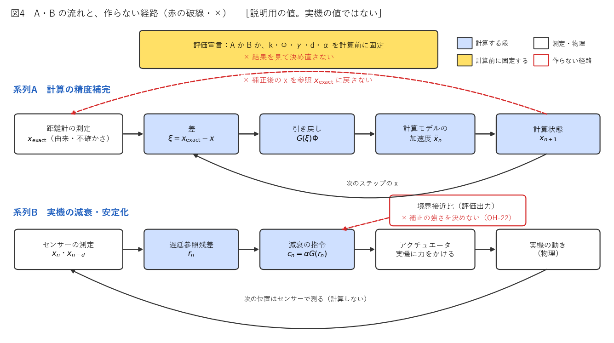
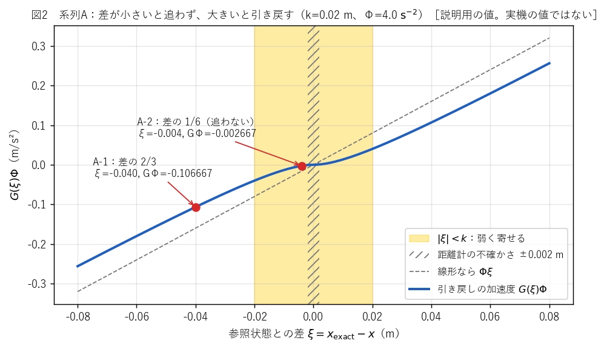
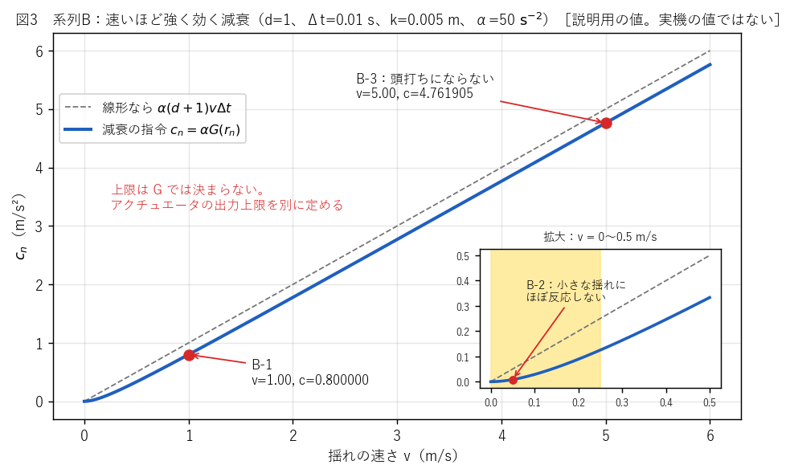

<!-- ファイル名: NRA-IDE_補助式A・B系列_導出と使い方(2026_1120_1141).md | 作成: 2026_1120_1141 JST -->

# NRA-IDE 補助式 A・B 系列 — 導出の経過・記号・使い方

**要旨**：補助式には二つの系列がある。同じ関数 $G$ を使うが、入力の意味と用途が違う別物である。

- **系列A**：計算の精度補完。独立した高精度の参照との差で、計算状態を補う。正典 [FORMULA §5](../../FORMULA.md) の補完式。
  - ひとことで：計算が測定から外れたら、外れ具合に応じて測定の側へ引き戻す。わずかな外れは追わない（例：カーナビが自車位置を GPS に合わせ直す）。
- **系列B**：実機の減衰・安定化。自分の過去位置との差で、実機に減衰をかける。正典の外にある。
  - ひとことで：速く動くほど強くブレーキをかける。ゆっくりした小さな揺れには反応しない（例：車のショックアブソーバー）。

どちらを使うかは4節、逆導出にしないための注意は5節に置く。



> **但し書き**：本書の数値はすべて説明用の例であり、実機・圃場の測定値ではない。図も同じ値で描いた。経過の表の「根拠」欄は、資料・git 履歴・正典・利用者の証言・解析を区別して示す。

> **記号の但し書き**：本書の記号は本書の中だけで有効である。正典・辞書の記号とぶつからないよう、次のように選んだ（FORMULA §7：別の意味には別の基底名を使う）。
>
> - 加速度： $a_n=\dfrac{d^2x_n}{dt^2}=\ddot{x}_n$ である。1次元・成分表示なので $\ddot{x}_n$ と書く。辞書の「作用 $a_n$ 」と同じ記号になるため、 $a_n$ は使わない。
> - 角振動数：正典では $\omega$ が構造連続性の予約記号なので使わない。0.5 Hz の単振動の係数は $\pi^2$ と直接書く。
> - 4/18 メモの遅延と残差応答の記号は、吸収厚み・境界接近比の予約記号と同じ字だった。本書では遅延を $d$ 、応答を $G(r_n)$ ・ $c_n$ と書く（3.1）。
> - $r_n$ ・ $c_n$ が境界接近比・制約と大小だけの区別にならないよう、本書では境界接近比と制約を記号で書かず、言葉で書く。
> - $x$ ・ $v$ は、系列Aでは計算状態、系列Bでは測った値を表す。意味は各節の記号表で定める。

## 1. 共通の部品：二次残差ゲート $G$

$$
G(z)=z\,\frac{\lvert z\rvert}{k+\lvert z\rvert},\qquad k>0
$$

| 入力の大きさ | $G$ の形 | 働き |
|---|---|---|
| $\lvert z\rvert\ll k$ | $G(z)\approx z\lvert z\rvert/k$ | 二次で小さく、ほとんど効かない |
| $\lvert z\rvert=k$ | $G(z)=z/2$ | 二次と線形の切り替わり |
| $\lvert z\rvert\gg k$ | $G(z)/z\to1$ | 線形に近づく。有界な値へ飽和しない |

$z>0$ では $G(z)=z-k+\dfrac{k^2}{k+z}$ であり、 $z\to\infty$ で $z-k$ に漸近する。係数 $\lvert z\rvert/(k+\lvert z\rvert)$ は1へ飽和するが、出力 $G(z)$ は飽和しない（[FORMULA §5.3〜5.4](../../FORMULA.md)）。


| 系列 | 入力 $z$ | 入力の意味 |
|---|---|---|
| A | $\xi=x_{\mathrm{exact}}-x$ | 計算がどれだけ外れているか |
| B | $r_n=\widetilde{x}_{n+1}-x_{n-d}$ | 実機がどれだけ速く動いているか |

## 2. 系列A：計算の精度補完

### 2.1 導出の経過

| 日付 | 資料 | 段階 | 根拠 |
|---|---|---|---|
| 3/28 | [量子拡張セッション記録 §6.5](../../nra-core/quantum/NRA-IDE_quantum_Python/NRA-IDE_量子拡張セッションサマリー_2026-03-28.md) | 層で出た誤差を丸めずに、次の層の入力ゆらぎとして渡す | 資料（A の起点かは未定） |
| 4/7 | [JAX解説 §2](./BioDynamic_IDE_Engine_JAX_v2_20260407_py_詳細解説.md) | $\ddot{x}+\gamma\dot{x}=F_{\mathrm{IDE}}(x)+G(r)\Phi(x)$ 、 $r=x_{\mathrm{exact}}-x$ 。古典層が量子層を補助する | 資料 |
| 7/11 | FORMULA.md | 補完式として正典に入る（「補完式」の語の初出 commit は 8d2699b） | git 履歴 |
| 7/17 | [ハイブリッド計算 §3-1](./NRA-IDE_HybridCalc_vs_Traditional.md) | $G$ は飽和せず、補正量の上限を保証しない | 資料 |
| 現行 | [FORMULA §5](../../FORMULA.md) | $r\to\xi$ 。 $x_{\mathrm{exact}}$ に由来・不確かさを付ける。次元整合を定める。公理ではない派生的な補完モデルとする | 正典 |

用途（FORMULA §5）：二重ゆらぎ式の EMAラグ、局所急変への追従遅れ、領域固有の精度限界を補う。

### 2.2 式

正典の式（FORMULA §5）：

$$
\frac{d^2x}{dt^2}+\gamma\frac{dx}{dt}=F_{\mathrm{IDE}}(x)+G(\xi)\Phi(x),\qquad \xi=x_{\mathrm{exact}}-x
$$

例で用いる1ステップの計算（積分法は半陰的オイラー。速度を先に更新し、新しい速度で位置を更新する）：

$$
\begin{aligned}
\text{10}\quad \xi_n &= x_{\mathrm{exact},n}-x_n \\[4pt]
\text{20}\quad \ddot{x}_n &= F_{\mathrm{IDE}}(x_n)+G(\xi_n)\Phi(x_n)-\gamma v_n \\[4pt]
\text{30}\quad v_{n+1} &= v_n+\ddot{x}_n\Delta t \\[4pt]
\text{40}\quad x_{n+1} &= x_n+v_{n+1}\Delta t
\end{aligned}
$$

- $x_{\mathrm{exact},n}$ は計算状態 $x_n$ と同じ対象時刻の参照値を使う。対象時刻と取得時刻を両方記録する。
- 補助項は加速度 $\ddot{x}_n$ に入り、速度を経て位置へ届く。

### 2.3 記号

| 記号 | 意味 | 次元 |
|---|---|---|
| $x_n$ | 計算状態（時刻 $n$） | $X$ |
| $v_n$ | 計算状態の速度 | $XT^{-1}$ |
| $x_{\mathrm{exact},n}$ | 由来と不確かさを記録した、事前定義の高精度参照状態。絶対的な真値を意味しない | $X$ |
| $\xi_n$ | 参照状態との差 | $X$ |
| $k$ | knee値。これより小さい差は二次で弱く扱う | $X$ |
| $\gamma$ | 減衰係数（ $\gamma\ge0$ ） | $T^{-1}$ |
| $F_{\mathrm{IDE}}(x)$ | 領域固有の基礎動力学項。IDE一次式ではない | $XT^{-2}$ |
| $\Phi(x)$ | 補助計算項 | $T^{-2}$ |
| $G(\xi)$ | 二次残差ゲート | $X$ |
| $\ddot{x}_n$ | 加速度 | $XT^{-2}$ |
| $\Delta t$ | 時間刻み | $T$ |

### 2.4 現場・用途の例

**散布機ブームの高さを計算するモデルを、校正済み距離計の測定へ寄せる。**

モデルは、次の動きの予測や、測っていない速度を出すために使う。測定とずれたままでは予測も外れるので、測定の側へ寄せる。

- $x$ ：モデルが計算するブーム先端の高さ
- $x_{\mathrm{exact}}$ ：校正済みレーザー距離計の測定値。由来＝校正記録、不確かさ＝ $\pm0.002\ \mathrm{m}$
- $F_{\mathrm{IDE}}(x)=-\pi^2(x-h_0)$ ：ブームの吊り下げを、振動数 0.5 Hz の単振動で近似した領域モデル。係数は $(2\pi\times0.5)^2=\pi^2\approx9.869604\ \mathrm{s^{-2}}$ 、 $h_0=0.50\ \mathrm{m}$
- $\Phi(x)=4.0\ \mathrm{s^{-2}}$ （一定）、 $\gamma=0.5\ \mathrm{s^{-1}}$
- $k=0.02\ \mathrm{m}$ ：距離計の不確かさの10倍までの差は、二次で弱く寄せる設計
- 事前固定：積分法＝半陰的オイラー、 $\Delta t=0.01\ \mathrm{s}$ 、1ステップのみ、計算＝倍精度、表示＝小数点以下6桁で四捨五入（途中の値は丸めずに計算する）

### 2.5 数値のはめ込み

初期値は $x_n=0.56\ \mathrm{m}$ 、 $v_n=0.10\ \mathrm{m/s}$ 。

**A-1 の代入（ $x_{\mathrm{exact},n}=0.52\ \mathrm{m}$ ）**

$$
\begin{aligned}
\text{10}\quad \xi_n &= 0.52-0.56=-0.04 \\[4pt]
G(\xi_n) &= \frac{(-0.04)\times0.04}{0.02+0.04}=\frac{-0.0016}{0.06}=-0.026667 \\[4pt]
G(\xi_n)\Phi &= -0.026667\times4.0=-0.106667 \\[4pt]
F_{\mathrm{IDE}}(x_n) &= -9.869604\times(0.56-0.50)=-0.592176 \\[4pt]
\text{20}\quad \ddot{x}_n &= -0.592176+(-0.106667)-0.5\times0.10=-0.748843 \\[4pt]
\text{30}\quad v_{n+1} &= 0.10+(-0.748843)\times0.01=0.092512 \\[4pt]
\text{40}\quad x_{n+1} &= 0.56+0.092512\times0.01=0.560925
\end{aligned}
$$

**A-1 と A-2 の比較**（参照値だけを変える）

| 段 | 式 | A-1： $x_{\mathrm{exact}}=0.52$ | A-2： $x_{\mathrm{exact}}=0.556$ |
|---|---|---|---|
| 10 | $\xi_n$ | $-0.040000$ | $-0.004000$ |
| — | $G(\xi_n)$ | $-0.026667$ | $-0.000667$ |
| — | $G(\xi_n)/\xi_n$ | $0.667$ | $0.167$ |
| — | $F_{\mathrm{IDE}}(x_n)$ | $-0.592176$ | $-0.592176$ |
| — | $G(\xi_n)\Phi$ | $-0.106667$ | $-0.002667$ |
| — | $\gamma v_n$ | $0.050000$ | $0.050000$ |
| 20 | $\ddot{x}_n$ | $-0.748843$ | $-0.644843$ |
| 30 | $v_{n+1}$ | $0.092512$ | $0.093552$ |
| 40 | $x_{n+1}$ | $0.560925$ | $0.560936$ |

補助項なしの場合は $\ddot{x}_n=-0.642176$ 、 $v_{n+1}=0.093578$ 、 $x_{n+1}=0.560936$ である。

- 符号：A-1 の $\xi_n<0$ は、計算が測定より $0.04\ \mathrm{m}$ 高いことを表す。 $G<0$ となり、加速度に下向きの分を足して、計算を測定の側へ引き戻す。
- A-1：差が $k$ の2倍あるので、 $G$ は差の $2/3$ の大きさになり、速度を下げる。
- A-2：差は距離計の不確かさの2倍で、 $G$ は差の $1/6$ の大きさしかない。測定の不確かさと同程度の差は追いかけない。
- 1ステップでは補助項の効果はまず速度に出る。位置の差は小数点以下6桁目に現れる。



### 2.6 使ってはならない場面

- $x_{\mathrm{exact}}$ の由来・不確かさを計算前に固定できない。
- 計算結果を見て $k$ ・ $\Phi$ ・ $\gamma$ を調整する（5節）。
- 実機の制御として使う。実機に力をかける場合は系列Bの判定へ回す（4節）。
- 補正量の上限として扱う。 $G$ は飽和しない。

## 3. 系列B：実機の減衰・安定化

### 3.1 導出の経過

| 日付 | 資料 | 段階 | 根拠 |
|---|---|---|---|
| 4/7 | [JAX解説 §2](./BioDynamic_IDE_Engine_JAX_v2_20260407_py_詳細解説.md) | 共通の部品：関数 $G$ と線形減衰 $\gamma\dot{x}$ | 資料 |
| 4/18 | [設計メモ §1](./NRA-IDE_predictor_corrector_2026-04-18_231654.md) | 出発点：位相差に応じた重み付きの補助項を、速度の更新に足す形（補助線形式） | 資料 |
| 4/18 | 設計メモ §2 | 予測子・修正子：暫定位置を出し、過去位置との差で位置を補正する | 資料 |
| 4/18 | 設計メモ §3 | 遅延を固定する。適応させると遅延を決める遅延が要る | 資料 |
| 4/18 | 設計メモ §4 | 位相差でなく残差（ズレ量）を使う | 資料 |
| 4/18 | 設計メモ §6 | 補正先を速度へ移して確定する | 資料（移した理由の記載なし） |
| 4/21 | [量子アーキテクチャ修正版](./nra-ide-hybridcalc-quantum-architecture-next_ver/NRA-IDE_QuantumArchitecture_Revised_2026-04-21_0141_JP.md) | 遅延幅の記号を、吸収厚みの記号と分ける | 資料 |
| 4/29 | [量子版の完成版 §3.1〜3.2](./nra-ide-hybridcalc-quantum-architecture-next_ver/NRA-IDE_Quantum_Reduction_Final_2026-04-29_1648_JP.md) | 遅延参照残差を、予測した状態記述子と、遅延参照幅だけ前の参照との差として定める。補正は状態を直接補正する形で、強さを境界接近比のゲートで決める | 資料 |
| 日付記載なし | [残渣ベース設計思想 §3・§4](../01_理論・公理_検討覚書/NRA-IDE_残渣ベース設計思想の合理性_技術要件と論理的帰結.md) | 過去の構造を錨にして、外乱への過剰反応を抑える。乗算・加算・絶対値だけで実装できる | 資料 |
| 10/22 | [変遷記録](./nra-ide-hybridcalc-quantum-architecture-next_ver/変遷記録.md) QH-22 | 境界接近比のゲートを不採用とする。境界接近比は、事前に固定した物理制御の指令に使う | 資料 |
| 10/23 | [用語集「遅延参照残差」](../../dictionary/quantum-hybrid/Glossary_JP.md#^qh-delayed-reference-residual) | 名を「遅延参照残差」と定め、正典の残差 $\xi$ とは別の量とする | 資料 |
| 2026-11-20 | 対話 | 植え付け期に、精度の問題を考える途中で偶然生まれた別系列とみられる。4/18 メモで遅延と残差応答に使っていた予約記号と同じ字を、 $d$ ・ $G(r_n)$ ・ $c_n$ に置き換えたのは、既存の記号と混ざらないため | 利用者の証言 |
| 2026-11-20 | 対話 | 滑らかな運動では遅延参照残差 $r_n$ が速度に比例し、式は速度の非線形減衰として働く（3.2） | 解析 |

- 4/29 の量子版は状態を直接補正する形で、4/18 メモ §2 に近い。本書の系列Bは、4/18 メモ §6 の速度を補正する形である。

用途：実機に減衰をかけて揺れを抑える。精度補完ではない。

### 3.2 式

$$
\begin{aligned}
\text{10}\quad \widetilde{x}_{n+1} &= x_n+v_n\Delta t \\[4pt]
\text{20}\quad r_n &= \widetilde{x}_{n+1}-x_{n-d} \\[4pt]
\text{30}\quad c_n &= \alpha\,G(r_n) \\[4pt]
\text{40}\quad v_{n+1} &= v_n+F_{\mathrm{IDE}}(x_n)\Delta t-c_n\Delta t
\end{aligned}
$$

- 実機では、制御装置が10〜30を計算し、 $-c_n$ をアクチュエータの加速度指令として出す（力＝質量 $\times\,c_n$ ）。
- 40は実機の物理が行う。次の $x_{n+1}$ ・ $v_{n+1}$ は計算せず、センサーで測る。40を計算するのは設計段階のシミュレーションだけである。
- $d$ ステップの間で速度がほぼ一定なら、 $x_n-x_{n-d}\approx d\,v_n\Delta t$ である。したがって $r_n\approx(d+1)\,v_n\Delta t$ となり、 $c_n\approx\alpha\,G\bigl((d+1)v_n\Delta t\bigr)$ は速度にかかる減衰になる。遅い動きには二次、速い動きには線形で効く。

### 3.3 記号

| 記号 | 意味 | 次元 |
|---|---|---|
| $x_n$ | センサーで測った位置（時刻 $n$） | $X$ |
| $v_n$ | 測った、または位置から求めた速度 | $XT^{-1}$ |
| $\widetilde{x}_{n+1}$ | 暫定位置（現時点の情報だけで計算する） | $X$ |
| $d$ | 遅延ステップ数。正の整数で、計算前に固定する | 無次元 |
| $r_n$ | 遅延参照残差：暫定位置と $d$ ステップ前の位置との差。用語集の「遅延参照残差」（4/29 の $r_t$ ）に当たる。系列Aの $\xi$ とは別の量 | $X$ |
| $k$ | knee値 | $X$ |
| $\alpha$ | 減衰の強さ。計算前に固定する | $T^{-2}$ |
| $c_n$ | 減衰の加速度指令 | $XT^{-2}$ |
| $F_{\mathrm{IDE}}(x)$ | 実機の基礎動力学（シミュレーションで使う領域モデル） | $XT^{-2}$ |
| $\Delta t$ | 制御周期 | $T$ |

### 3.4 現場・用途の例

**散布機ブームの揺れを、油圧アクチュエータで抑える。**

- $x$ ：レーザー距離計で測るブーム先端の高さ
- 事前固定： $\Delta t=0.01\ \mathrm{s}$ 、 $d=1$ 、 $k=0.005\ \mathrm{m}$ 、 $\alpha=50\ \mathrm{s^{-2}}$ 、計算＝倍精度、表示＝小数点以下6桁で四捨五入（途中の値は丸めずに計算する）
- アクチュエータの出力上限は、 $G$ とは別に定める（3.6）

### 3.5 数値のはめ込み

**B-1 の代入（ $x_{n-1}=0.550\ \mathrm{m}$ 、 $x_n=0.560\ \mathrm{m}$ 、 $v_n=1.00\ \mathrm{m/s}$ ）**

$$
\begin{aligned}
\text{10}\quad \widetilde{x}_{n+1} &= 0.560+1.00\times0.01=0.570 \\[4pt]
\text{20}\quad r_n &= 0.570-0.550=0.020 \\[4pt]
G(r_n) &= \frac{0.020\times0.020}{0.005+0.020}=\frac{0.0004}{0.025}=0.016 \\[4pt]
\text{30}\quad c_n &= 50\times0.016=0.8 \\[4pt]
\text{40}\quad -c_n\Delta t &= -0.8\times0.01=-0.008
\end{aligned}
$$

**B-1〜B-3 の比較**（揺れの速さだけを変える）

| 段 | 式 | B-1：速い揺れ | B-2：小さな揺れ | B-3：非常に速い揺れ |
|---|---|---|---|---|
| — | $x_{n-1}$ | $0.550$ | $0.5595$ | $0.510$ |
| — | $x_n$ | $0.560$ | $0.5600$ | $0.560$ |
| — | $v_n$ | $1.00$ | $0.05$ | $5.00$ |
| 10 | $\widetilde{x}_{n+1}$ | $0.570000$ | $0.560500$ | $0.610000$ |
| 20 | $r_n$ | $0.020000$ | $0.001000$ | $0.100000$ |
| — | $(d+1)v_n\Delta t$ | $0.020$ | $0.001$ | $0.100$ |
| — | $G(r_n)$ | $0.016000$ | $0.000167$ | $0.095238$ |
| — | $G(r_n)/r_n$ | $0.800$ | $0.167$ | $0.952$ |
| 30 | $c_n\ (\mathrm{m/s^2})$ | $0.800000$ | $0.008333$ | $4.761905$ |
| 40 | $-c_n\Delta t\ (\mathrm{m/s})$ | $-0.008000$ | $-0.000083$ | $-0.047619$ |

- 符号： $r_n>0$ は、ブームが上へ動いていることを表す。 $c_n>0$ となり、指令 $-c_n$ は下向きの加速度で、動きに逆らう。
- B-2：小さな揺れには $G$ が差の $1/6$ の大きさしかなく、細かい振動に反応しない。指令が細かく振れるのを防ぐ。
- B-1：速い揺れには減衰がはっきり効く。
- B-3：速さに比例して指令が増え、頭打ちにならない。アクチュエータの出力上限を別に定めなければならない。



### 3.6 使ってはならない場面

- 対象のモデルの中で、数値の安定化として使う。観測されていない人工の項が対象状態に入り、対象そのものの動きと区別できなくなる。
- 補正量の上限として扱う。 $G$ は飽和しないので、上限は別に定める。
- 計算結果を見て $d$ ・ $\alpha$ ・ $k$ を変える（5節）。
- 正典の式として扱う。正典に入れるなら、物理的な制御則として位置づけ、領域の根拠を付ける。

## 4. 使い分け（案）

計算を始める前に、評価宣言の中で次の順に判定し、固定する。評価宣言は、計算開始前に固定し、評価の結果で書き換えない記録である（[FORMULA §0.5.1](../../FORMULA.md)）。A・B の選択を評価宣言に書き加えるのは本書の案である。

```text
10 IF 対象 == 実機への物理的な制御（実際に力をかける装置がある）: 系列B GOTO 99
20 IF 由来・不確かさを記録した x_exact がある AND 目的 == 計算の精度補完: 系列A GOTO 99
30 どちらも使わない。補完なしで計算し、補完できない理由を記録する GOTO 99
99 評価宣言に記録して固定する
```

- 計算結果を見て A と B を切り替えない。
- 同じ状態の更新に A と B を両方入れない。補正を二重に数えることになる。
- 対象が違えば両方を使える。例：ブームの計算モデルには A、ブームの実機には B。

## 5. 逆導出にしないための注意

逆導出は、結果側（Effect-Side）から原因側の値・規則へ戻る経路（逆導出A）と、評価出力から同じ評価対象の基準・閾値・ゲート幅へ戻る経路（逆導出B）である。自動・手動・人間のレビュー・承認・版更新のどれを介しても禁止される（AXIOMS §14、[辞書「逆導出」](../../dictionary/NRA-IDE_Dictionary_JP.md#^reverse-derivation)）。A・B とも、次の経路を作らない。

| 作らない経路 | 系列A | 系列B |
|---|---|---|
| 結果を見てパラメータを決め直す | $k$ ・ $\Phi$ ・ $\gamma$ を、この計算の結果から調整しない | $d$ ・ $\alpha$ ・ $k$ を、制御の結果から調整しない |
| 計算した値を参照へ戻す | 補正後の $x$ を $x_{\mathrm{exact}}$ として使わない | 遅延参照には測った位置の記録だけを使い、計算した位置で置き換えない |
| 境界接近比で補正の強さを決める | 使わない | 使わない。4/29 の量子版にあった比率ゲートは 10/22 に不採用とした（[変遷記録](./nra-ide-hybridcalc-quantum-architecture-next_ver/変遷記録.md) QH-22） |
| 補助の項で判定を動かす | 境界接近比の判定を軽くする・覆す・置き換えることに使わない | 同じ |

- パラメータは、領域の根拠に基づいて計算前に決める（FORMULA §5.2）。2.5・3.5 の数値例を見てパラメータを選び直すことも、この注意の対象である。
- 境界接近比を使ってよいのは、事前に固定した物理制御の指令（例：保守的な運転モードへの切り替え）である（変遷記録 QH-22）。

## 6. 未定・未検証

| 箇所 | 状態 |
|---|---|
| 系列A：3/28 の発想から 4/7 の式への接続 | 資料で決まらない |
| 系列A：4月の「飽和応答」の記述が、係数と出力を区別した 7/17 の記述へ移った経過 | 資料なし |
| 系列B：補正先を位置から速度へ移した理由 | 証言で偶然の着想とされる。資料なし |
| 系列B：多ステップで減衰として働くか、位置を補正する案との比較 | 数値検算は未実施 |
| 2.5・3.5 の数値 | 説明用の例。実機の値ではない |

## 7. 関連

- [補助式の中途導出と探索経緯（2026-11-18）](./NRA-IDE_補助式の中途導出と探索経緯%282026_1118_1512%29.md)
- [FORMULA §5 補完式](../../FORMULA.md)
- [設計メモ（2026-04-18）](./NRA-IDE_predictor_corrector_2026-04-18_231654.md)
- [JAX解説（2026-04-07）](./BioDynamic_IDE_Engine_JAX_v2_20260407_py_詳細解説.md)
- [残渣ベース設計思想](../01_理論・公理_検討覚書/NRA-IDE_残渣ベース設計思想の合理性_技術要件と論理的帰結.md)
- [ハイブリッド計算（7/17）](./NRA-IDE_HybridCalc_vs_Traditional.md)
- [変遷記録（量子アーキテクチャ）](./nra-ide-hybridcalc-quantum-architecture-next_ver/変遷記録.md)
- [数式配置の5大鉄則](../../dictionary/NRA-IDE数式配置の5大鉄則（式の文法）.md)
