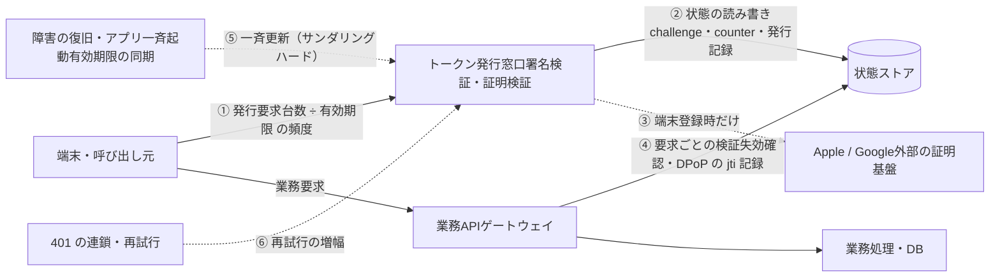
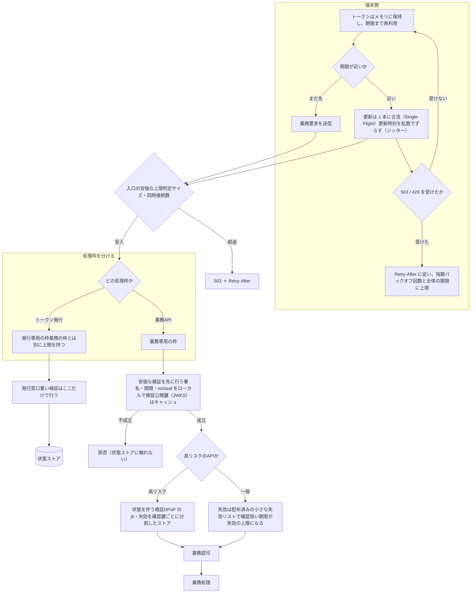
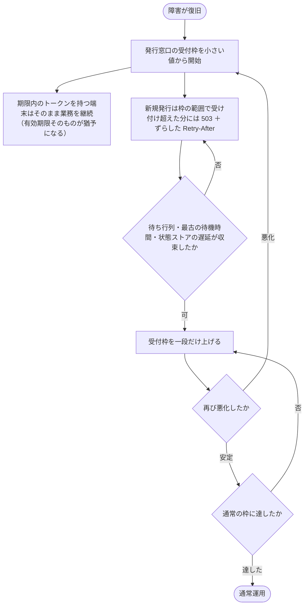

動的API · トラフィック · 2026-10-16

# 動的APIで増える負荷と、その回避方法

静的キーを短命トークンに置き換えると、新しい負荷が生まれます。このページでは、負荷がどこに生まれ、何で抑えられるかをまとめています。どの対策も、負荷を理由に認証・認可を緩めないことを前提にしています。

## 考え方の前提

推定

増える負荷は「全体が均等に重くなる」形ではありません。**トークンの発行窓口**と**状態ストア**（失効情報・再利用防止）に集中し、さらに**一斉に更新が走る瞬間**に跳ね上がります。業務APIの検証は、設計次第でほとんど増やさずに済みます。

推定

静的キーを廃止すると、盗んだキーで無制限に呼んでいた不正なトラフィックが減ります。差し引きで全体が増えるか減るかは、実測するまで分かりません。

根拠

08 の A 原則2（トークン交換と業務APIの分離）・Phase 4、C §5（入口制御・N/M/D/H）、具体的提言 §5・§8、精査 F09（先行更新による発行率の増加 8/7）。DPoP の nonce と再利用防止は RFC 9449 の仕組みです。

## 図1 負荷はどこで生まれるか

①⑤⑥は発行窓口に、②④は状態ストアに集中します。業務処理そのもの（BIZ）の負荷は、認証方式を変えても基本的には変わりません。

## 規模の目安（例示の計算）

同時にアクティブな端末を **100 万台**と仮定した計算です。実際の台数ではありません。先行更新は、期限の 15〜60 秒前に一様にずらす前提です（平均 37.5 秒前）。

| 有効期限 | 発行頻度（期限ちょうど） | 発行頻度（先行更新あり） | 増加率 |
| --- | --- | --- | --- |
| 5 分（300 秒） | 3,333 件/秒 | 3,810 件/秒 | 8/7 ≒ 1.143 |
| 15 分（900 秒） | 1,111 件/秒 | 1,159 件/秒 | ≒ 1.043 |
| 60 分（3,600 秒） | 278 件/秒 | 281 件/秒 | ≒ 1.011 |

- **一斉更新**：障害の復旧後に 100 万台が 60 秒以内に一斉に更新すると、約 16,667 件/秒です。これは 5 分期限の平常時（3,333 件/秒）の 5 倍にあたります。
- **DPoP の再利用防止**：保護APIへの要求が 20,000 件/秒で、証明の受付窓を 60 秒とすると、状態ストアへの書き込みは 20,000 件/秒、保持する件数は約 120 万件になります。

発行頻度は有効期限に反比例します。期限を短くするほど安全側に寄りますが、その分の発行負荷は発行窓口に集まります。

## 図2 負荷を抑えた要求経路

要点は 3 つです。重い検証を発行時に集めること、業務APIはローカルで検証できるトークン（JWT と公開鍵キャッシュ）を使い、要求ごとに認証サーバーへ問い合わせないこと、状態を伴う検証は高リスクのAPIに絞ることです。

## 図3 一斉更新が起きたときの段階的な再開

C の資源状態 D（縮退）→ H（復帰保留）→ 段階的な再開にあたります。悪化の検知は速く、復帰はゆっくり行います。Retry-After を全端末で同じ値にすると、次の一斉更新を作ってしまいます。

## 問題ごとの回避方法

| 問題 | 有効な回避方法 | 代償・注意 |
| --- | --- | --- |
| ① 平常時の発行負荷 | リスクに応じて有効期限を分ける（高リスクは短く、一般は長く）。トークンを期限まで再利用する | 期限が長いほど、盗まれたときに使われる時間が延びる |
| ② 発行時の状態の読み書き | 重い検証を発行時だけに集める。challenge・counter・発行記録を一つのトランザクションで確定する | 状態の正本をどこに置くかを先に決める必要がある（提言 §6） |
| ③ 外部の証明基盤 | 証明は端末登録のときだけ行う。日常の更新には使わない | 外部基盤が止まると、新規の登録は保留になる |
| ④ 要求ごとの検証 | JWT をローカルで検証し、公開鍵はキャッシュする。要求ごとの問い合わせ（introspection）は避ける。状態を伴う検証は高リスクAPIだけにする。DPoP の jti ストアは鍵ごとに分割し、受付窓を短くする（サーバー nonce も使える） | 一般APIの失効は即時ではなく、最大で有効期限分だけ遅れる |
| ⑤ 一斉更新 | 端末側のジッターと Single-Flight。発行窓口の専用枠。段階的な再開。Retry-After をずらす | 再開に時間がかかる |
| ⑥ 再試行の増幅 | 上限つきの指数バックオフ。401 での自動更新は 1 回で打ち切る。503 と 429 を再認証に変えない | 利用者には「しばらく待つ」と表示する必要がある |
| 社内サービス同士 | mTLS の接続を使い回し、送信者拘束を要求ごとではなく接続ごとに確認する | 接続を集約する経路の設計が必要 |

## 負荷対策として、やってはいけないこと

- 混雑を理由に有効期限を延ばしたり、期限切れのトークンを通したりする（A の 60 分猶予案。精査 F09 で 65 分の利用窓になると指摘）。
- 状態ストアが重いからといって、再利用防止や counter の検証を省く（B の案。精査 F04）。
- 未受理の要求に 200 を返す。拒否は 503 や 429 で正直に返す（C §5.5）。
- CPU 使用率だけを見て、一気に通常運用へ戻す（C §6.3）。

## 大事な部分のまとめ

- 動的APIで増える負荷は、発行窓口と状態ストア、そして一斉更新の瞬間に集中します。業務APIの検証はローカル検証で抑えられます。
- 最も効く対策は、重い検証を発行時に集め、業務APIをローカル検証にする「分離」と、端末側のジッター・合流・バックオフで「同期を崩す」ことの 2 つです。
- 発行窓口と業務APIの処理枠を分けると、一方の混雑がもう一方を止めなくなります。
- 負荷対策は入口の枠と時間の使い方だけで行います。認証・認可の条件は変えません。

## 要点（要約）

負荷の発生点は 6 か所です。分離（発行と業務）、同期を崩す（ジッター・合流・バックオフ）、処理枠の分割、状態を伴う検証を高リスクAPIだけに絞る、段階的に再開する、の 5 つで回避します。有効期限は安全性と発行負荷の釣り合いで決め、数値は実測で確定させます。