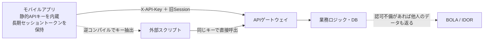
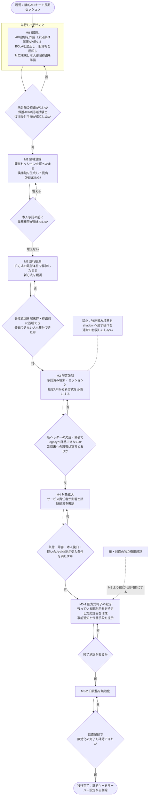
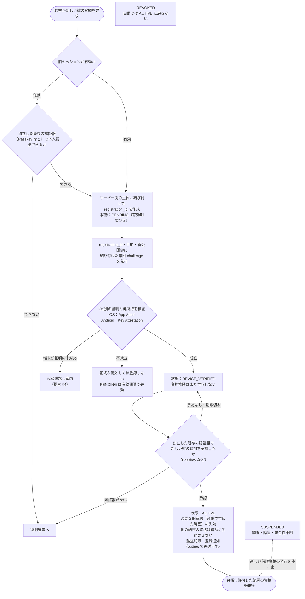
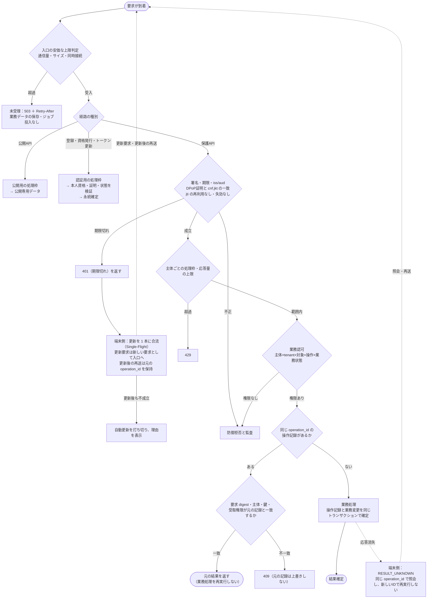

> note/08_セキュリティ · 移行フロー · 2026-10-16（再精査 P1〜P14 反映版）

# 静的APIキーから動的API認証への移行フロー

根拠は 08 の 3 原文（A 標準仕様書・B 移行計画書・C 統合設計案）と、同日の精査記録（F01〜F12）・具体的提言です。骨格には提言が推奨する C の「防御・縮退・復旧の分離」を使い、精査で問題とされた A/B の近道は採用していません。

## 前提と状態区分

- **位置付け**：08 の 3 原文と提言はどれも**非正典・未承認・未実装**です。この図は設計検討用で、本番仕様ではありません。精査の判定は「精査完了／解消未完了（未解消 12 項目）」です。
- **事実**：08 の「現況」は、モバイルアプリが**静的APIキーと長期セッショントークン**でバックエンドを呼ぶ構成です（B:7、A:23）。NRA-IDE の `src/nra_llm_pipeline_*.py` にある LLM プロバイダ用キーは、これとは別の境界です。前回版の図1はこの 2 つを混同していたため、差し替えました。
- **事実**：移行段階 M0〜M5、登録状態 PENDING〜REVOKED、受付順序、障害時の許可表は、提言 §2・§3・§5・§7・§10 にある候補案です。名前はすべて候補名で、導入済みの機能ではありません。
- **推定**：図の分岐の書き方と、段階の間を矢印でつないだ部分は、提言の文章を図にしたものです。差戻しの矢印は、提言の「次へ進む条件」を満たさない場合を表した解釈です。図2の M5 を「判定・承認」「無効化」「監査確認」に分けた順序も、承認が無効化の前提であることから置いた解釈です。図3で、旧セッションが無効でも独立した認証器で本人認証できれば登録へ進む分岐は、提言 §3 の「独立した認証器がない場合は復旧審査へ」から置いた解釈で、提言に明記された手順ではありません。
- **未確定**：対象サービス、端末 OS の分布、処理容量、認証製品、法的な本人確認要件はまだ示されていません（C:58）。そのため図には数値の閾値を入れていません。PENDING の有効期限の値も未確定です。

## 図1　現況（静的APIキー方式）

出典: A §1.1–1.2、B 冒頭の前提条件。BOLA はキー方式とは別に存在する問題です（精査 F01、C:60）。

## 図2　移行全体フロー（M0 → M5）

出典: 提言 §10（M0〜M5 と次へ進む条件）、§11（復旧経路を移行終了前に用意）、精査 F08。M0〜M5 は C の資源状態 N/M/D/H とは別物です。M5 は、提言 §10 の表では「無効化」と「終了承認」が同じ行にありますが、承認は無効化の前提なので、判定・承認（M5-1）→ 無効化（M5-2）→ 監査確認の順に分けています（再精査 P7）。

## 図3　新しい鍵の登録（旧セッションから直接有効化しない）

出典: 提言 §3（登録状態と手順 1〜6、失効対象は「必要な旧資格」）、§4（OS 別の実装契約と、対応できない端末の代替経路）、§10・AT15（端末Aの移行を理由に端末Bを暗黙に失効させない）、精査 F02・F05。B の「旧セッションを身元保証人にして無操作で登録する」案は採用していません。旧セッションが無効でも、独立した認証器があれば通常の承認で登録でき、復旧審査はそれがない場合の経路です（再精査 P3〜P5）。IP/ASN/OS の一致は補助的な観測にとどめます。

## 図4　移行後の日常リクエスト受付

出典: 提言 §2（受付順序）、§5（受入条件 1〜7、401 の扱い）、§6（同じ確定単位での冪等性、手順4：同じ operation_id は要求 digest などが一致する場合だけ元の結果へ合流し、内容が違えば 409）、§9（状態表示）、精査 F03・F07・F11。トークン更新は保護API の検証へ直接戻さず、新しい要求として入口の上限判定と認証用の処理枠を通します（再精査 P6）。jti の保存を省く API は、台帳で明示的に指定したものに限ります（「動的APIで増える負荷と、その回避方法」図2、再精査 P1）。縮退制御は入口の枠だけを変えられ、認証・認可の条件は変えられません（C §2）。

## 障害時に許可すること（提言 §7 の要約）

| 障害 | 保護API（既発行資格） | 新規登録・資格発行 | 復帰の条件 |
|---|---|---|---|
| Apple/Google 等の証明基盤が停止 | その外部サービスを毎回必要とせず、他の必須検証がすべて成立する範囲だけ継続 | 必要な証明を取れない登録は保留 | 外部証明の正常化と再検証 |
| Redis（任意キャッシュ）が停止 | 正本DBで同じ検証を続けられ、負荷上限内なら継続 | 同じ条件を満たす場合だけ継続 | 正本との整合と負荷を確認 |
| Redis が唯一の再利用防止正本で停止 | 再利用防止を検証できない保護要求は停止 | 停止 | 正本の復旧と整合確認。検証の省略で代替しない |
| counter・失効の正本DBが停止、または巻き戻りの疑い | 照合できない保護要求は停止。独立した公開経路だけ継続 | 停止 | 証拠照合、失効処理、必要なら強い再登録 |
| 端末の鍵を喪失 | 失った鍵が必要な操作は不可 | 別の本人証明または復旧審査で新規登録 | 新しい鍵の承認と、必要な旧資格の失効 |

## A/B 原文から採用しなかった近道

| 原文の案 | 採用しない理由（精査） | この図での扱い |
|---|---|---|
| 旧セッションだけで新端末を自動登録（B:83, 164） | 漏えいした旧セッションが新しい鍵の信頼に昇格する（F05） | 図3：独立した認証器の承認か復旧審査を必須にする |
| 障害時に署名や signCount の検証を省略（B:266, 329） | 同じ署名の再利用や counter の巻き戻しが通る（F04） | 障害表：省略せず、保留または停止 |
| 短命 Bearer ＋ IP/TLS 指紋で盗用を防ぐ（B:346） | 秘密鍵を持っていることの証明にならない（F03） | 図4：DPoP などの送信者拘束を受入条件にする |
| UUID 化で BOLA を解消（A:99）。端末署名が通れば BOLA も解消（C:294 が誤解として整理。A:33 は端末署名を通さない通信を破棄するという主張） | 正規の端末でも他人の ID を要求して署名できる（F01） | 図4：業務認可を独立した判定として残す |
| Redis の TTL だけで冪等性を確保（A:171–173） | 停止のタイミングによっては、正当な再送が拒否される（F07） | 図4：操作記録を同じトランザクションで確定し、同じ operation_id は元の結果へ合流する |
| enforced から shadow への切戻し（B:183） | 強制済みの境界が緩む（F08） | 図2：通常の切戻し手段にしない |

## 大事な部分のまとめ

- 防御（不正を止める）、縮退（処理しきれないものを受け付けない）、復旧（デジタル資格を失った後の権利回復）は、それぞれ別の系統として持ちます。縮退を理由に認証・認可を緩めることはしません。
- 新しい鍵は、旧セッションだけでは ACTIVE になりません。独立した本人承認か、復旧審査を通します。ACTIVE で失効させるのは台帳で定めた必要な旧資格だけで、他の端末の資格を暗黙に失効させません。
- BOLA の是正と復旧経路の準備は、移行の後ではなく前に済ませます（M0、M5 の前提）。旧資格の無効化は終了承認の後に行います。
- 検証できない状態では、新しい資格を発行せず、保護された操作も通しません。トークン更新も入口の上限判定を通ります。

## 要点（要約）

棚卸し・BOLA 是正（M0）→ 候補鍵の登録（M1）→ 並行観測（M2）→ 限定強制（M3）→ 対象拡大（M4）→ 旧方式終了（M5：承認→無効化→監査確認）の順に進め、各段階のゲートを満たさなければ次に進みません。図の数値や段階名はすべて未承認の候補で、受入試験 AT01〜AT20 も未実行です。
