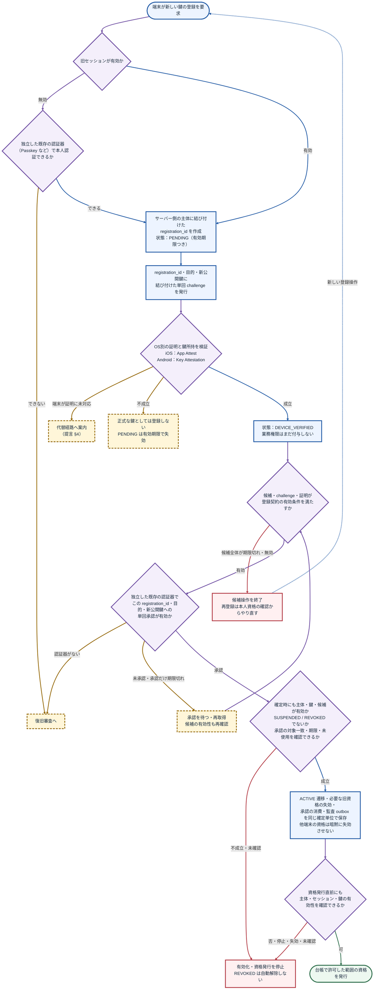
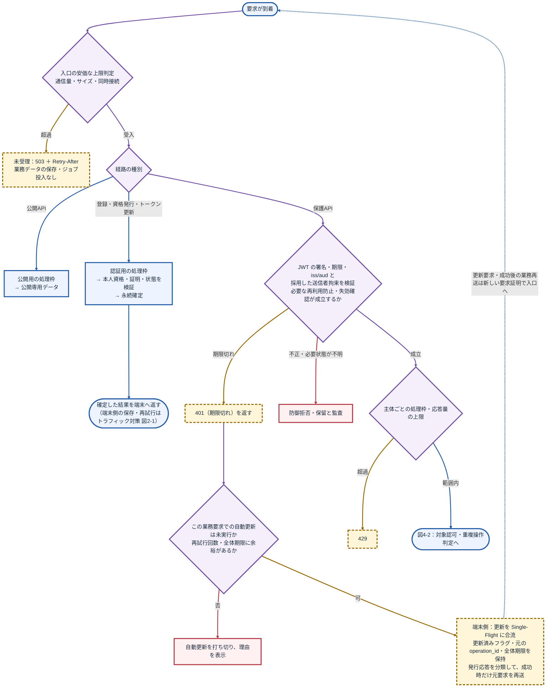
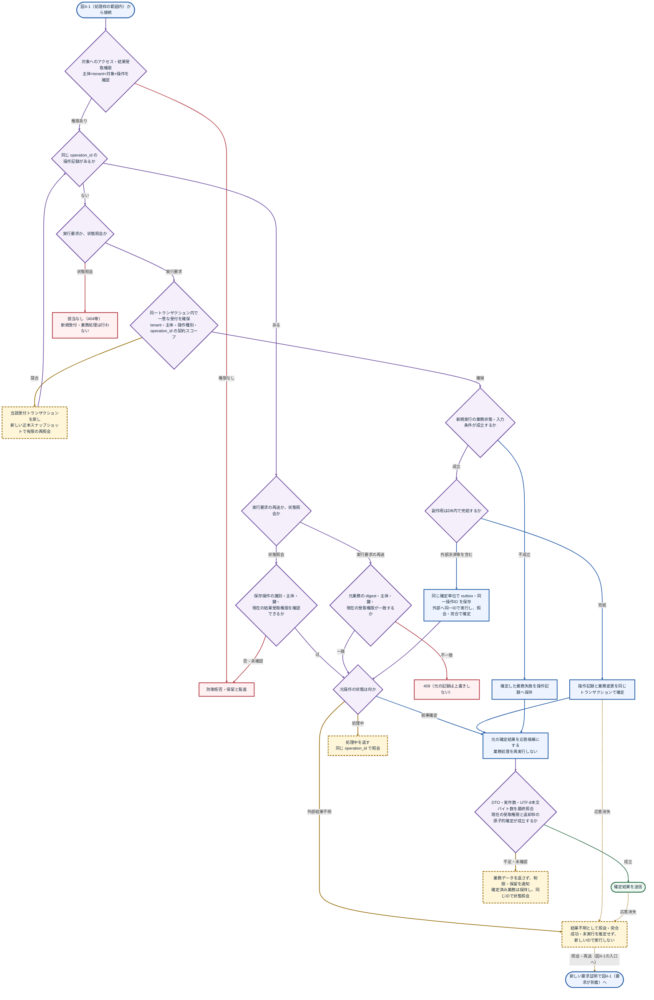

> note/08_セキュリティ · 2026-10-17 設計思想・仕様説明改訂版 · 非正典・本番未実装・未検証

# 動的鍵によるAPI保護の設計思想と仕様

本書は、既存APIへ追加する認証・認可・操作受付の設計を説明します。端末が保持する鍵、サーバーが発行する短命トークン、要求ごとの鍵所持証明を分け、登録から失効までの条件を定めます。移行手順は、その条件を既存サービスへ段階的に適用する手順として後半に置きます。

## 〈推論〉本設計の位置付け

以下は、確認できた資料を根拠に、既存APIへ追加する改良部分を組み立てた設計案です。実サービスの構成・運用条件との適合は未確認です。根拠資料に記載された現況を、実環境で確認済みの事実として扱いません。

- **推論**：資料から導いた処理順序・分岐・改良ロジックです。設計上の提案であり、実装済み・安全性検証済みという意味ではありません。
- **未決**：実装前に責任者が決める条件です。保存先、保持期間、処理容量、障害時の扱い、外部処理との整合方法などは、対象サービスごとに決定します。
- **未検証**：実ブラウザでの描画・印刷、本番APIへの組込み、受入試験、負荷・障害試験は確認が残っています。


色は処理上の役割を示します。青は通常処理、紫は検証・判定、緑は完了・許可、黄土色の破線枠は待機・再試行・推論・未決、赤は拒否・停止・異常です。色だけで確定性を判断せず、ノードと分岐の文字を確認してください。緑のノードも設計案に含まれ、実サービスでの成功を意味しません。

接続線は原則として接続先の役割と同じ色です。差戻し・再試行は黄土色で示します。破線矢印の意味は元の図のラベルに従い、すべてを未決とは読み替えません。

## 1. 設計思想：要求を受理する根拠を分ける

この設計で守る対象は、利用者のデータ、更新処理、決済等の外部副作用です。アプリに埋め込んだ共有秘密だけに依存せず、「現在有効な本人資格」「承認済みの鍵の所持」「対象と操作への権限」「今回の操作を実行してよい状態」をサーバー側で確認します。鍵の所持を証明できても、他人のデータや未許可の操作への権限は増えません。

防御・縮退・復旧には、それぞれ別の責任を持たせます。防御は不正な要求を拒否し、縮退は処理容量を超える要求を入口で制限します。復旧は鍵を失った本人が別の確認手段で権利を回復する手続きです。混雑や利便性を理由に、必須の検証を省略しません。

| 想定する問題 | 本設計で追加する条件 | 残る限界 |
|---|---|---|
| アプリから共通APIキーを抽出される | 端末ごとの承認済み公開鍵と、その鍵に拘束した短命資格を使う | アプリの識別情報自体は秘密として扱えない |
| アクセストークンだけを盗まれる | 同じ登録鍵で作った要求証明を要求する | 端末上で鍵を不正利用できる攻撃は別途対処が必要 |
| 漏えいした旧セッションで攻撃者の鍵を追加される | 独立した本人承認を、新しい鍵と登録操作に結合する | 本人確認・復旧審査の強度は対象サービスで決める |
| 正規利用者が他人の対象IDを指定する | 主体・tenant・対象・操作をサーバー側で認可する | 鍵署名、UUID、端末証明だけではBOLAを解消できない |
| 同じ証明や更新操作を再送される | 証明の重複検出と業務操作の一意受付を別に実施する | 外部先が冪等性や照会を提供しない場合、自動で一回実行を保証できない |
| 障害後に更新要求が集中する | 入口制限、専用枠、更新の合流、段階再開を使う | 必要容量と効果は負荷・障害試験で確かめる |

## 2. 「動的鍵」が指すものと更新の単位

本書でいう動的鍵は、端末鍵に結び付いた短命資格と、要求ごとに作る所持証明を組み合わせる認証方式の呼称です。秘密鍵をAPI要求のたびに作り直す仕様にはしません。秘密鍵の更新、アクセストークンの更新、要求証明の生成は、それぞれ別の周期・理由で行います。

| 要素 | 作る主体・保存先 | 更新する契機 | 用途 |
|---|---|---|---|
| 端末のDPoP鍵ペア | 端末で生成。秘密鍵は利用可能なOSの保護領域へ保存し、持出しを制限 | 初回登録、承認された鍵更新、喪失・侵害後の再登録 | API要求に対する鍵所持証明 |
| 公開鍵と登録記録 | サーバーの登録正本 | 本人承認、停止、失効、鍵更新 | どの主体にどの鍵を許可したかを管理 |
| 短命アクセストークン | 認証サーバーが発行。端末では原則メモリ保持 | 有効期限前の更新、許可範囲変更等 | API・権限・期限・登録鍵の結合 |
| DPoP proof | 端末がDPoPを使うHTTP送信の直前に生成 | 再送・状態照会を含む送信ごと | 今回のメソッド・宛先・資格に対する所持証明 |
| Refresh Token | 採用する認証基盤が発行。端末はOSの保護された保存先を使用 | 更新契約に従う。失効・再利用検出も管理 | 新しいアクセストークンを取得する資格 |
| 登録challengeと本人承認 | サーバーが登録操作に結合して管理 | 登録操作ごと。期限切れ後は所定の手順で再取得 | 古い証明や別の鍵への承認の流用を防止 |
| トークン発行署名鍵 | 認証サーバー側の鍵管理基盤 | 発行側の鍵更新・侵害対応の計画による | アクセストークンへ発行者の署名を付ける |

端末の署名鍵と、トークン発行者の署名鍵は役割も保管場所も異なります。端末の公開鍵を受信しただけでは、その所有者がアカウント本人であることは確定しません。登録承認と本人認証で結合を作り、以後の要求でその結合を確認します。

## 3. 構成要素と信頼境界

| 構成要素 | 担当する処理 | 信用の根拠にしないもの |
|---|---|---|
| 端末アプリ | 鍵生成、登録手続き、短命資格の保持、送信ごとのproof生成 | 自己申告のuser_id、権限、移行完了フラグ |
| 登録サービス | challenge、OS別証明、本人承認、公開鍵と状態の確定 | 旧セッションだけによる新鍵の承認 |
| 認証サーバー | 既存の認証・grantを検証し、登録鍵に拘束した資格を発行 | 公開鍵を提出しただけの要求、無条件の資格更新 |
| Gateway・API | 入口制限、資格・proof・失効・再利用の検証、業務認可 | 未検証ヘッダーの主体、クライアントが任意に指定した転送元情報 |
| 登録・失効・操作の正本 | 状態、一意性、確定結果、監査outboxを保持 | 任意キャッシュの値だけで成立したとする判定 |
| 復旧受付 | 既存鍵に依存しない本人確認と、必要な新鍵の承認 | 鍵を失ったという申告だけの権限回復 |

外部公開するGatewayから業務APIまで、検証を迂回できる旧版、内部ルート、一覧、export、キャッシュ経路も保護対象に含めます。認可で使う主体とtenantは検証済み資格とサーバー台帳から決めます。

モバイル向けの本案はDPoPを基準にします。サービス間でmTLSを採用する場合は別プロファイルとし、検証済み接続証明書とトークンの証明書拘束を照合します。TLS終端を分ける場合、検証済み証明書情報を信頼できる経路だけで引き継ぎます。[RFC 8705](https://www.rfc-editor.org/rfc/rfc8705.html)

## 4. 登録と有効化の仕様

旧セッションで行える自動処理は、登録候補の提出までです。登録サービスは、サーバーで確定した主体にregistration_idを結合し、目的、新しい公開鍵のthumbprint、単回challenge、期限、状態版を保存します。本人承認も同じ登録操作と鍵へ結合します。

| 状態 | 確認した内容 | 許可する処理 |
|---|---|---|
| PENDING | 登録候補を受け付けた | 登録手続きと候補照会。業務権限は増やさない |
| DEVICE_VERIFIED | 必要なOS別証明と登録鍵の所持を検証した | 本人承認の確認へ進む。承認不足なら業務資格は発行しない |
| ACTIVE | 本人承認・鍵・候補の有効条件を確定時にも満たした | 台帳で許可された資格発行 |
| SUSPENDED | 調査・障害・整合性不明で停止している | 新規発行と、その状態が必須の保護要求を停止 |
| REVOKED | 失効が確定した | 当該資格の利用不可。自動でACTIVEへ戻さない |

候補全体が期限切れなら、その登録操作を終了します。本人承認だけが期限切れなら、候補の有効性を再確認したうえで承認を取り直します。承認を更新しても候補やchallengeの期限は無制限に延びません。

有効化では、候補の状態版、鍵、主体、期限、承認の対象・未使用を再照合します。ACTIVEへの遷移、承認の消費、必要な旧資格の失効、監査・通知outboxの作成を同じ確定単位にします。他端末の資格は、失効対象として明示した場合だけ変更します。資格発行の直前にも有効性を確認します。

**図3　新しい鍵の登録（旧セッションから直接有効化しない）**



この図の本人承認はアカウント本人による認証器追加の承認です。移行終了や復帰保留解除で必要になるサービス責任者の運用承認とは区別します。独立した認証器がない場合は、事前に用意した復旧審査へ進みます。

## 5. OS別証明とDPoP鍵の結合

App Attest、Android Key Attestation、DPoPは別の仕組みです。OS別証明が成功しただけで、任意の別鍵まで信用したことにはしません。

| 項目 | iOSでの契約 | Androidでの契約 |
|---|---|---|
| 証明処理 | App Attest固有の鍵・検証手順を扱う | Keystoreの証明対象鍵とチェーン・失効・要求条件を確認 |
| DPoP鍵 | App Attest鍵をそのままDPoP用に利用できるとは仮定しない | DPoP公開鍵と証明対象鍵の一致、または別鍵との結合を検証 |
| 別鍵の結合 | registration_id・目的・challenge・DPoP公開鍵thumbprintを同じ検証対象へ含める | 同じ項目を証明の契約と照合し、単なる自己申告にしない |
| 再利用防止 | App AttestのcounterとDPoPのjtiを別に管理 | App Attestと同じcounterがあるとは仮定しない |
| 未対応端末 | 必須の証明強度を満たさない操作を制限し、代替経路を案内 | 証明済みの強度で許可できる範囲を台帳に定める |

結合するデータは、型・順序・長さ・文字コード・版・目的識別を固定したバイト表現にします。曖昧な文字列連結で署名対象を組み立てません。バイト表現と検証器の実装は未決であり、異なる鍵・主体・登録操作へ証明を流用する試験を通すまで採用しません。

照合先は [Appleの検証手順](https://developer.apple.com/documentation/devicecheck/validating-apps-that-connect-to-your-server) と [Android Key Attestation](https://developer.android.com/privacy-and-security/security-key-attestation) です。Appleページ本文は今回の取得経路では確認できていないため、iOS固有実装の適合確認は残っています。

## 6. アクセストークンと要求証明の契約

JWTアクセストークンを使う場合、発行者が署名し、APIは許可した発行者・鍵・アルゴリズムで検証します。ID TokenやDPoP proofを、アクセストークンとして受け入れません。検証するアルゴリズムと鍵の用途は設定で固定し、未検証のヘッダーから任意の鍵取得先を選ばせません。[JWT検証の指針 RFC 8725](https://www.rfc-editor.org/rfc/rfc8725.html)

| 項目 | 本設計で確認する内容 |
|---|---|
| iss・aud | 設定した発行者と、当該APIを対象とするaudience |
| sub・scope | 主体と許可範囲。発行元のgrantや現在の権限を超えない |
| iat・exp・必要ならnbf | 発行時刻・期限・有効開始。サーバー時計と設定済みの許容差で判定 |
| cnf.jkt | 今回のDPoP公開鍵のthumbprintと一致する拘束 |
| sid・tenant・資格版 | 必要な場合のアプリ固有契約。名称・型・正本との照合を定義 |
| トークンのjti | 資格を識別する値。要求証明のjtiとは別 |

DPoPの要求形式は次です。山括弧内は説明用の置換箇所であり、実際の資格や署名ではありません。TLSを必須にします。

```http
GET /v1/records/record-001 HTTP/1.1
Host: api.example.invalid
Authorization: DPoP <access_token>
DPoP: <signed_proof_jwt>
```

proofの検証項目は [RFC 9449 §4](https://www.rfc-editor.org/rfc/rfc9449.html#section-4) に従います。本案の初期候補はES256・P-256とし、端末と認証基盤の対応確認を採用条件にします。署名方式の変更は設定変更として管理します。

| proofの項目 | 確認内容 |
|---|---|
| typ・alg・jwk | dpop+jwt、許可した非対称署名方式、秘密部分を含まない公開鍵と署名 |
| htm・htu | 今回のHTTPメソッドと宛先。htuの照合ではquery・fragmentを除外 |
| ath | 保護APIで提示した資格について、base64url(SHA-256(ASCII(access_token)))と一致 |
| iat・jti | 設定した受理時間内で、今回の送信を識別するproof |
| nonce | サーバーが要求した場合、その発行元・用途・有効条件に対応する値 |

JWKのthumbprint計算には [RFC 7638](https://www.rfc-editor.org/rfc/rfc7638.html) の表現を使います。DPoPは本文や任意ヘッダー全体への署名ではありません。本文、queryの条件、金額、送金先等はTLS、入力検査、業務認可、必要な取引確認で扱います。

htuの照合先は、設定した公開URLと信頼するproxyの構成から再構成し、規格に従うURI正規化を固定します。未検証のHostや転送ヘッダーだけで照合先を決めません。内部URLへの書換えと公開URLの差もGatewayとAPIで共通の契約にします。

## 7. proofの再利用防止と鍵の更新

本案では全保護APIでproofの単回受入を要求します。署名・拘束・用途・時刻を確認してから、検証領域・鍵thumbprint・jtiをスコープに正本へ原子的に記録します。同じproofが別ノードへ同時到着しても、一方しか受理しない構成にします。これは本設計の配備方針であり、すべてのDPoP配備に共有ストアを義務付ける規格上の主張ではありません。

記録はproofを受理できる最終時刻まで保持します。nonceがあっても本案ではiatの受理窓を維持し、nonceだけで重複検出を置き換えません。最大長、保存時間、障害時の停止、全ノードの整合を契約にします。[RFC 9449 §11.1](https://www.rfc-editor.org/rfc/rfc9449.html#section-11.1)

端末鍵を更新する場合、新しい鍵も登録・本人承認を通します。既存のトークンの拘束先だけをクライアントの申告で書き換えません。旧鍵に拘束したRefresh Tokenを、新鍵のproofだけで更新することも許可しません。旧鍵が使えない場合は独立した本人確認・復旧へ進みます。

過去の操作結果を新鍵で受け取る必要がある場合は、通常の同鍵再送と分けた回復契約を設けます。新鍵の承認だけで過去操作の受取権限を自動移管せず、主体・操作・回復承認の対応を監査可能にします。

## 8. 資格発行・更新APIと保存する正本

次の経路名・項目名は既存APIへ接続する候補です。既存のOAuth基盤がある場合はそのtoken endpointとgrantを使い、公開鍵提出だけで資格を発行する独自の近道を作りません。DPoPは鍵所持の追加証明であり、それ単独で本人認証やアクセス許可を成立させません。[RFC 9449 §3](https://www.rfc-editor.org/rfc/rfc9449.html#section-3)

| 経路の候補 | 入力・確認 | 確定するもの |
|---|---|---|
| POST /auth/key-registrations | 検証済み本人資格、新公開鍵、目的 | 主体に結合した候補・challenge・期限 |
| POST /auth/key-registrations/{id}/proof | 登録対象と一致するOS別証明・鍵所持証明 | 証明結果と状態版 |
| POST /auth/key-registrations/{id}/approve | 独立した認証器で得た、同じ登録対象への承認 | 承認対象・期限・単回使用状態 |
| 登録サービス内部の確定処理 | 全前提の再照合、停止・失効・競合確認 | ACTIVE・必要な失効・承認消費・監査outbox |
| 既存のtoken endpoint | 有効なgrant、承認済み鍵、DPoP proof、現在の失効状態 | 鍵に拘束した短命資格と発行操作記録 |
| GET /operations/{operation_id} | 有効な本人資格・proof・現在の結果受取権限 | 操作状態または受取可能な確定結果。業務は新規実行しない |

Refresh Tokenを使うpublic clientにはDPoPの鍵拘束を適用し、更新時にも同じ鍵を確認します。ローテーションを併用するなら、旧値の消費、新値、発行操作記録を原子的に確定します。応答消失と再利用攻撃を同じ事象として処理せず、許可した同一発行操作の照会で復旧します。token endpointの操作ID・照会は本案の追加契約であり、DPoP規格が提供する機能ではありません。[RFC 9449 §5](https://www.rfc-editor.org/rfc/rfc9449.html#section-5)、[RFC 9700 §4.14](https://www.rfc-editor.org/rfc/rfc9700.html#section-4.14)

発行結果の再受取は認証用の処理枠・専用認可で行い、一般の業務結果照会と分けます。OS別証明は登録や必要な資格発行の契約で扱い、日常の業務要求ごとにApp Attest Assertionを必須にする設計とは区別します。証明でcounterを使う処理では、増加確認・challenge消費・発行操作の確定・監査outboxを同じ確定単位へ置きます。

| 正本の候補 | 最低限保持する内容 | 一意性・確定条件 |
|---|---|---|
| 登録候補・鍵台帳 | 主体、tenant、registration_id、公開鍵識別、目的、証明、必要なcounter、承認、状態版、期限 | 承認対象一致と状態版の条件付き更新 |
| セッション・更新資格 | 主体、セッション、鍵拘束、許可範囲、期限、失効、更新世代 | 同一世代の競合消費を防ぐ |
| proof再利用記録 | 検証領域、鍵thumbprint、jti、受理終了時刻 | 同じスコープの挿入は一度だけ成功 |
| 発行・業務操作記録 | tenant、主体、操作種別、operation_id、digest、状態、確定結果 | 契約スコープの一意制約を副作用より先に確保 |
| 外部処理・監査outbox | 同一操作ID、配送状態、外部照会結果、監査イベント | 業務確定とoutbox作成を同じ確定単位へ置く |

秘密鍵はサーバーへ提出しません。Refresh Tokenの照合情報は復元不要な形を基本とし、同一発行結果の再受取に秘密資格を保存する必要がある場合は、暗号化・鍵管理・短い保持期限・受取認可を別途定めます。トークン、proof全文、秘密資格を通常ログへ出しません。

## 9. 保護APIの受付と、重複操作の仕様

入口制限、資格・proof検証、現在の登録・失効確認、proofの一意受入、主体別の枠、対象への認可を通した後に、操作の種別と状態を判定します。処理中や結果不明を成功と扱いません。

**図4-1　移行後の日常リクエスト受付（入口制限・資格検証・枠判定）**



**図4-2　移行後の日常リクエスト受付（対象認可・重複操作判定・業務確定と返却）**



| 要求と操作状態 | 必要な確認 | 実施する処理 |
|---|---|---|
| 同じ実行要求の再送・結果確定 | 現在の本人資格・鍵・受取権限、元業務digest一致 | 元の確定結果を候補にする。副作用を再実行しない |
| 状態照会 | 保存操作の識別と現在の受取権限 | 状態だけを照会する。GET本文を元POST本文と比較しない |
| PENDING | 同じ操作への照会権限 | 処理中を返す。回数・期限つきで照会を案内 |
| UNKNOWN | 外部結果等の照会・突合条件 | 結果不明を保持し、新IDで同じ操作を再実行しない |
| 状態照会・記録なし | 現在の本人資格・鍵・対象への権限 | 該当なしを返す。新規受付・業務処理・副作用は行わない |
| 新規実行要求・記録なし | 一意受付の確保、業務入力と新規実行条件 | DB内なら受付と業務変更を同一トランザクションで確定 |
| 同一IDでdigest不一致 | 現在の認証・認可は別途必要 | 409。元記録を上書きしない |

存在確認の直後に並行要求が到着するため、SELECTで「記録なし」と判定するだけでは不十分です。状態照会で記録がない場合は、新規の受付を確保せず該当なしを返します。一意制約の確保に失敗した要求はトランザクションを戻し、新しい正本スナップショットで有限回だけ再照会します。PENDINGの放置を理由に別IDで再実行せず、所有権・期限・再開条件を確認する復旧処理へ送ります。

外部決済等は、業務と同じ確定単位でoutboxを保存し、外部へも同じ操作IDを渡します。外部の冪等性・結果照会が成立しない構成は、自動復旧による一回実行を保証したと扱いません。結果不明のまま止め、突合・運用判断で解消します。

結果送信直前には、現在の受取権限、DTOの実件数、UTF-8本文バイト数、全体・tenant・主体の返却枠を再確認し、枠を正本で原子的に確定します。返却を止めても、確定済みの業務を「未受理」へ戻しません。

## 10. 既存APIへの接続例と実装責任

次は接続順序を示すPythonの疑似コードです。暗号検証、正本、一意制約、業務トランザクションを実装したコードではありません。各メソッドは不成立・状態不明で例外または明示した拒否結果を返す契約とし、暗黙の許可へ落としません。

```python
def protected_request(request, service):
    service.admit_before_authentication(request)
    principal, proof = service.verify_access_and_sender(request)
    service.require_live_registration_and_session(principal)
    service.record_verified_proof_once(proof)
    service.admit_authenticated_principal(principal, request)
    service.authorize_target_or_receipt(principal, request)
    outcome = service.dispatch_by_request_kind(principal, request)
    dto = service.build_authorized_response(principal, outcome)
    return service.finalize_and_send(principal, dto, outcome)
```

| 接続箇所 | 実装で担保する責任 |
|---|---|
| verify_access_and_sender | 発行鍵検証と端末proof検証を分離し、別用途JWTを受理しない |
| record_verified_proof_once | 署名等の確認後に原子的な重複検出。mTLSへDPoPのjti検査を機械的に流用しない |
| dispatch_by_request_kind | 照会は照会のみ。再送はdigestと状態を確認。新規は一意受付後、確定時の認可・業務条件も検証して副作用を確定 |
| finalize_and_send | 実件数・実バイト数・現在の受取権限・返却枠を確定してから送信 |
| すべての経路 | 旧版・一覧・export・キャッシュにも同じ保護境界を適用 |

単件読取の既存参照例は [read_guard.py](../../local_reports/note08_immediate_patch/read_guard.py) です。所有者認可・DTO・累積枠の局所例であり、本書の登録・DPoP・更新・外部処理の実装ではありません。ローカル資料の配布同梱は保証しません。

## 11. 失効・障害・本人復旧

| 事象 | 保護APIの動作 | 登録・資格発行の動作 |
|---|---|---|
| 端末鍵・セッションが停止または失効 | 必須状態を満たさない要求を拒否 | 新規資格を発行しない |
| 任意キャッシュが停止 | 正本で同じ検証ができ、負荷上限内なら継続 | 同じ条件が成立する範囲だけ継続 |
| 再利用防止・失効の唯一の正本が停止 | 必須検証ができない保護要求を停止 | 必要状態が不明なら停止 |
| 証明基盤が停止 | 外部照会が不要で、他の必須検証が成立する既発行資格だけ継続 | 証明を取得できない新規登録は保留 |
| 端末鍵を喪失 | 旧鍵が必要な操作を停止 | 独立した本人確認・復旧審査で新候補を登録 |
| 正本の巻き戻り・分断を疑う | 影響する資格を保留し、証拠と整合を確認 | counter・失効・世代の検査を省略して発行しない |

失効情報にキャッシュを使う場合は、許容する鮮度と停止条件を明示します。「即時失効」を約束するなら、その時点の正本照合または同等の機構が必要です。短命であることだけでは即時失効を成立させません。

## 12. 現況と段階移行の適用条件

原資料A/Bの現況は、アプリ内の静的APIキーと長期セッションでバックエンドを呼ぶ構成です。実サービスを今回調査して確定した現況ではありません。NRA-IDEのLLMプロバイダ用APIキーとは対象境界を分けます。

**図1　現況（静的APIキー方式）**

```mermaid
flowchart LR
  APP["モバイルアプリ<br/>静的APIキーを内蔵<br/>長期セッショントークンを保持"] -->|"X-API-Key ＋ 旧Session"| GW["APIゲートウェイ"]
  GW --> BE["業務ロジック・DB"]
  APP -. "逆コンパイルでキー抽出" .-> ATK["外部スクリプト"]
  ATK -->|"同じキーで直接呼出"| GW
  BE -. "認可不備があれば他人のデータも返る" .-> BOLA["BOLA / IDOR"]
  %% READABILITY: role colors do not certify implementation or validation.
  classDef normal fill:#edf4ff,stroke:#245ca6,stroke-width:3px,color:#17283b;
  class APP,GW,BE normal;
  classDef review fill:#f4effb,stroke:#7050a3,stroke-width:3px,color:#17283b;
  classDef ok fill:#edf8f0,stroke:#31704e,stroke-width:3px,color:#17283b;
  classDef caution fill:#fff6d9,stroke:#946700,stroke-width:3px,color:#17283b,stroke-dasharray:7 4;
  classDef danger fill:#fff0f1,stroke:#b43d47,stroke-width:3px,color:#17283b;
  class ATK,BOLA danger;
  linkStyle 0 stroke:#245ca6,stroke-width:2.5px;
  linkStyle 1 stroke:#245ca6,stroke-width:2.5px;
  linkStyle 2 stroke:#b43d47,stroke-width:2.5px;
  linkStyle 3 stroke:#245ca6,stroke-width:2.5px;
  linkStyle 4 stroke:#b43d47,stroke-width:2.5px;
```



M0では、実際の全経路、データ区分、認可、旧資格、処理容量、復旧手段を棚卸しします。未分類経路は保護APIとして扱います。移行済みかどうかはサーバー台帳で判断し、新ヘッダーの欠落を理由に旧方式へ戻しません。

**図2　移行全体フロー（M0 → M5）**

```mermaid
flowchart TD
  START(["現況：静的APIキー＋長期セッション"]) --> M0
  subgraph PRE["先行して行うこと"]
    M0["M0 棚卸し<br/>API台帳を作成（未分類は保護API扱い）<br/>BOLAを是正し、旧資格を棚卸し<br/>対応端末と本人復旧経路を準備"]
  end
  M0 --> G0{"未分類の経路がないか<br/>保護APIの認可試験と<br/>復旧受付手順が成立したか"}
  G0 -- "否" --> M0
  G0 -- "可" --> M1
  M1["M1 候補登録<br/>既存セッションを保ったまま<br/>候補鍵を生成して提出（PENDING）"] --> G1{"本人承認の前に<br/>業務権限が増えないか"}
  G1 -- "増える" --> M1
  G1 -- "増えない" --> M2
  M2["M2 並行観測<br/>旧方式の最低条件を維持したまま<br/>新方式を観測"] --> G2{"失敗原因を端末群・経路別に説明でき<br/>登録できない人も集計できたか"}
  G2 -- "否" --> M2
  G2 -- "可" --> M3
  M3["M3 限定強制<br/>承認済み端末・セッションと<br/>指定APIから新方式を必須にする"] --> G3{"新ヘッダーの欠落・偽装で<br/>legacyへ降格できないか<br/>別端末への影響は宣言どおりか"}
  G3 -- "否" --> M3
  G3 -- "可" --> M4
  M4["M4 対象拡大<br/>サービス責任者が影響と試験結果を確認"] --> G4{"負荷・障害・本人復旧・<br/>問い合わせ体制が受入条件を満たすか"}
  G4 -- "否" --> M4
  G4 -- "可" --> M5A
  M5A["M5-1 旧方式終了の判定<br/>残っている旧利用者を特定し対応計画を作成<br/>事前通知と代替手段を提示"] --> G5A{"終了承認があるか"}
  G5A -- "否" --> M5A
  G5A -- "可" --> M5B["M5-2 旧資格を無効化"]
  M5B --> G5B{"監査記録で<br/>無効化の完了を確認できたか"}
  G5B -- "否" --> M5B
  G5B -- "可" --> DONE(["移行完了：静的キーをサーバー設定から削除"])
  REC["紙・対面の独立復旧経路"] -. "M5 より前に利用可能にする" .-> M5A
  NO1["禁止：強制済み境界を shadow へ戻す操作を<br/>通常の切戻しにしない"] -.- M3
  %% READABILITY: role colors do not certify implementation or validation.
  classDef normal fill:#edf4ff,stroke:#245ca6,stroke-width:3px,color:#17283b;
  class START,M0,M1,M2,M3,M4,M5A,M5B normal;
  classDef review fill:#f4effb,stroke:#7050a3,stroke-width:3px,color:#17283b;
  class G0,G1,G2,G3,G4,G5A,G5B review;
  classDef ok fill:#edf8f0,stroke:#31704e,stroke-width:3px,color:#17283b;
  class DONE ok;
  classDef caution fill:#fff6d9,stroke:#946700,stroke-width:3px,color:#17283b,stroke-dasharray:7 4;
  class REC caution;
  classDef danger fill:#fff0f1,stroke:#b43d47,stroke-width:3px,color:#17283b;
  class NO1 danger;
  linkStyle 0 stroke:#245ca6,stroke-width:2.5px;
  linkStyle 1 stroke:#7050a3,stroke-width:2.5px;
  linkStyle 2 stroke:#946700,stroke-width:2.5px;
  linkStyle 3 stroke:#245ca6,stroke-width:2.5px;
  linkStyle 4 stroke:#7050a3,stroke-width:2.5px;
  linkStyle 5 stroke:#946700,stroke-width:2.5px;
  linkStyle 6 stroke:#245ca6,stroke-width:2.5px;
  linkStyle 7 stroke:#7050a3,stroke-width:2.5px;
  linkStyle 8 stroke:#946700,stroke-width:2.5px;
  linkStyle 9 stroke:#245ca6,stroke-width:2.5px;
  linkStyle 10 stroke:#7050a3,stroke-width:2.5px;
  linkStyle 11 stroke:#946700,stroke-width:2.5px;
  linkStyle 12 stroke:#245ca6,stroke-width:2.5px;
  linkStyle 13 stroke:#7050a3,stroke-width:2.5px;
  linkStyle 14 stroke:#946700,stroke-width:2.5px;
  linkStyle 15 stroke:#245ca6,stroke-width:2.5px;
  linkStyle 16 stroke:#7050a3,stroke-width:2.5px;
  linkStyle 17 stroke:#946700,stroke-width:2.5px;
  linkStyle 18 stroke:#245ca6,stroke-width:2.5px;
  linkStyle 19 stroke:#7050a3,stroke-width:2.5px;
  linkStyle 20 stroke:#946700,stroke-width:2.5px;
  linkStyle 21 stroke:#31704e,stroke-width:2.5px;
  linkStyle 22 stroke:#245ca6,stroke-width:2.5px;
  linkStyle 23 stroke:#245ca6,stroke-width:2.5px;
```



| 段階 | 次へ進むために確認すること |
|---|---|
| M0 棚卸し | 未分類経路の解消、BOLA是正、復旧受付と対応端末の確認 |
| M1 候補登録 | 本人承認前に業務権限が増えないこと |
| M2 並行観測 | 失敗理由を端末・経路別に説明し、登録不能者も集計できること |
| M3 限定強制 | 欠落・偽装ヘッダーでlegacyへ降格できず、影響範囲が宣言どおりであること |
| M4 対象拡大 | 負荷・障害・本人復旧・問い合わせ対応の受入条件を満たすこと |
| M5 旧方式終了 | 残存者対応・事前通知・代替手段を準備し、終了承認後に無効化を行い監査で完了確認 |

M0〜M5は移行段階、PENDING〜REVOKEDは登録状態、N/M/D/Hは資源運用状態です。相互に自動変換せず、NRA-IDE正典の状態名とも対応付けません。

## 13. 採用前に決める値と受入試験

| 未決事項 | 確定する仕様 | 未設定・確認不能時の扱い |
|---|---|---|
| 端末・認証基盤 | 対応OS、必要な証明強度、独立認証器、OAuth連携 | 対応を推測して有効化しない |
| 鍵・資格・時刻 | 許可署名方式、発行鍵、issuer、audience、access TTL、時刻許容差、鍵更新契機 | 設定不足のプロファイルは有効にしない |
| 登録と承認 | challenge・候補・承認の各期限、結合バイト表現、競合処理 | 自動延長・対象の読み替えをしない |
| 正本と保持 | 再利用記録、失効、操作結果の保持・整合・復旧方法 | 必須状態が不明な要求を拒否・保留 |
| 外部副作用 | 同一IDの意味、照会、outbox、結果不明時の手順 | 不明を未実行と推定しない |
| 資源と応答 | 経路枠、共有総量、deadline、DTO、件数・バイトの上限 | 無制限へ変換しない |

受入試験では、別鍵、別主体、別tenant、別宛先、期限境界、重複proof、失効、正本停止、登録確定時の競合、同一操作の並行実行、外部応答消失、旧経路迂回、実返却量超過を確認します。登録・更新・業務・結果照会の各経路で実施し、利用者の権限と結果表示が正しいことまで確認します。詳細な既存試験候補は提言のAT01〜AT20を参照します。これらは本番で未実行です。

## 参照資料と版

| 資料 | 参照範囲・位置付け |
|---|---|
| [A 標準仕様書](次世代API保護アーキテクチャ設計標準仕様書.md) | 先行案。採用しない近道も含む原文 |
| [B 移行計画書](ユーザーを強制ログアウトさせずに静的APIキーから完全移行する.md) | 先行案。無条件の自動登録・検証省略は不採用 |
| [C 統合設計案](動的API認証・意図的縮退・独立復旧経路の統合設計案.md) | 防御・縮退・復旧の分離の出典 |
| [2026-10-16 精査 F01〜F12](2026-10-16_note08_security_review.md) | 元資料の精査時点の判定。現在の実装合格ではない |
| [2026-10-16 具体的提言](2026-10-16_note08_concrete_recommendations.md) | §2〜§11、AT01〜AT20。非正典・本番実装未検証 |
| [トラフィック対策](動的API%20トラフィック対策.md) | 設計思想・仕様改訂版の負荷・復帰条件 |
| [2026-10-17 再精査 N01〜N10](../../local_reports/2026-10-17_note08_dynamic_api_review/REPORT.md) | ローカル監査資料。修正前4ファイルのハッシュと指摘を保持 |
| [N01〜N10 修正・再検証記録](../../local_reports/2026-10-17_note08_dynamic_api_review/RESOLUTION.md) | ローカル監査資料。承認した文書修正と、実描画・実システムの未検証を区別 |

前版にある「再精査P1〜P14」は前版の識別表記として履歴に残し、その原報告・採否記録は今回特定できていません。今回のN番号や2026-10-16のF番号へ読み替えません。ローカル資料へのリンクは配布物への同梱を保証しないため、公開時には同梱または公開参照先を別途確認します。

本改訂では、以前の図中心の説明を、鍵・資格・証明の区別、信頼境界、登録、受付、更新、失効、実装契約の説明へ組み直しました。A/B/C原文と過去の精査記録は履歴資料として保持しています。規格の要件と、本案で追加した全保護APIの単回受入・操作照会等の配備方針を区別して採用してください。
