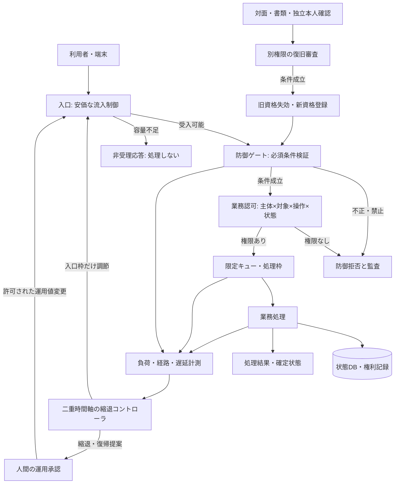

# 動的API認証・意図的縮退・独立復旧経路の統合設計案

**提案者（整理・設計）：結（ゆい）／対話に基づく設計試案**  
**対象対話：M-Tokuniとの討議、原資料「貼り付けたテキスト（1）(2).txt」（全約2,845行）**  
**作成：2026年10月16日 15:59 JST**  
**ステータス：概念設計 Rev.0／実機未検証／本番仕様ではない**

> **本書の出発点**：静的APIキーの問題を動的な認証機構へ移すだけでは、安全にも実運用にもならない。認証処理が新たな集中負荷を生むため、要求の経路、接合点、故障の伝播を先に分類する。予備サーバーがない状況では、**意図的に入口を絞り、受理しない処理を明示し、復帰を評価する仕組み**が必要である。認証・認可違反の遮断は、それとは独立した防御手段として維持する。最後にはデジタル資格の喪失と、現実の本人・権利を区別する独立した復旧手段を置く。

---

## 0. 大事な部分のまとめ――先に固定する設計境界

この設計は次の**三系統**を混合しない。

| 系統 | 目的 | 正常な出力 | 許してはいけない変更 |
|---|---|---|---|
| **A. 動的処理・縮退系** | 過負荷時に制御可能な状態を保つ | 通常処理／一部拒否／意図的縮退／評価後の復帰 | 処理能力が足りないために認証・認可条件を緩めること |
| **B. 独立した防御系** | 不正な主体・操作・対象への経路を閉じる | 許可／拒否／隔離と監査 | Aの負荷制御から、禁止を許可に変更できること |
| **C. 本人・権利の独立復旧系** | デジタル認証手段を失った後の正当な権利回復 | 資格再発行／保留／拒否 | 書類を見せただけで従来の秘密鍵が復元された扱いにすること |

- **優先原則**：許可された処理だけを安全に継続する。個々の要求を全部成功させることは最優先目標にしない。
- **意図的なボトルネック**：処理要求を高コストな認証、DB、外部サービスへ通す前の入口に設置する。
- **処理の真偽**：拒否した要求を「受理した」「保存した」とは表示しない。受理後に結果を見失った場合は「未確定」として照会する。
- **縮退≠防御遮断**：過負荷でフォームを受け付けないのはA。不正署名や他人のデータへの無権限アクセスを拒否するのはB。
- **復旧≠抜け道**：復旧系Cは、任意の救済措置ではなく別途の強固な本人・権利確認で成立する。

**要点（短い要約）**：測る → 経路を識別する → 接合部への影響を予測する → 高コスト処理への流入を絞る → 安全状態を維持する → 回復を実測する → 条件を満たした場合だけ復帰する。独立した防御境界と権利回復経路は、この列の外に設ける。

---

## 1. 根拠・前提・未確定事項を分ける

### 1.1 元資料に存在する構成案（資料由来）

原資料は、以下の順序を提示する。

1. APIに対するBOLA／IDOR、静的な共有秘密、経営判断・専門人材不足。
2. 入口制限、公開識別子の変更、レスポンス最小化。
3. Secure Enclave、App Attest、Android Keystore／StrongBox／鍵証明、サーバーへの公開鍵登録。
4. チャレンジとAssertionによる短命アクセストークン発行、並行API通信。
5. `signCount` の順序競合、応答消失、冪等性、ジッター、Redis、通信断と縮退。
6. 既存認証からの段階移行、移行期間の旧セッション、七つの欠陥と「逃げ道」。

### 1.2 今回の討議で追加された設計条件（ユーザー提示）

- 負荷の可視化だけでは足りず、**何が、どの経路から、どの接合点を通って負荷を発生させたか**が先に必要。
- 事例分類と接合・実態評価が終わらなければ、フローチャートを書けても設計は成立しない。
- **予備サーバーがなければ二重ゆらぎは能力増強装置ではなく、突然の全停止を避ける時間稼ぎ**である。
- 意図的なボトルネックにより、フォームには安価な失敗応答のみを返し、**実処理を行わない**方式も採る。
- 負荷低下時の復帰は機械判定だけとは限らず、**人間が決定する場合**がある。
- 制御アルゴリズム・内部閾値は公開しなくてよい。ただし、処理されたかどうかは利用者へ正確に通知する。
- デジタル復旧手段の数・種類の選択を利用者に認める。ただし選択可能範囲と運営側の必須境界を分ける。
- 紙媒体と対面確認は「古い技術」ではなく、デジタル障害と依存先を異にする最終的な信用・復旧経路である。

### 1.3 未確定事項（推測で埋めない）

対象サービスの契約・権利の性質、個人データの機密区分、端末OS分布、処理容量、単位時間の到着率、DB上限、認証基盤構成、合法的な本人確認要件、バックアップと監査要件は未提示。下記の**閾値・時間・台数は例示値**であり、運用値として承認したものではない。

> 技術的補正：署名・App Attest・UUID化・DPoPのいずれも、**それ単独ではBOLAを防げない**。正規端末が権限のないレコードを要求し、正当に署名することもある。個別リソースと業務操作の認可はサーバー側に残す。

---

## 2. システム境界と接合箇所：一枚の全体チャート



**矢印が意味すること**：縮退コントローラが変更できるのは「入口の受入枠、優先度、待機、再試行間隔、復帰許可」だけ。**防御ゲートや業務認可の必須条件を緩める矢印は存在させない。**

**主要な接合点**

| ID | 接合点 | 起き得る問題 | 最低限の観測情報 |
|---|---|---|---|
| J1 | 入口→認証 | 同時トークン更新、再接続集中 | 到着率、拒否率、要求種別、処理枠 |
| J2 | 認証→状態ストア | カウンター更新競合、Redis瞬断 | 遅延、更新失敗、状態整合、再試行数 |
| J3 | 認可→業務処理 | 正規の端末が他人のデータを要求 | 主体・操作・対象・権限判定結果 |
| J4 | 業務→DB | 接続枯渇、トランザクション滞留 | DB接続数、待機時間、ロールバック数 |
| J5 | 応答→端末 | 成功後の応答喪失・重複送信 | request_id、operation_id、確定状態 |
| J6 | 運用制御→入口 | 調整が遅れ過負荷、戻し過ぎて再過負荷 | モード、変更理由、直前値、復帰履歴 |
| J7 | デジタル→独立復旧 | 紙の本人確認をデジタル権限へ接続する不正 | 審査根拠、承認者、失効・再登録履歴 |

---

## 3. 入力を「事例」で振り分ける：最初の分類ロジック

原因を測定値だけから決めつけない。まず**事象の入口・経路・確定した状態**を記録する。

| ケース | 入力事象 | 推定経路（調査対象） | 処理系の応答 | 独立防御系の応答 |
|---|---|---|---|---|
| C01 | 通常利用者が集中 | 端末→入口→認証→業務 | 受入枠縮小・重要処理を優先 | 認証・認可を維持 |
| C02 | アプリ再起動で認証更新が集中 | 端末→チャレンジ→認証状態ストア | 更新ジッター・単一更新待機 | 失効条件は維持 |
| C03 | 通信復帰時に再送が集中 | 端末再送→入口→冪等性判定 | 重複排除・段階再投入 | リプレイ条件は維持 |
| C04 | DB接続枯渇 | 認可→業務→DB | DBを使う機能を縮退・非受理 | 他人のデータは依然として禁止 |
| C05 | 署名が不正／鍵失効 | 端末→防御ゲート | 負荷の原因としては計測 | 当該要求を拒否 |
| C06 | 正規端末から無権限のID要求 | 端末→認可判定 | 受入枠と独立に処理 | オブジェクト単位で拒否 |
| C07 | 外部Attestation基盤障害 | 新規登録→外部証明 | **未確認の新規登録は保留** | 既定の本人性要件を緩和しない |
| C08 | Redis・状態ストア停止 | 認証検証→状態ストア | 認証に依存する操作を制限 | カウンター／再利用防止を無条件省略しない |
| C09 | 機種変更で鍵が失われた | 端末→資格照合失敗 | 新規認証器の登録案内 | 旧トークンのみで無条件再バインドしない |
| C10 | 利用者が全認証器を紛失 | 利用者→最終復旧窓口 | デジタル操作は拒否・保留 | 書類・対面による別途審査 |
| C11 | フォーム負荷で安全な受付能力なし | フォーム→入口（業務前） | **未受理と明示し、書き込みゼロ** | 防御判定とは別扱い |
| C12 | 正規の処理成功後に応答だけ喪失 | 業務→DB確定→応答消失 | **再処理せず処理状態を照会** | 再送が別操作にならないよう保護 |

**原因に関する規則**：C01とC05が同時に起きることもある。CPU高騰の原因を「攻撃」または「正規負荷」の一方に自動確定しない。分類結果には「複合」「経路未特定」「観測不足」を必ず残す。

---

## 4. 正常処理：動的認証の具体的な流れ

### 4.1 デジタル本人証明とAPIアクセス権を別物として持つ

**提案構成**

- **長期の証明要素**：利用者の本人認証と、端末・アプリの鍵の登録。iOSのApp Attest、Androidのハードウェア鍵証明・Play Integrityは**異なる検証対象と仕様**であり、同一のAPIだと見なさない。
- **動的なアクセス資格**：サーバーが正当な証明を確認後に発行する短命アクセストークン。使用範囲・対象・発行元・期限を限定する。
- **盗難トークンの再利用抑止**：保護対象APIでは、できる限りトークンを送信者の公開鍵へ拘束する（例：DPoP／mTLS）。**短命Bearerを出すだけでは盗難後の再利用は防げない。**
- **業務認可**：ユーザーID・役割・リソース所有権・操作種別・時点の業務状態をサーバー側で判定する。端末証明で代用しない。

### 4.2 登録時のロジック

```text
[端末登録を要求]
  ↓
[既存の本人認証資格・再認証条件を確認]
  ├─ 不成立 → 登録拒否／別途の復旧手続き
  └─ 成立
       ↓
[登録用チャレンジ払い出し]
       ↓
[端末側鍵生成・必要な証明の取得]
       ↓
[サーバーで証明チェーン、アプリ識別、要求チャレンジ等を検証]
  ├─ 不成立／未確認 → 正式鍵としては登録しない
  └─ 成立
       ↓
[新鍵の本人・端末への紐づけ、監査ログ、登録通知]
       ↓
[必要に応じて旧鍵の権限を失効・置換]
```

> **移行期の禁止事項**：旧セッションがあるという理由だけで、新端末を無条件に強い資格へ昇格させない。旧セッションの漏洩が新しい信頼基盤を汚染するため、登録時の本人再証明・通知・猶予・承認を別途定義する。

### 4.3 日常の通信のロジック

```text
[利用者が操作]
  ↓
[有効な短命資格があるか]
  ├─ ない → 一つの更新処理へ合流（Single-Flight）
  │             ↓
  │       [チャレンジ・必要な署名・サーバー検証]
  │             ├─ 不成立 → 認証失敗／復旧案内
  │             └─ 成立 → 新資格発行
  └─ ある
       ↓
[入口で容量上限・優先区分を判定]
  ├─ 非受理 → 処理せず明確な拒否応答
  └─ 受入
       ↓
[資格の真正性／送信者拘束の証明を検証]
  ├─ 不成立 → 防御拒否
  └─ 成立
       ↓
[対象データと操作の認可判定]
  ├─ 権限なし → 防御拒否
  └─ 権限あり → 業務処理・状態確定・結果応答
```

短命資格の例として**300秒**を資料から引き継ぐが、サービス別の実測値と脅威モデルにより設定し直す。更新を完全同時刻に集中させず、端末側の更新予定時刻に**ジッター**を入れる。サーバー側では発行・失効・有効期限を権威的に管理し、端末の時刻は参考信号にとどめる。

**重要な区別**：AppleのApp Attestの`signCount`検査と、DPoPの要求ごとの証明・リプレイ検査は別の仕組み。DPoPを業務APIに付ける設計を、必ずApp Attest Assertionを毎回発行する設計と混同しない。

---

## 5. 予備サーバーなしの「意図的なボトルネック」：具体制御案

### 5.1 守るのはピーク処理件数ではなく、回復可能な運用状態

**負荷を増やす処理の手前**に、軽量な受付判定を置く。候補はEdge／Gatewayのリクエスト上限、業務別同時処理枠、DB同時接続枠、認証更新の流入枠。入口制御そのものに大きな計算資源が必要なら設置位置を再検討する。

意図的に保持するのは、公開状態確認・静的案内・安価な非受理応答などの最小機能である。なお回線や入口そのものが飽和すれば、**予備能力なしに応答継続を保証することはできない**。

### 5.2 二重ゆらぎの役割を限定して定義

現段階では「二重ゆらぎ」の既存研究式を勝手にAPI系へ数値代入しない。以下は**実装前に測るべき二種類の動き**という設計仮説である。

- **短い時間幅の変動**：到着率の跳ね上がり、認証更新の集中、キュー増加速度、瞬間的なDB待機。
- **長い時間幅の蓄積・回復**：未完了要求数、キュー滞留時間、DB処理の回復速度、失敗後の再試行がもたらす残留負荷。

両者を区別せずCPU使用率だけで制御すると、まだ低負荷でもキューが蓄積している状態や、瞬間ピークだが回復可能な状態を取り違える。

**計測用の状態項目（候補）**：`arrival_rate`、`admitted_rate`、`rejected_rate`、`inflight`、`queue_depth`、`oldest_queue_age`、`auth_refresh_rate`、`auth_store_latency`、`db_wait`、`db_conn_used`、`write_commit_error`、`retry_amplification`。

### 5.3 資源系の状態遷移――防御遮断とは別のステートマシン

| 資源状態 | 条件の例（数値は要実測） | 入口・業務の動作 | 復帰条件 |
|---|---|---|---|
| **N：通常** | 処理余力が継続的に存在 | 許可対象を通常受理 | 悪化時はMへ |
| **M：吸収・予防** | 短期到着急増、滞留の増加 | ジッター、非重要処理の同時枠削減 | 短期値だけでなく蓄積も改善ならNへ |
| **D：縮退** | 受入を続けると待機やDBが限界へ接近 | **フォーム等を未受理として拒否**、一部機能を停止 | 滞留解消と処理余力の継続確認後にHへ |
| **H：復帰保留** | 負荷低下したが再開条件未確定 | 縮退のまま計測。必要な操作は人間の承認待ち | 機械的条件と必要承認が成立したら段階的復帰 |

N→M→Dという一本道に固定しない。深刻な事象ではN→Dへの直接遷移を許容し、D→Nは原則行わずHと小刻みな再開を経由する。攻撃や不正認可の拒否は、この状態機械とは独立に常時有効。

**原則**：入口で「処理しない」と判定した後には、DB書き込みや非同期ジョブ投入を行わない。処理をすでに受理したものは後段の別状態として追跡する。

### 5.4 例示計算――瞬間ピークで何が起こるか

仮に業務処理が安定して**毎秒100件**、到着が**毎秒160件**、待機可能上限が**300件**とする。単純化し、応答コスト・他処理・変動を無視すれば、入口制御をしない場合の待機増加は**毎秒60件**で、**約5秒**で300件に達する。

そこで入口を**毎秒80件**まで意図的に制限すると、最大処理能力との差で、既存の滞留を徐々に減らせる余地が生じる。残りの要求には安価な未受理応答を返す。**これらの数字は説明用であり、実容量・安全閾値ではない**。実際には認証負荷・拒否応答負荷・同時接続数・DBの限界があるため、負荷試験によって再設計する。

### 5.5 フォーム入力の扱い：意味を三状態に分ける

| 応答状態 | サーバーで起きた事実 | ユーザー表示例 | 再送の扱い |
|---|---|---|---|
| **NOT_ACCEPTED** | 入口で拒否。キュー投入なし・書込なし | 「現在処理を受け付けていません。入力は送信・保存されていません」 | 利用者が後で新しく送信 |
| **ACCEPTED_PENDING** | 永続的に受理済み。未完了 | 「受け付けました。結果は確定していません」 | operation_idで状態照会、勝手な再実行禁止 |
| **RESULT_UNKNOWN** | 送信後に応答消失。サーバー実行状態は不明 | 「処理結果を確認できません。再送せず、状況を確認してください」 | idempotency key／操作IDで照合 |
| **COMPLETED** | DB等で結果確定 | 「処理が完了しました」 | 原則再処理しない |

**HTTP応答例（業務仕様に応じ調整）**：未受理の過負荷 `503 Service Unavailable`＋`Retry-After`、利用者別の頻度超過 `429 Too Many Requests`、永続受理済みで未完了 `202 Accepted`。期限やリトライの一斉集中を避ける。**拒否・未受理を成功`200`として返す設計は採らない。**

---

## 6. 復帰計算と人間の承認――急激な再開を防ぐ

### 6.1 自動復帰を許してよい候補条件

以下のすべてを確認する。閾値は事前負荷試験で決める。

1. 直近の負荷だけでなく、**滞留数と最古待機時間**が収束している。
2. 認証状態ストア、DB、ネットワークなど**接合先の回復**を確認した。
3. 未完了操作と結果不明操作の整合性が調べられる。
4. 適切な期間、回復状態が**継続**している（瞬間的低下ではない）。
5. 受付枠を少し上げた後も再過負荷が起きないことを確認した。
6. 防御系の例外スイッチや不明な状態が残っていない。

### 6.2 人間の介入を必要にする条件（案）

`RESULT_UNKNOWN`が大量発生、DBのコミット状態が不明、Redisの状態が巻き戻った可能性、複数経路の原因未特定、セキュリティ事件との重なりがある場合は、**通常運用への全復帰を自動確定しない**。人間が証拠を確認して復帰範囲・順序を承認する。

**復帰操作の順番**：公開案内→軽量・非書込み機能→低リスク書込み→通常の機密操作、という候補。機密操作は認証認可条件を一切降格させない。事業要件によって順序を再設定する。

### 6.3 なぜ復帰判定は非対称か

負荷悪化の検知は速く、復帰は遅くする。戻し過ぎるとクライアント再試行、認証トークン更新、DB待機が同時に再発する。**入口が減ったから安全に復帰できる、とは判定しない。**

---

## 7. 独立した防御ロジック――縮退に合わせて緩めない

**最小の防御通過条件（考え方）**：

1. リクエスト自体が受理対象である。
2. トークンや署名を既定の強度で検証できる。
3. 必要な再利用防止・失効状態を検証できる。
4. 主体・操作・対象・時点の業務認可が成立する。
5. 重要操作であれば追加の本人確認・取引内容の確認が成立する。

どれかが**禁止または未確認**なら、その操作は通さない。障害時に継続させられるのは、もともと認可不要な公開情報、すでに端末に存在する許可済みの静的表示など、**新しい権利を付与しない範囲**である。

**元資料の危険な近道を採用しない理由**

| 元資料の提案例 | 問題点 | 本案での扱い |
|---|---|---|
| UUID化でBOLAを解消 | UUIDが分かれば、無権限のレコード取得は依然可能 | UUIDは補助。各操作の認可判定が必須 |
| Redis障害で`signCount`を省略 | 検証前提が変わる。再利用防止が不成立となるおそれ | 状態が必要な新規資格発行を保留。別経路で実証された整合性がある場合のみ維持 |
| Attestation不能なら一般操作に仮設トークン | 未確認の端末へ既存の業務権限を付与しかねない | 公開情報のみ。資格発行・権限追加は保留 |
| 古いセッションで新端末を自動登録 | セッション盗難が信頼登録へ昇格 | 登録・変更は別途強い再証明と監査 |
| IP／ASN／TLS指紋だけで鍵拘束 | 移動回線で変化し、暗号学的な本人証明にならない | 異常検知の補助信号。強い必要条件は送信者証明 |
| 端末署名が通ればBOLAも解消 | 正当な端末は無権限要求にも署名可能 | サーバー側オブジェクト認可を残す |

---

## 8. 七つの現場問題を処理経路へ接合した対処表

元資料後半で提示された「7欠陥」を、**起点→伝播→防止→縮退→復帰**の五項目で組み直す。

| 欠陥 | 起点・伝播 | 最初に守る境界 | 許可される縮退 | 復帰の確認 |
|---|---|---|---|---|
| ① 移行時の不正バインド | 旧トークン漏洩→不正端末登録 | 登録時の本人再証明・通知・監査 | 登録保留、旧方式の高リスク操作制限 | 本人確認と不正鍵の失効 |
| ② 端末差異・機種バグ | 鍵証明不能→端末利用不能 | 高い権限を証明なしで発行しない | 公開閲覧、対応端末への切替案内 | 必要な証明を再取得、互換性試験 |
| ③ 機種変更・鍵紛失 | 鍵IDは残るが秘密鍵なし | 旧セッションのみで新鍵を許可しない | 登録待ち・別資格で本人確認 | 新鍵の本人紐付けと旧鍵失効 |
| ④ Apple／Google側の障害 | 新規Attestation停止 | 未確認端末へ業務権限を追加しない | 新規登録を保留・公開情報のみ | 外部証明再開後に正式登録 |
| ⑤ 時刻ずれ・アプリ復帰 | トークン更新失敗→401連鎖 | 期限・署名検証を保つ | 一回の更新処理に合流・UI待機 | 権威サーバー時刻と資格状態の再照合 |
| ⑥ 状態ストア障害 | Redis不通→Counter不明 | 失効／リプレイ条件を未確認で許可しない | 新規発行保留、公開操作のみ | 永続記録と整合性を検査し復帰 |
| ⑦ トークン盗用・実機攻撃 | 正規端末や盗難トークンから大量API | オブジェクト認可、送信者拘束、漏洩量上限 | 対象アカウントの資格失効・隔離 | 侵害範囲、鍵再登録、業務監査 |

**追加確認**：ネットワークや端末側での自動再試行が、大量の再送・認証更新を発生させる場合、元の障害が収束しても負荷が残る。したがって入口の一斉再開をしない。

---

## 9. 利用者選択の復旧方式と紙媒体の最終経路

### 9.1 利用者が選べるもの

利用者が自分で選択できるデジタル復旧手段の**数と種類**を用意する案。

| 選択例 | デジタル復旧手段 | 喪失時の影響 |
|---|---|---|
| D0 | 0個 | 日常のデジタル経路だけでは復旧不可 |
| D1 | 1個 | その手段を喪失するとデジタル復旧不可 |
| D2 | 独立した2個 | 一方を喪失しても復旧可能な場合がある |
| Dn | 複数種類 | 可用性は増え得るが、弱い経路が攻撃面にもなり得る |

個数より**独立性と強度**を検証する。復旧方法の追加・削除は重要操作として強い確認を要求する。D0は「書類での権利回復まで不要」という意味ではない。

### 9.2 書類・対面による最終復旧――デジタル認証とは独立した経路

```text
[利用者が全デジタル資格を喪失]
    ↓
[通常API経路では本人確認不成立 → アカウント操作は通さない]
    ↓
[別窓口：紙の申請・対面・必要な本人確認資料]
    ↓
[書類真正性、現実の本人、権利関係を別々に検証]
    ├─ 確認不能／矛盾あり → 保留・追加資料・人間の審査
    └─ 確認成立
         ↓
[独立権限の承認（必要なら複数人）]
         ↓
[旧秘密鍵・旧トークンを復元せず失効]
         ↓
[新端末・新鍵を新規登録、変更通知、監査記録]
         ↓
[新しい資格で通常APIへ再入場]
```

金融機関や公的手続きでは、書類・対面の必要性、法的本人確認、代理権、保存期間等はサービス・法域ごとに異なる。**紙は偽造不能ではないし、目の前の人間の存在だけで権利は確定しない。** また紙の受付後の処理が停止中のオンラインDBだけに依存するなら、完全に独立した復旧経路とはいえない。紙の受付記録、待避運用、後日の権利照合について別途業務継続計画を策定する。

### 9.3 非公開と利用者への説明の境界

**非公開にできる**：内部の閾値、経路選択アルゴリズム、観測ルール、鍵管理詳細。  
**正確に伝える**：要求は未受理か、受理済みか、保存されたか、結果未確定か、復旧方法があるか。  
**隠してはいけない選択上の帰結**：D0選択時のデジタル復旧不可、紙・対面の最終経路の有無、復旧所要条件、取消・異議申立て手段。

---

## 10. 実態評価のための最低限のログと測定

**同じ処理を複数経路から追跡できること**を先に確認する。

| フィールド例 | 意味 | 備考 |
|---|---|---|
| `trace_id` | 経路全体の観測ID | 接合点を追う |
| `operation_id` | 一つの業務操作の識別子 | 受理・処理・確定を追う |
| `idempotency_key` | 同一操作の再送識別 | 主体・操作・対象に結びつける |
| `path_class` | 公開・認証・読み取り・書込み・回復 | ボトルネック別集計 |
| `admission_state` | 受理／拒否／保留 | **拒否と失敗を混同しない** |
| `resource_mode` | N/M/D/H | 変更した人・理由も記録 |
| `auth_result` | 認証成功・失敗・未確認 | 生の秘密鍵やトークンは記録しない |
| `authorization_result` | 個別認可結果 | 対象IDは必要最低限に制限 |
| `business_state` | 非受理・処理中・確定・未確定 | DBの処理事実に対応 |
| `queue_age`,`db_wait` | 遅延・蓄積 | 個々の復帰判定に利用 |
| `recovery_route` | D0/D1/D2／対面など | 秘密情報や本人確認資料の過剰保存を避ける |

**ログ監査の必要条件**：暗号署名された端末でも無権限要求を行える、ログ自体が改ざん・欠落し得る、複数の時刻源が食い違う。機密データを大量にログに出して二次漏洩させない。監査ログを業務APIと同一権限で削除できないようにする。

---

## 11. 机上から実装へ進むための検証シナリオ

**「通常動作を確認する試験」より先に、通ってはいけない状態を定義する。**

| 試験ID | 意図的に作る状態 | 期待結果（合否条件） |
|---|---|---|
| T01 | 正規ユーザーAがユーザーBのUUIDへアクセス | 端末署名が正しくてもBOLA拒否 |
| T02 | 署名を壊した要求が高負荷時に到達 | 高負荷でも認証・認可を省略しない |
| T03 | API流入が持続的に処理能力を超える | 入口拒否が先行。DB処理数が制御枠を超えない |
| T04 | フォームに未受理を返す | 実際にDB書込み・ジョブ投入がゼロ |
| T05 | DBコミット後に応答を消失させる | 再送で二重実行せず、元結果を照会可能 |
| T06 | Redis停止・状態巻き戻り | 未確認資格を発行しない。監査記録が残る |
| T07 | 端末時計をずらしてバックグラウンド復帰 | 更新競合が雪崩化せず、無限401にならない |
| T08 | 外部Attestationサービス停止 | 業務権限を証明なしで新規付与しない |
| T09 | 移行時に旧セッションの盗難を仮定 | 盗難セッションだけで新端末を強制登録できない |
| T10 | DB待機が蓄積中にCPUだけ正常化 | 直ちにN状態へ戻らない |
| T11 | 回復後、全端末が一斉再試行 | 段階復帰・ジッター・流入制限で再破綻を抑制 |
| T12 | デジタル復旧0個の利用者が端末を喪失 | デジタル迂回復旧なし。存在する場合のみ紙・対面窓口に誘導 |
| T13 | 偽造書類または権利関係の不整合 | 自動で新鍵を発行せず、人間の保留判定 |
| T14 | 縮退コントローラの設定を改ざん | 防御ゲートの禁止条件を変更できない |

**合格できない場合**：フローチャートを詳細化しても本番移行へ進めない。先に経路と境界設計を修正する。

---

## 12. 開発順序――コードを書く前のゲートを置く

| 段階 | 作業 | 次段階へ進む条件 |
|---|---|---|
| **P0 概念・事例** | C01〜C12の実サービス適合性を確認。未観測経路を列挙 | 経路図と未確定点に責任者を付ける |
| **P1 接合・容量** | J1〜J7の測定、DB上限、認証更新集中の実負荷試験 | 劣化の発端と伝播先を説明できる |
| **P2 独立防御** | BOLA認可、機密データ最小応答、失効・再送判定 | 防御を縮退制御で迂回できないことを確認 |
| **P3 入口・縮退** | N/M/D/Hと非受理応答、冪等性、段階復帰 | T03〜T06、T10〜T11の負荷・障害試験合格 |
| **P4 動的認証** | 本人・端末登録、短命資格、必要箇所の送信者拘束 | 端末差異・機種変更・盗難トークン試験合格 |
| **P5 段階移行** | 新旧の観測、権限別強制、旧方式の終了 | 移行期乗っ取り・降格経路のテスト合格 |
| **P6 独立復旧** | 利用者選択D0/D1/D2、書類・対面経路、旧資格失効 | 審査と復旧が権限分離され、監査可能 |
| **P7 継続運用** | 定期的な過負荷・障害訓練と変更時再評価 | 依存関係変更ごとに経路図を更新 |

**現実的な導入順の注意**：既存システムのBOLAなど明確な権限不備は、新型の端末認証完成を待たずに修正する。上の順序は、全てが直列の開発依存だという意味ではない。特に既存サービス移行時の安全保護は先行実施する。

---

## 13. 設計がまだ成立していない部分（明示的な保留）

1. **二重ゆらぎの実装式**：短期と長期の観測量、蓄積・吸収の尺度、統計窓、動的閾値を未定義のまま性能主張はできない。既存のNRA-IDE理論式を利用する場合も、各状態変数の計測可能性と因果関係を先に示す。
2. **分散状態の整合**：認証状態とDBコミット、Redis冪等性キャッシュの原子的整合性は、コード例だけでは証明できない。
3. **外部依存の故障**：Apple／Google／時刻源／通信キャリア／認証サービスが失われた際、独立性がどこまで残るかは実試験が必要。
4. **端末固有の証明強度**：App AttestとAndroid鍵証明、Play Integrityの意味・信頼根・失効確認は個別に仕様化する。
5. **紙・対面の権利確認**：紙だけで権利が証明できる範囲、法令、本人確認手順、人的不正を防ぐ権限分離はサービスごとに決める。
6. **予備能力なしの限界**：入口回線、CPU、電源、クラウド制御面など自体が停止すれば、本案の文字列応答さえ返せない場合がある。
7. **安全性の数値評価**：事故減少率、受理可能処理率、CPU負荷低減率、復旧時間などは測定前で未確定。

---

## 14. 要点（要約）――本案の到達点と次の一歩

**到達点**：APIの動的認証を独立防御の一部として置き、そのために新しく生じる負荷を**入口で管理**する。二重ゆらぎは無限の処理能力を生む仕組みではなく、予備サーバーのない環境で**処理を犠牲にして全体が破綻するまでの過程を制御し、回復可能性を守る候補技術**として位置付ける。独立した書類・対面経路は、利用者がデジタル資格を失っても権利そのものを失ったと即断しないために残す。

**実装以前の次の一歩**：対象サービスを一つ選び、まず**C01〜C12（事例）×J1〜J7（接合点）**の実測マトリクスを作ること。これがないまま個別のSwift／Go／Kotlinコードを書いても、入口を絞る位置も復帰条件も確定しない。

**設計の中心文**：

> 「防御は通してはいけないものを止め、縮退は処理できないものを無理に通さず、復旧はデジタルの喪失を人間の権利の喪失へ直結させない。」

---

## 15. 参考元・一次資料

### 本案の主資料

- 提供テキスト：`貼り付けたテキスト（1）(2).txt`、約2,845行。主な参照位置：初期のBOLA／IDOR論（冒頭〜約230行）、端末証明（約393〜1,460行）、短命資格と通信障害（約1,460〜2,000行）、移行（約2,390〜2,580行）、7欠陥とフェイルセーフ（約2,590〜末尾）。
- 2026年10月16日の討議：二重ゆらぎの適用限界、意図的ボトルネック、回復時の人間判断、復旧手段の利用者選択、紙媒体・対面復旧の独立性。
- 上記資料の断言は、独立して再現・試験できていない限り**検証済み事実として採用しない**。

### 技術照合用の公的・一次資料（2026-10-16時点の参照）

- OWASP API Security Top 10 / BOLA：<https://api-security.owasp.org/editions/2023/en/0xa1-broken-object-level-authorization/>
- IETF RFC 9449（OAuth 2.0 DPoP）：<https://www.rfc-editor.org/rfc/rfc9449.html>
- Apple `DCAppAttestService`：<https://developer.apple.com/documentation/DeviceCheck/DCAppAttestService>
- Android Key Attestation：<https://developer.android.com/privacy-and-security/security-key-attestation>
- Android Play Integrity API：<https://developer.android.com/google/play/integrity/overview>
- NIST SP 800-63B-4（認証器と認証管理、2025年7月公開）：<https://csrc.nist.gov/pubs/sp/800/63/B/4/final>

**注**：参照規格があることは、本案の実装準拠・安全性の証明にはならない。
