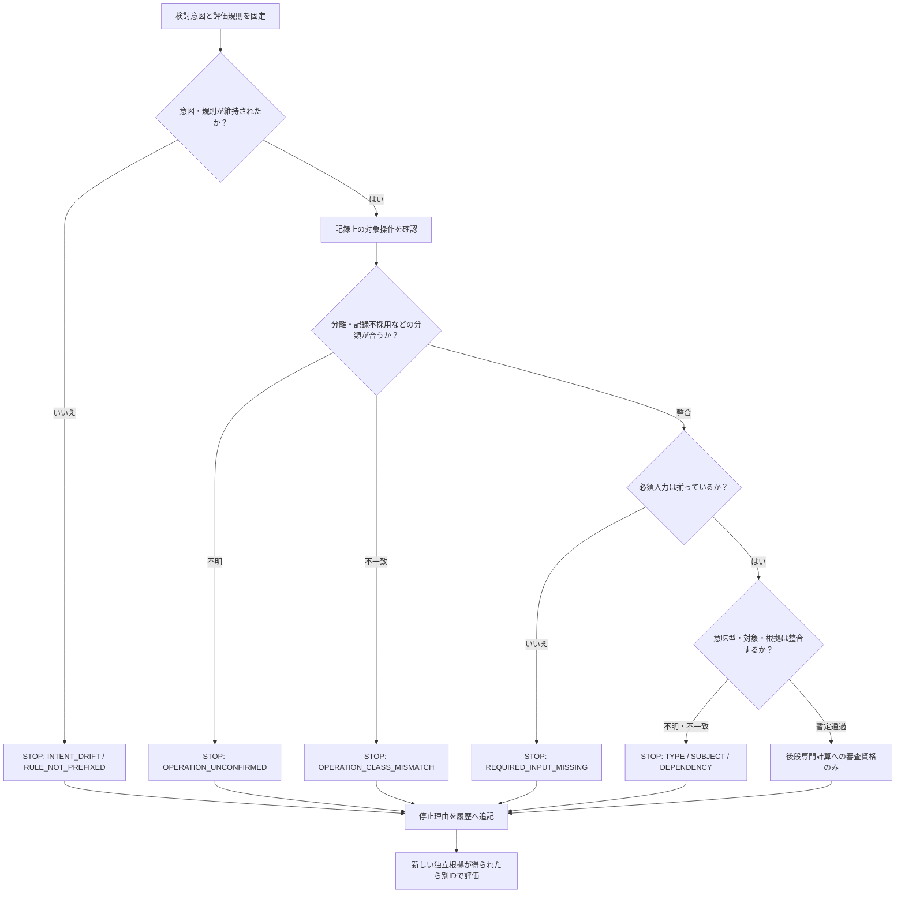
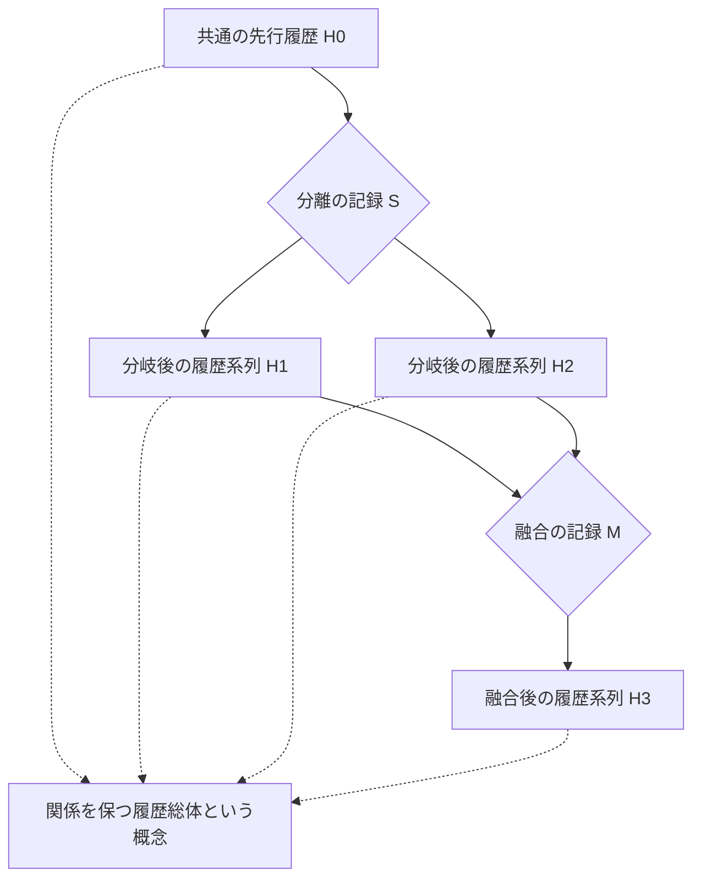
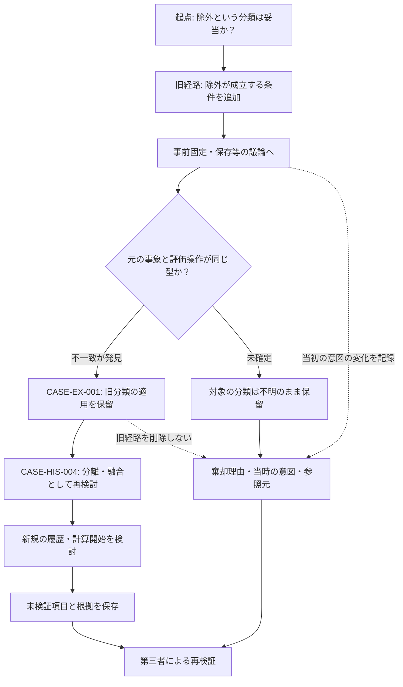

# NRA-IDE判断経路・履歴接続チャート（一次稿）

- 作成：2026-11-12 19:04 JST
- 状態：**非正典／未確定／長論文・コードとの照合前**
- 共通事例ID：`CASE-EX-001`, `CASE-TYP-002`, `CASE-INF-003`, `CASE-HIS-004`, `CASE-REV-005`, `CASE-REC-006`
- **注意：図中の「事象」は事象についての記録・主張と区別する。図は現実そのものの完全模型ではない。**

## 図1：分類・型・欠損の検証経路

**説明**：失敗経路も成功経路もログに接続する。`STOP` が停止するのは当該依存評価であり、現実の生成・適法な観測・履歴の記録ではない。図の通過は現実の真偽の証明ではない。

## 図2：分岐・融合と履歴の接続

**説明**：「履歴総体は一つ」は数値の加算ではなく、相互関係を保持するという構造上の主張である。図は先行・後続関係の候補であり、全事象を完全に観測したことを意味しない。融合は元の履歴への復帰ではない。

## 図3：今回の誤分類と、判断変更の履歴

**説明**：後から成立した新しい説明だけを残さず、旧経路がなぜ採用不能となったのかを参照できるようにする。新しい根拠による再検証を禁じない。旧稿を丸ごと正典に格上げすることもない。

## 論文・コード・図の相互照合

| 事例ID | 長論文 | 参照コード | 主な図 |
|---|---|---|---|
| `CASE-EX-001` | 1節、3節、9節 | `OPERATION_CLASS_MISMATCH` | 図1、図3 |
| `CASE-TYP-002` | 2節、5節、9節 | `TYPE_MISMATCH` | 図1 |
| `CASE-INF-003` | 7節、9節 | `REQUIRED_INPUT_MISSING` | 図1 |
| `CASE-HIS-004` | 4節、9節 | `HistoryLinks` | 図2 |
| `CASE-REV-005` | 6節、9節 | `INTENT_DRIFT` | 図1、図3 |
| `CASE-REC-006` | 7節、9節 | `previous_evaluation_id` | 図1、図3 |

## 後日検証すべきこと

1. 論文・コード・図の三者に同じ意味の「分類」「履歴」「根拠」が使われているか。
2. 型検査の一致が、現実の事実成立を保証するような読み方になっていないか。
3. 正典の `AXIOMS.md`、`FORMULA.md` の状態語・計算規則に適合するか。
4. 図2にある分離・融合の成立条件をどう定義するか。
5. 棄却記録と新規事実の参照が混同されていないか。

**図は定義の代わりではなく、検証すべき分岐を可視化する補助物である。**
