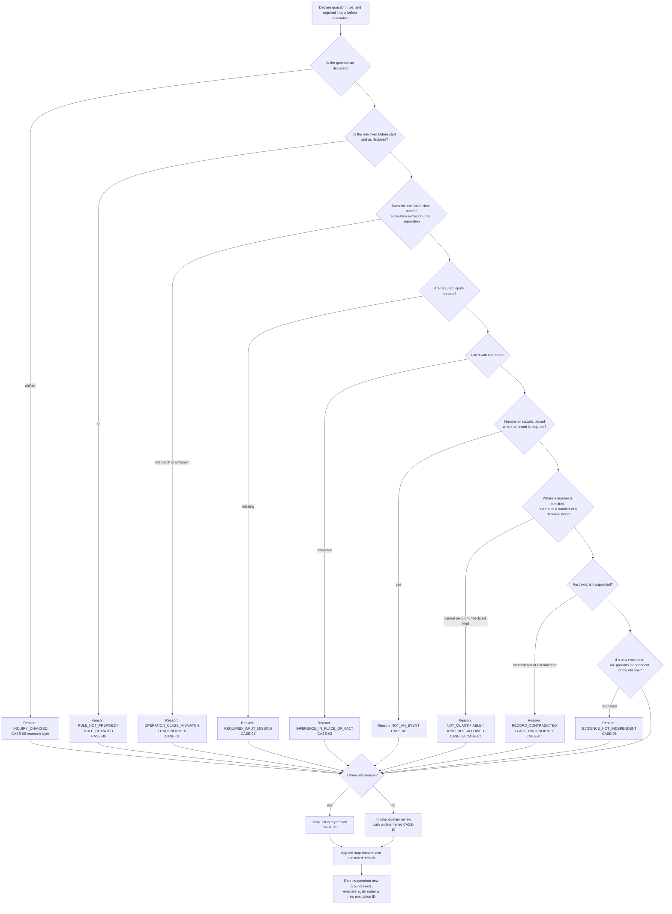
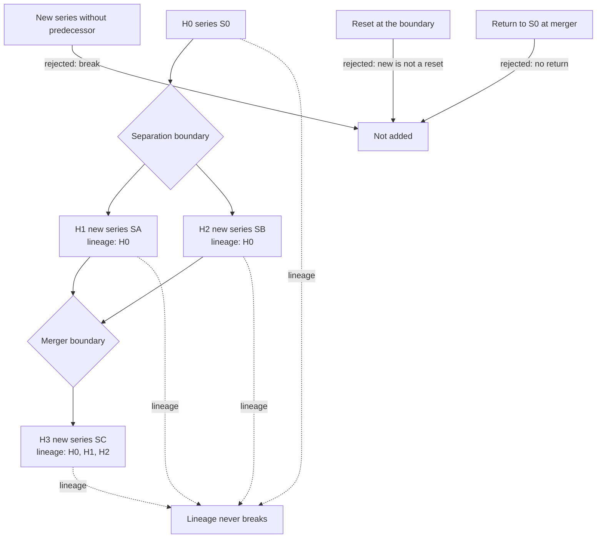
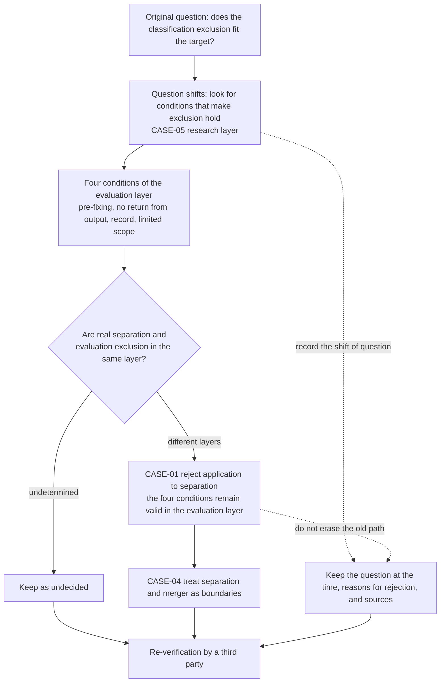
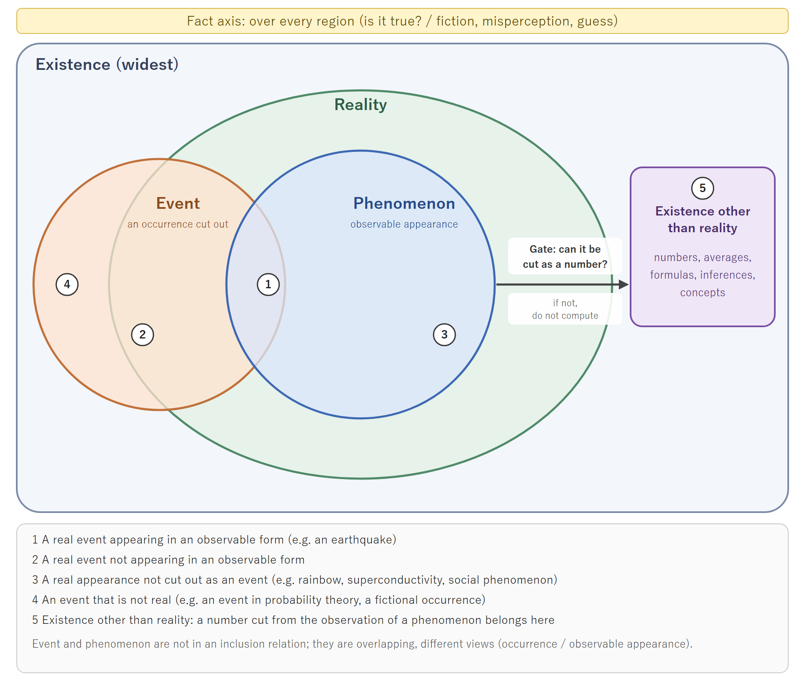

# NRA-IDE Judgment Path Charts (Second Draft)

- Author: M-Tokuni
- Created: 2026-11-12 21:53 JST
- Status: **non-canonical / second draft**; uses the same case IDs (CASE-01 to CASE-11) as the paper and the reference code
- Japanese version: `NRA_IDE_判断経路チャート_二次稿_2026_1112_2153_JP.md`
- **Note: the charts do not replace definitions. Passing through a chart does not prove that a record is a fact or that a classification corresponds to reality.**

## Fig. 1: Judgment path and stop (order of `gate` in the reference code)

**Explanation**: no check stops at the first failure; reasons are collected before deciding stop or pass. Only the evaluation concerned stops; real events, observation, and history records do not.

## Fig. 2: History boundaries (CASE-04)

**Explanation**: boundaries exist but history never breaks. The starting point of a new series is measured at the boundary, not restarted from zero. A merger is not a return to H0. The chart shows relations among records, not a complete model of real history.

## Fig. 3: Path of the misclassification and keeping the reasons for rejection (CASE-01, CASE-05)

**Explanation**: the four conditions of the initial essay are not rejected. What is rejected is applying them to a real separation.

## Fig. 4: Relation among existence, reality, event, phenomenon, and number (set diagram)

**Explanation**: a set diagram drawn with overlapping inclusion, not a parent-child tree (it cannot be drawn in Mermaid, so the SVG is the original).

- Existence is the widest and contains reality (nested).
- Event and phenomenon are not contained in one another; they partly overlap. There are events outside reality (an event in probability theory, a fictional occurrence). A phenomenon is what is real appearing in an observable form, so it lies inside reality.
- A number lies inside existence and outside reality (existence other than reality). From a phenomenon to a number, one passes through the gate "can it be cut as a number?". If it cannot, do not compute.
- Fact is not a region but a truth axis over the whole figure (the band at the top).
- Formulas stand only on a number (5 in the figure). Reading back from a number to an event changes the kind of existence, and confusion arises there.

The meaning of numbers 1 to 5 in the figure is in the table of Section 1 of the paper and in the legend of the figure.

## Correspondence among paper, code, and charts

| id      | Paper | Reference code                                                             | Chart          |
| ------- | ----- | -------------------------------------------------------------------------- | -------------- |
| CASE-01 | 6.1   | `OPERATION_CLASS_MISMATCH` (EV-01)                                       | Fig. 1, Fig. 3 |
| CASE-02 | 4.2   | `NOT_AN_EVENT` (EV-02), `KIND_NOT_ALLOWED` (EV-15); ELIGIBLE if declared (EV-16) | Fig. 1, Fig. 4 |
| CASE-03 | 4.1   | `REQUIRED_INPUT_MISSING` (EV-03), `INFERENCE_IN_PLACE_OF_FACT` (EV-04) | Fig. 1         |
| CASE-04 | 5     | `HistoryLinks`                                                           | Fig. 2         |
| CASE-05 | 6.2   | `INQUIRY_CHANGED` (EV-05)                                                | Fig. 1, Fig. 3 |
| CASE-06 | 6.1   | `RULE_NOT_PREFIXED` (EV-06, EV-08), `RULE_CHANGED` (EV-07)             | Fig. 1         |
| CASE-07 | 4.3   | `RECORD_CONTRADICTED` (EV-09)                                            | Fig. 1         |
| CASE-08 | 7.2   | ELIGIBLE (EV-10), `EVIDENCE_NOT_INDEPENDENT` (EV-11)                     | Fig. 1         |
| CASE-09 | 3     | `NOT_QUANTIFIABLE` (EV-13)                                               | Fig. 1, Fig. 4 |
| CASE-10 | 3     | ELIGIBLE (EV-14)                                                           | Fig. 1         |
| CASE-11 | 7.1   | multiple reasons (EV-15)                                                   | Fig. 1         |

## About images

The images of Figs. 1 to 3 are rendered from the Mermaid sources in this file and placed in the same folder (mermaid-cli 12.2.0). The Mermaid source is authoritative; re-render the images after any edit. Fig. 4 is a set diagram that cannot be drawn in Mermaid, so the SVG is the original and the PNG is its rendering (generated 2026-11-13). Fig. 1 was redrawn to match the added reason code (`KIND_NOT_ALLOWED`) (2026-11-13). The images of the first draft correspond to the first-draft charts and are not used for the second draft.

| Figure                                | Japanese                                                         | English                                                          |
| ------------------------------------- | ---------------------------------------------------------------- | ---------------------------------------------------------------- |
| Fig. 1 Judgment path                  | `NRA_IDE_Draft2_fig1_route_JP_2026_1112_2153.png/.svg`         | `NRA_IDE_Draft2_fig1_route_EN_2026_1112_2153.png/.svg`         |
| Fig. 2 History boundaries             | `NRA_IDE_Draft2_fig2_history_JP_2026_1112_2153.png/.svg`       | `NRA_IDE_Draft2_fig2_history_EN_2026_1112_2153.png/.svg`       |
| Fig. 3 Path of misclassification      | `NRA_IDE_Draft2_fig3_research_path_JP_2026_1112_2153.png/.svg` | `NRA_IDE_Draft2_fig3_research_path_EN_2026_1112_2153.png/.svg` |
| Fig. 4 Three layers and the fact axis | `NRA_IDE_Draft2_fig4_three_layers_JP_2026_1112_2153.png/.svg`  | `NRA_IDE_Draft2_fig4_three_layers_EN_2026_1112_2153.png/.svg`  |

Fig. 1 draws a stopping branch for each check, but the actual gate does not stop at the first failure; it collects reasons (CASE-11). The figure does not show this.
