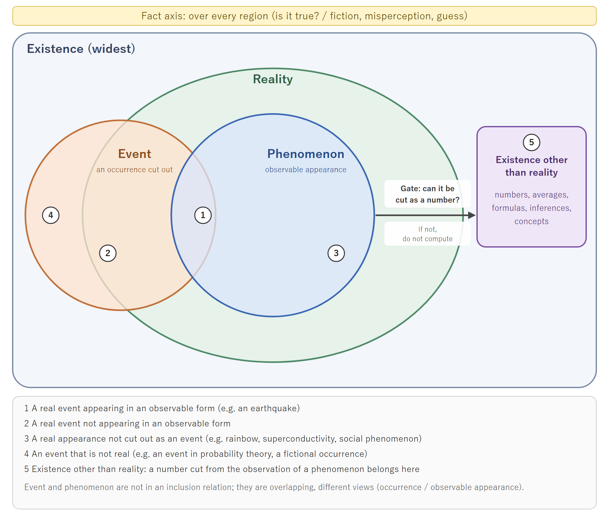

# Layers of Existence, Event, and Numeric Cut, and the Judgment Path in NRA-IDE
## From the record of an "exclusion" misclassification — Second Draft

**Status: second draft / non-canonical / not peer-reviewed**  
**Author: M-Tokuni**  
**Created: 2026-11-12 21:53 JST**  
**Previous version: `NRA-IDE 判断経路・三段構成 一次稿/` (2026-11-12 19:04, kept unchanged)**  
**Japanese version: `NRA_IDE_判断経路論文_二次稿_2026_1112_2153_JP.md` (revised as a pair)**

> **How to read**: This paper does not revise the canon. Formulas (D1)–(D4) are proposals, not canonical formulas. The reference code and the charts share the case IDs of this paper, but agreement among the three is not proof of correctness.

---

## Abstract

Starting from a misclassification in which a physical separation was explained as an evaluation "exclusion," this paper organizes the layers of the judgment path. It distinguishes three layers: existence (the widest), real events and phenomena (occurrences and observable appearances), and numeric cut (a value cut statically from the observation of a phenomenon). Fact is placed over every layer as the axis that asks whether something is true. Event and phenomenon are treated not as an inclusion relation but as overlapping, different views. Formulas stand only on the numeric layer, and a number exists but is not a physical reality (it is existence other than reality). From this distinction the paper derives the following disciplines. If a phenomenon cannot be cut as a number, do not compute. Do not fill missing parts with inference. Do not read back from a number to an event. History has boundaries but never breaks; a new series is not a reset, and there is no return. Evaluation exclusion is a rule of the evaluation layer and belongs to a different layer from a real separation. The status of comparison with the canon (AXIOMS v2.5, FORMULA) is shown per section, and items not yet compared or undecided are kept.

**Keywords**: existence, reality, event, phenomenon, fact, numeric cut, missing data, exclusion, separation, history boundary, evaluation layer, research layer

---

## 0. Changes from the first draft

| id | Change | Reason |
|---|---|---|
| CH-01 | Stopped writing "fact/event" as one term; separated fact (truth axis) from event (occurrence) | The words have different uses (Appendix A) |
| CH-02 | Replaced most "real-world ..." (現実の〜) with "real" (実在の) or "physical" | 現実 denotes recognition of the situation at hand |
| CH-03 | Replaced the type table (EventReference, Measurement, etc. in parallel) with the three-layer structure | Items of different layers were listed side by side, mixing two axes: "is it a fact?" and "can it be quantified?" |
| CH-04 | Changed the average-value error from "not a fact" to "a fact but not an event" | A correctly computed average is a fact |
| CH-05 | Removed the discussion of reverse derivation A/B and kept one sentence: "Do not fill missing parts with inference." | Limited to what the subject of this paper needs |
| CH-06 | Made a shift of question in the research layer clearly distinct from reverse derivation B | Reverse derivation B is defined as a path to the gauge of the same target |
| CH-07 | Rewrote history as "boundaries exist but history never breaks" | Prevents "new" from being read as a reset |
| CH-08 | Positioned the initial essay "On Exclusion" as valid in the evaluation layer, not as an old hypothesis | The essay itself does not discuss separation; the misclassification arose in its later application |
| CH-09 | Added the results of comparison with FORMULA §0.5.1–0.5.4 | The first draft marked even comparable items as unverified |
| CH-10 | Renumbered the cases as CASE-01 to CASE-11, shared by paper, code, and charts | The IDs did not match across the three in the first draft |
| CH-11 | Expressed event and phenomenon not as a parent-child tree but as an overlapping set diagram (Fig. 4). An event is not necessarily below reality (there are events that are not real) | A phenomenon is not contained in an event (rainbow, superconductivity, social phenomenon), and an event is not limited to reality (an event in probability theory, a fictional occurrence). The limit "an occurrence within reality" was narrower than the use of the terms |
| CH-12 | Changed "existence that does not really exist" and "exists but is not real" to "existence other than reality" and "exists but is not a physical reality" | In everyday Japanese, 実在する is close to "actually exists," so "存在するが実在しない" reads as a contradiction |
| CH-13 | Added Appendix C (reference technology: Event Sourcing) and split the "history-aware state variable (working title)" into a separate open-issues file (B-06) | To keep an existing technology out of this paper's definitions, and an undecided design candidate out of the dictionary and the body |
| CH-14 | Added declaration of kinds (`allowed_kinds`) and the reason code `KIND_NOT_ALLOWED` to the code, and wrote the layer correspondence and the fact that it is "code for explanation" in the comments | To make the code behave as §4.2 states (an average may be used as an input inside a declared rule), and to remove the mismatch of calling a statistic `NOT_QUANTIFIABLE` |

## 1. Use of terms

| id | Term (JP) | Core | Use in this paper |
|---|---|---|---|
| T-01 | fact (事実) | Whether it is true (contrast: fiction, misperception, rumor) | Truth axis over every layer |
| T-02 | event (事象) | Occurrence; a happening cut out as an object of analysis or processing | Second layer. This paper treats real events. There are also events that are not real (an event in probability theory, a fictional occurrence) |
| T-03 | phenomenon (現象) | Manifestation and observability; a visible working or appearance | Second layer. What is real, appearing in an observable form. Not necessarily contained in an event |
| T-04 | 現実 (no fixed English term) | Recognition of the situation at hand | Not used as a technical term (only in general words such as "practical constraints") |
| T-05 | reality (実在) | Whether something is physically and objectively genuine; whether it is there (narrow) | What physically and genuinely happened or is there |
| T-06 | existence (存在) | Superordinate concept including the physical, mathematical, ideal, past, and future (as wide as in quantum physics or Buddhism) | First layer; the "existence" of the Nomological Ring Axiom "Existence is Generation." |

Fig. 4 is a set diagram. It is drawn with overlapping inclusion, not as a parent-child tree.

- Existence is the widest and contains reality (nested).
- Event and phenomenon are not contained in one another; they partly overlap.
- An event is not limited to reality. There are events outside reality.
- A phenomenon is what is real appearing in an observable form, so it lies inside reality.
- A number lies inside existence and outside reality (existence other than reality). From a phenomenon to a number, one passes through the gate (Section 3).
- Fact is not a region but a truth axis over the whole figure (the band at the top).

| Number in figure | Region | Example |
|---|---|---|
| 1 | A real event appearing in an observable form | an earthquake |
| 2 | A real event not appearing in an observable form | — |
| 3 | A real appearance not cut out as an event | rainbow, superconductivity, social phenomenon |
| 4 | An event that is not real | an event in probability theory, a fictional occurrence |
| 5 | Existence other than reality | numbers, averages, formulas, inferences, concepts |

**Example**: confirm the fact that an earthquake occurred; compute the energy of the earthquake as a physical event; explain the mechanism of the earthquake as a natural phenomenon.

## 2. Three layers: existence, event, numeric cut

### 2.1 First layer: existence

Existence is the widest. Not only what is real, but also numbers, formulas, concepts, the past, and the future are included in existence. There is existence outside reality (existence other than reality). The "existence" of the Nomological Ring Axiom "Existence is Generation." (AXIOMS §2) is read in this wide sense.

### 2.2 Second layer: real events and phenomena

An event is an occurrence cut out as an object of analysis or processing. This paper treats events that occurred within reality (real events); separation, merger, rupture, addition, and removal are such events. There are also events that are not real, such as an event in probability theory or a fictional occurrence.

A phenomenon is the appearance of what is real in an observable form. Some phenomena are not cut out as a single event, such as a rainbow, superconductivity, or a social phenomenon. Conversely, some real events do not appear in an observable form. Event and phenomenon are not in a relation where one contains the other; they are overlapping, different views: attending to the occurrence, or attending to the observable appearance (Fig. 4). The same earthquake can be spoken of as an event whose energy is computed, or as a phenomenon whose mechanism is explained.

Both are hard to quantify. The whole of an ongoing event or phenomenon cannot be expressed by a single number.

### 2.3 Third layer: numeric cut

A number is a value cut statically from the observation of a phenomenon. Cutting at one point between state and persistence gives a number, and a continuous sequence of cuts gives the variation of the number. Only here does computation become possible.

A number exists but is not a physical reality (it is existence other than reality). That a gauge showed 20 mm can be a fact, but "20" itself does not exist as a physical entity.

**Comparison with the canon (compared)**: AXIOMS §2 states that "existence is not a static entity but continuous generation accompanied by history; stillness is merely a temporary cut of the generation process." The view of a number as a static cut corresponds to this. FORMULA §0.5.2 defines the update number $n$ as "the order of events" and maps the value $o_n$ of the observation event $\mathrm{Ev}_n$ to $\delta_n$ by the projection rule $\sigma$. The sequence of $\delta_n$ corresponds to the continuous sequence of cuts in this paper. Which cut is used is fixed by the evaluation declaration $\mathsf{Decl}$ and by $\sigma$, and evaluations with different declarations are not compared (FORMULA §0.5.1). The same event cut differently gives a different evaluation.

### 2.4 The fact axis

Fact is not a layer but a truth axis laid over each layer. "Did the event really happen?", "Was the number really shown?", and "Is the computation correct?" are all questions of fact. What is not a fact is fiction, misperception, rumor, or guesswork. Being a record or being a number does not mean being non-fact.

**Comparison with the canon (compared)**: the "observation event (type: record of an event)" in the dictionary and FORMULA §0.5.2 matches the use in T-02, an event cut out as an object of processing. The question to ask is not "record or event?" but "is the event a fact?"

## 3. The gate from the second to the third layer: can it be cut as a number?

A phenomenon in front of us cannot always be cut as a number. If it cannot, do not compute. Do not put a substitute number in its place and continue.

**Comparison with the canon (compared, partial)**: FORMULA §0.5.2 does not input an event whose target, unit, time, or provenance is unknown, or whose value is invalid or non-finite, and results in `CONFESSION`; when a value is merely unavailable from an observation channel, it reports `NOT_OBSERVABLE` with the reason. The correspondence between the gate of this paper (`NOT_QUANTIFIABLE` and `KIND_NOT_ALLOWED` in the reference code) and canonical states can be read as follows.

| id | Situation stopped at the gate | Canonical handling | Status |
|---|---|---|---|
| G-01 | No value is obtained from the observation path | `NOT_OBSERVABLE` with the reason | Compared |
| G-02 | A value exists but unit, target, or provenance is unknown, or it is non-finite | `CONFESSION` | Compared |
| G-03 | A description of the appearance of a phenomenon exists but no numeric cut | No direct provision in the canon | Not compared |

Reason codes are not canonical state names. Mapping to canonical states follows the declared handling of missing data (FORMULA §0.5.1).

## 4. Disciplines within the third layer

### 4.1 Do not fill missing parts with inference

When a required input is missing, do not fill it with inference. An inference exists but is not a physical reality. Placing an inference in the position of a fact makes a non-fact a premise of computation. Treat what is missing as missing and stop the computation that depends on it.

If the required value can be strictly computed from known axioms, definitions, and rules, it is not gap-filling (intermediate study 1604 §4, case D). Whether that computation may be applied to the real event is checked separately.

### 4.2 Do not read back from a number to an event

When reading back from a number (third layer) to an event (second layer), the kind of existence changes. Confusion arises here.

The average of 10, 20, and 30 is 20. If the computation is correct, "the average is 20" is a fact. But the average 20 is not a physical reality, and it is not an event. No occurrence called "20" happened at any time or to any target. The error is "treating existence other than reality as a real event."

Using an average as an intermediate computation inside a pre-fixed projection rule is a different matter and is not prohibited. The subject of judgment is the ratio of the Primary Formula, not the average. In the reference code, the kinds that may be entered as a numeric input are declared before evaluation (`allowed_kinds`). An undeclared average entered as a numeric input stops with `KIND_NOT_ALLOWED`, and a declared one passes. Even when it passes, the average does not become a single event; placed in the position of an event, it stops as CASE-02.

### 4.3 Primary sources and the fact axis

A primary source can contain a wrong claim. "The paper published the claim" and "the claim is correct" are separate questions of fact. Even if the claim is later refuted, the record that it was published is kept. There is no guarantee that records can always be kept without limit; constraints of law, authority, and retention periods are handled separately.

## 5. History boundaries: boundaries exist but history never breaks

### 5.1 Three disciplines

1. **No break**: separation and merger are boundaries of history. After a boundary, history remains connected to what came before.
2. **New is not a reset**: from a boundary, a new series begins for each configuration. A new series inherits the history before the boundary as its lineage. Changes that arose before the boundary (including residual deviation and degradation) are carried over, not restarted from zero. The starting state is measured at the time of the boundary.
3. **No return**: merger, reconnection, or reattaching a removed element is not a return to a state before a boundary but a new boundary.

The past, though no longer real, does not vanish as existence. The boundary disciplines restate this.

### 5.2 History graph (proposal)

$$
G_H=(V_H,E_H) \tag{D1}
$$

$V_H$ is the set of records of boundaries and series, and $E_H$ is the set of precedence and inheritance relations. Because a shared lineage is not counted twice, it is not expressed as an arithmetic sum of series.

$$
H_0\xrightarrow{\mathrm{split}}(H_1,H_2),\qquad
(H_1,H_2)\xrightarrow{\mathrm{merge}}H_3,\qquad
\mathrm{Lineage}(H_3)\supseteq\{H_0,H_1,H_2\} \tag{D2}
$$

(D2) is a schema of precedence and inheritance, not a definition of an operation on histories. $H_3$ is not a return to $H_0$.

### 5.3 Comparison with the canon

| id | This paper | Canon | Status |
|---|---|---|---|
| H-01 | New is not a reset | Non-Spontaneous Tau Recovery (AXIOMS §7), Restoration Degradation (§8); $\lambda$ and $p$ do not decrease during evaluation (FORMULA §0.5.3–0.5.4) | Compared, consistent |
| H-02 | The starting state is measured at the boundary | The declared thickness $\tau^{[e]}_0$ of an added element is determined by Cause-Side measurement at the time of addition (FORMULA §0.5.4) | Compared, consistent |
| H-03 | No return | Returning a removed element is treated anew as an addition (dictionary, "Removal of a Structural Element") | Compared, consistent |
| H-04 | Separation is a real event | Removal of a structural element updates $\mathsf{Active}_n$ and is recorded as an event (FORMULA §0.5.3–0.5.4); it is not evaluation non-adoption | Compared, consistent |
| H-05 | After separation, both branches have successors | The canon treats only the side of the evaluation target and has no provision for tracking the successors of the side that left (nor does it deny them) | Outside the canon's provisions |
| H-06 | A new series begins at a merger | Addition updates $\mathsf{Active}_n$ within an evaluation; a new computation arises only as a change of declaration when removal is handled under a series link $\min_e$ | Undecided (a new series and a new computation need to be written separately) |

## 6. The evaluation layer and the research layer

### 6.1 Evaluation exclusion (evaluation layer)

Exclusion is declaring, before evaluation, that an acquired observation value is "not included in this computation." That the observation value was acquired remains a fact. The four conditions given in the initial essay "On Exclusion" (2026-11-12) hold as rules of the evaluation layer.

| id | Condition | Relation to the canon |
|---|---|---|
| X-01 | Fix the criteria before evaluation | The evaluation declaration is not rewritten by the results of the evaluation (FORMULA §0.5.1) |
| X-02 | Create no path from evaluation output back to the criteria | AXIOMS §14 |
| X-03 | Keep the excluded observation values in the record ("not used this time," not "was false") | Proposal of the initial essay |
| X-04 | Limit the scope of the conclusion to the observation values used | Proposal of the initial essay |

Missing data and exclusion are the same hole from the computation's point of view, but they are recorded in separate accounts. Missing data could not be acquired; excluded data were acquired but declared not to be used (initial essay §4). A cumulative exclusion count is kept so that repeated exclusion of the same value can be noticed (initial essay §5).

**Difference of layer**: evaluation exclusion is an operation of the evaluation layer and belongs to a different layer from a real separation (an event of the second layer). The classification should have been reconsidered when separation began to be treated as an example of exclusion (CASE-01).

### 6.2 A shift of question in the research layer

During a study, the question may shift from "does classification X fit the target?" to "what conditions make classification X hold?" This is a shift that occurs in the research layer.

Reverse derivation B is defined as "a path from an evaluation output to the gauge of the same target" (AXIOMS §14). A shift of question in the research layer does not fall under this definition. The two are similar in appearance but different in nature, and clearly distinct. This paper does not call a shift in the research layer reverse derivation.

As a discipline of the research layer, when the question shifts, record that it shifted and treat it as a new question. Do not count the original question as achieved. Revising a hypothesis or discovering a new question is not itself prevented.

Separately, in the evaluation layer, changing an evaluation rule such as an exclusion criterion after seeing a previous evaluation output violates X-02 in 6.1. That is a different problem from a shift in the research layer.

## 7. Stop and new evaluation

### 7.1 Scope of stopping

When a required ground is missing, what stops is only the computation that depends on it and the finalization of conclusions. Real events proceed regardless of the stop. Observation, recording, independently possible computation, and preservation of history continue. A stop is not proof that the target does not exist.

$$
\neg\mathrm{Established}(P_j)\Longrightarrow\mathrm{StopDependentEvaluation}(j) \tag{D3}
$$

### 7.2 New evaluation

Do not rewrite a stopped evaluation as a "success" with grounds obtained later. Evaluate again under a new evaluation ID and connect it to the old evaluation.

**Comparison with the canon (compared)**: FORMULA §0.5.1 states that "$\mathsf{Decl}$ is not rewritten by the results of the evaluation; post-hoc verification results do not retroactively rewrite the premises of that evaluation and are reflected in the next evaluation snapshot." This section follows the same principle.

$$
\mathrm{Established}(P'_k)\land
\bigl(\mathrm{Closure}(F_k)\cap\mathrm{Consulted}(j)=\varnothing\bigr)\land
\mathrm{DeclaredBeforeEvaluation}(k)
\Longrightarrow\mathrm{EligibleToStart}(k) \tag{D4}
$$

$F_k$ is the set of grounds of the new evaluation $k$, $\mathrm{Closure}$ is all of their dependencies, and $\mathrm{Consulted}(j)$ is the set of records consulted by the old evaluation $j$. If a new ground is a re-citation of an old ground, it is not independent (CASE-08). (D4) is a condition for proceeding to review; it does not mean permission to execute or release of an irreversible state.

## 8. Minimal record unit

| id | Field | Intent |
|---|---|---|
| F-01 | `case_id`, `evaluation_id` | Identify the case and the evaluation; a new evaluation gets a new ID |
| F-02 | `inquiry` | The question of the research layer; recorded as a new question when it shifts |
| F-03 | `rule_id`, `rule_version`, `declared_at` | The rule of the evaluation layer and the time it was fixed |
| F-04 | `kind` | Event record, numeric cut, statistic, inference, or operation report |
| F-05 | `support` | Fact axis (supported, contradicted, unconfirmed) |
| F-06 | `subject`, `unit`, `source` | About what, in which unit, and from where |
| F-07 | `dependencies` | Dependencies of grounds; used to judge independence |
| F-08 | `previous_evaluation_id` | Connection to the old evaluation |
| F-09 | `series_id`, `boundary`, `predecessor_ids`, `start_basis` | History boundaries and lineage |

Records are append-only; corrections are added as new records.

## 9. Cases

Paper, reference code, and charts use the same IDs.

| id | Situation | Expected judgment (reason code in code) | Section | Chart |
|---|---|---|---|---|
| CASE-01 | Treating evaluation exclusion as a real separation | Stop (`OPERATION_CLASS_MISMATCH`) | 6.1 | Fig. 1, Fig. 3 |
| CASE-02 | Treating an average as an event / entering an undeclared kind (such as an average) as a numeric input | Stop (`NOT_AN_EVENT` / `KIND_NOT_ALLOWED`). If declared, it passes as a numeric input | 4.2 | Fig. 1, Fig. 4 |
| CASE-03 | A required input is missing / filled with inference | Stop (`REQUIRED_INPUT_MISSING` / `INFERENCE_IN_PLACE_OF_FACT`) | 4.1 | Fig. 1 |
| CASE-04 | Boundaries of separation and merger | Keep lineage; reject break, reset, and return | 5 | Fig. 2 |
| CASE-05 | The question shifts in the research layer | Stop and record as a new question (`INQUIRY_CHANGED`) | 6.2 | Fig. 1, Fig. 3 |
| CASE-06 | The rule is not fixed before evaluation / executed with a rule different from the declaration | Stop (`RULE_NOT_PREFIXED` / `RULE_CHANGED`) | 6.1 | Fig. 1 |
| CASE-07 | A primary source containing an error | The claim stops (`RECORD_CONTRADICTED`); the record of publication is kept | 4.3 | Fig. 1 |
| CASE-08 | A new ground arrives after a stop | To review if independent; stop if a re-citation (`EVIDENCE_NOT_INDEPENDENT`) | 7.2 | Fig. 1 |
| CASE-09 | An appearance of the phenomenon exists but no numeric cut | Stop (`NOT_QUANTIFIABLE`) | 3 | Fig. 1 |
| CASE-10 | Event record and numeric cut are both present | To later domain review (truth still undetermined) | 3 | Fig. 1 |
| CASE-11 | Several defects at once | Stop, listing every reason | 7.1 | Fig. 1 |

**Verification limit**: passing the code tests only partly confirms that the code meets the declared conditions. The tests do not prove that a record is a fact or that a classification corresponds to reality.

## 10. Status of comparison with the canon

| id | Target | Status | Section |
|---|---|---|---|
| K-01 | AXIOMS §2 "existence" of the Nomological Ring Axiom; "stillness is a temporary cut of the generation process" | Compared (read in the wide sense; corresponds to the view of cuts) | 2.1, 2.3 |
| K-02 | FORMULA §0.5.1 fixing the evaluation declaration and handling post-hoc results | Compared | 2.3, 6.1, 7.2 |
| K-03 | FORMULA §0.5.2 observation event, projection, CONFESSION, NOT_OBSERVABLE | Compared (partly not compared: G-03) | 2.3, 2.4, 3 |
| K-04 | FORMULA §0.5.3–0.5.4 addition and removal of structural elements, $\mathsf{Active}_n$ | Compared (H-05 outside the canon's provisions; H-06 undecided) | 5.3 |
| K-05 | AXIOMS §7, §8 | Compared | 5.3 |
| K-06 | AXIOMS §14 definition of reverse derivation | Compared (a shift in the research layer does not fall under it) | 6.2 |
| K-07 | AXIOMS §2 non-identity of history, §4 history accumulation, and the boundary disciplines | Not compared | — |
| K-08 | Whether "missing information" in AXIOMS §11 includes exclusion | Not compared (initial essay §7) | — |

## 11. Undecided items

| id | Item |
|---|---|
| U-01 | Conditions for separation and merger to hold; difference from mere contact, change of relation, and removal of a structural element |
| U-02 | Relation between a new series and a new computation (H-06) |
| U-03 | Mapping to canonical states when an appearance of a phenomenon cannot be cut as a number (G-03) |
| U-04 | Exclusion as a back door to recovery: excluding values that contribute to accumulated deviation makes the ratio look lower (initial essay §6-1) |
| U-05 | Asymmetry of dangerous-side exclusion: whether exclusion that makes the ratio look smaller needs extra conditions (initial essay §6-4) |
| U-06 | Width near the boundary of a criterion (initial essay §6-5) |
| U-07 | Fixing the exclusion rule and ledger themselves as outside the scope of exclusion (initial essay §6-6) |
| U-08 | Definition of independence of grounds; this paper judges only by overlap of dependencies and does not detect records obtained through different paths from the same source |
| U-09 | Whether to adopt the "history-aware state variable (working title)," and its name and structure. First check its overlap with the existing target state, evaluation state, and event history (Q-01 of B-06) |

## 12. Conclusion

Existence, event, and numeric cut are different layers, and fact is the truth axis over all of them. Formulas stand only on the numeric layer, and a number exists but is not a physical reality. Event and phenomenon are not in an inclusion relation but are overlapping, different views. If a phenomenon cannot be cut as a number, do not compute. Do not fill missing parts with inference. Do not read back from a number to an event. History has boundaries but never breaks; new is not a reset, and there is no return. Evaluation exclusion is a rule of the evaluation layer and belongs to a different layer from a real separation. A shift of question in the research layer is distinct from reverse derivation; record that it shifted and treat it as a new question.

---

## Appendix A: Terms

| id | Term | Japanese | Meaning | Not to be confused with |
|---|---|---|---|---|
| A-01 | fact | 事実 | Whether it is true; an axis over every layer | Being a record or being a number |
| A-02 | event | 事象 | An occurrence cut out as an object of analysis. Besides real events there are events that are not real (an event in probability theory, a fictional occurrence). This paper treats real events | Numbers, statistics, inferences. Phenomenon (not an inclusion relation but overlapping, different views) |
| A-03 | phenomenon | 現象 | What is real, appearing in an observable form. Not necessarily contained in an event (rainbow, superconductivity, social phenomenon) | A number (what comes after cutting). A subordinate concept of event |
| A-04 | (no fixed term) | 現実 | Recognition of the situation at hand | Reality (実在) |
| A-05 | reality | 実在 | Being physically and objectively genuine | Existence (wider) |
| A-06 | existence | 存在 | Superordinate concept including the physical, mathematical, ideal, past, and future | Reality |
| A-07 | numeric cut | 数値の切り取り | A value cut statically from the observation of a phenomenon; a continuous sequence gives variation | Event |
| A-08 | boundary | 区切り目 | A point where a new series begins, such as separation or merger; history does not break | Break or reset of history |
| A-09 | lineage | 来歴 | Preceding history inherited across a boundary | Initialization of a new series |
| A-10 | evaluation exclusion | 評価上の除外 | Declaring before evaluation that an acquired observation value is not included in this computation | Real separation, missing data |
| A-11 | stop | 停止 | Stopping the computation and finalization of conclusions that depend on a missing ground | Stopping real events; proof of non-existence |
| A-12 | existence other than reality | 実在以外の存在 | The part of existence other than reality: numbers, formulas, averages, inferences, concepts. A numeric cut also belongs here | Reading "not real" as "does not exist" |

In English, "reality" covers both 現実 and 実在, so "reality" is not used for 現実 in English text. "Actuality" is not used.

## Appendix B: References

| id | Source | Handling |
|---|---|---|
| B-01 | Initial essay "On Exclusion" (除外についての考察, 2026-11-12, M-Tokuni) | Outside the repository; referenced as a study of the evaluation layer (6.1) |
| B-02 | `nra-core/foundations/NRA-IDE：事象の分岐・融合と計算成立境界（定義検討記録）2026-1112-1604.md` | Intermediate study; case D and comparison items referenced |
| B-03 | `NRA-IDE 判断経路・三段構成 一次稿/` (2026-11-12 19:04) | Previous version; changes in Section 0 |
| B-04 | `theory/AXIOMS.md` v2.5 §2, §7, §8, §14; `FORMULA.md` §0.5.1–0.5.4 | Comparison targets (compared within the repository on 2026-11-12) |
| B-05 | `local_reports/2026-11-12_judgment_path_term_alignment.md` | Term alignment table |
| B-06 | `nra-core/foundations/NRA-IDE：履歴付き状態変数（仮称）の検討事項（設計候補・未確定）2026-1112-2319.md` | An undecided design candidate related to the minimal record unit of Section 8 (Appendix C) |

## Appendix C: Reference technology — Event Sourcing (references)

Added: 2026-11-12 23:19 JST. This appendix is not a ground for the claims of this paper; it is a reference for thinking about the record design of Section 8.

**Classification: existing technology (software architecture). Not an NRA-IDE definition.**

**Definition**: a design method that records the state changes of an application sequentially as events and reconstructs the state of a target by processing those records. Event records are in principle kept append-only; past state changes are not directly overwritten, and corrections and cancellations are also recorded as new events.

**Main components**: domain event (a record expressing a state change), event store (a storage area that persists events), event stream (an ordered sequence of events per target), projection (state or reference data derived from a sequence of events), replay (an operation that reprocesses events to reconstruct state).

**Boundaries of application**

1. A recorded event is not the real event itself but an event object (a record) inside the software.
2. The existence of a record does not guarantee that the event it claims is a fact.
3. Complete storage of events does not mean that real events that were not observed have been stored.

**Relation to this paper**: it serves as an implementation reference for append-only storage (Section 8), for adding corrections as new records (4.3, Section 8), and for re-verification that follows dependencies (7.2). It is not, however, the same concept as the event, existence, and history boundaries of this paper (Sections 2 and 5). In Event Sourcing, the event store becomes the system of record inside the system. Do not directly replace this description with the view of this paper (2.2, 2.4) that "a record points to an event and is not the event itself."

**References**

| id | Source | Content checked (2026-11-12) |
|---|---|---|
| C-01 | Microsoft Learn, "Event Sourcing Pattern - Azure Architecture Center" (updated 2026-09-25 on the page) https://learn.microsoft.com/en-us/azure/architecture/patterns/event-sourcing | Storing the series of actions in an append-only store, immutability of events, reconstructing state by replaying the event stream, and making corrections with compensating events. It states that incorrect events persist and that schema changes are difficult |
| C-02 | Martin Fowler, "Event Sourcing" (2005-12-12) https://martinfowler.com/eaaDev/EventSourcing.html | Checked the one-sentence definition "Capture all changes to an application state as a sequence of events." The target is changes to application state |

What was checked is the range of the statements on the pages above. Neither source is a theory that observes and stores the whole history of real events.

The related undecided design candidate, the "history-aware state variable (working title)," is recorded separately in the open-issues document B-06. Because its name is also undecided, it is not in the dictionary.
