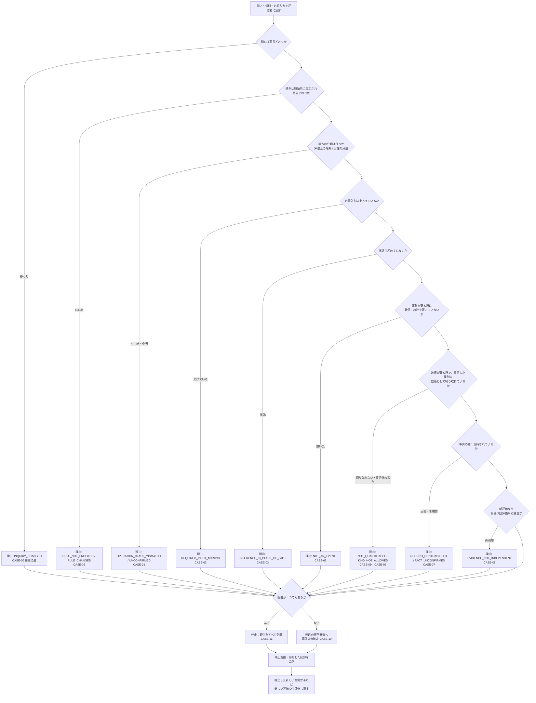
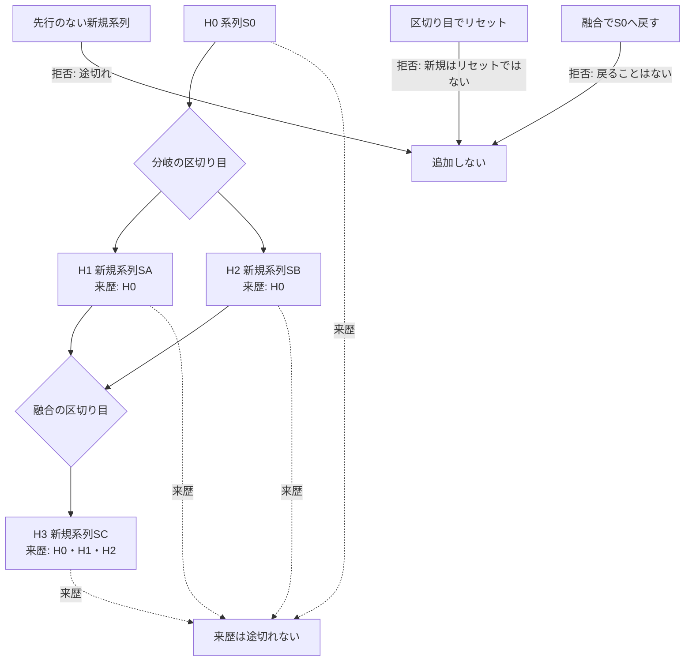
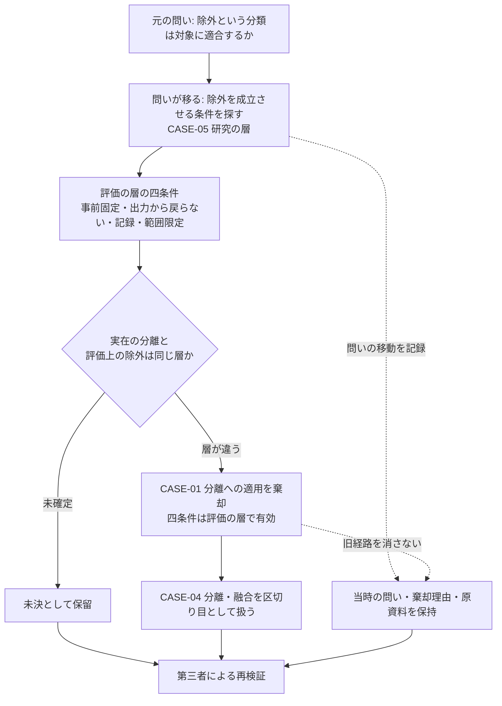
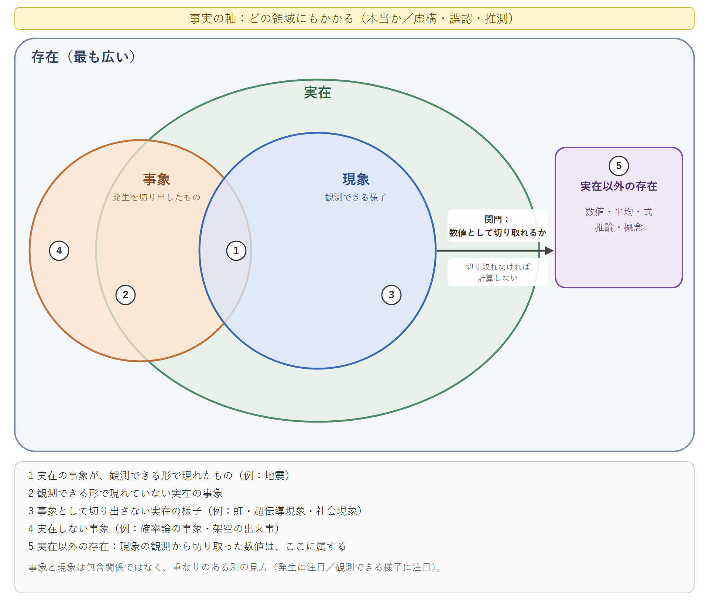

# NRA-IDE 判断経路チャート（二次稿）

- 著者：M-Tokuni
- 作成：2026-11-12 21:53 JST
- 状態：**非正典／二次稿**。論文・参照コードと同じ事例ID（CASE-01〜11）を使う
- 英語版：`NRA_IDE_Judgment_Path_Charts_Draft2_2026_1112_2153_EN.md`
- **注意：図は定義の代わりではない。図の通過は、記録が事実であることや分類が実在に対応することの証明ではない。**

## 図1：判断経路と停止（参照コード `gate` の順序）

**説明**：各判定は最初の1件で打ち切らず、理由を集めてから停止か通過かを決める。止まるのは当該評価だけで、実在の事象・観測・履歴の記録は止まらない。

## 図2：履歴の区切り目（CASE-04）

**説明**：区切り目はあるが途切れない。新規系列の出発点は区切り目の時点で測り、0から始めない。融合は H0 への復帰ではない。図は記録の関係であり、実在の履歴の完全な模型ではない。

## 図3：誤分類の経路と棄却理由の保持（CASE-01・CASE-05）

**説明**：初期考察の四条件は棄却していない。棄却したのは、それを実在の分離へ当てはめたことである。

## 図4：存在・実在・事象・現象・数値の関係（集合図）

**説明**：親子の樹形図ではなく、重なりのある包含で描いた集合図である（Mermaid では描けないため、SVG を原本とする）。

- 存在は最も広く、実在を含む（入れ子）。
- 事象と現象は、一方が他方に含まれず、部分的に重なる。事象は実在の外にもある（確率論の事象・架空の出来事）。現象は、実在が観測できる形で現れた様子なので、実在の内側にある。
- 数値は、存在の内側・実在の外側（実在以外の存在）にある。現象から数値へは関門「数値として切り取れるか」を通る。切り取れなければ計算しない。
- 事実は領域ではなく、図の全体にかかる真偽の軸（図の上部の帯）である。
- 式が立つのは数値（図の5）だけである。数値から事象へ遡って読むと、存在の種類が入れ替わるため、混同はそこで起きる。

図の番号1〜5の意味は、論文 1節の表と図の凡例にある。

## 論文・コード・図の対応

| id | 論文 | 参照コード | 図 |
|---|---|---|---|
| CASE-01 | 6.1 | `OPERATION_CLASS_MISMATCH`（EV-01） | 図1・図3 |
| CASE-02 | 4.2 | `NOT_AN_EVENT`（EV-02）、`KIND_NOT_ALLOWED`（EV-15）。宣言済みなら ELIGIBLE（EV-16） | 図1・図4 |
| CASE-03 | 4.1 | `REQUIRED_INPUT_MISSING`（EV-03）、`INFERENCE_IN_PLACE_OF_FACT`（EV-04） | 図1 |
| CASE-04 | 5 | `HistoryLinks` | 図2 |
| CASE-05 | 6.2 | `INQUIRY_CHANGED`（EV-05） | 図1・図3 |
| CASE-06 | 6.1 | `RULE_NOT_PREFIXED`（EV-06・EV-08）、`RULE_CHANGED`（EV-07） | 図1 |
| CASE-07 | 4.3 | `RECORD_CONTRADICTED`（EV-09） | 図1 |
| CASE-08 | 7.2 | ELIGIBLE（EV-10）、`EVIDENCE_NOT_INDEPENDENT`（EV-11） | 図1 |
| CASE-09 | 3 | `NOT_QUANTIFIABLE`（EV-13） | 図1・図4 |
| CASE-10 | 3 | ELIGIBLE（EV-14） | 図1 |
| CASE-11 | 7.1 | 複数理由（EV-15） | 図1 |

## 画像について

図1〜3の画像は、本ファイルの Mermaid 原稿から描画して同じフォルダに置いている（mermaid-cli 12.2.0）。Mermaid 原稿を正とし、修正したら画像も描き直す。図4は集合図で Mermaid では描けないため、SVG を原本とし、PNG はその描画結果である（2026-11-13 生成）。図1は理由コードの追加（`KIND_NOT_ALLOWED`）に合わせて描き直した（2026-11-13）。一次稿の画像は一次稿の図に対応するもので、二次稿には使わない。

| 図 | 日本語版 | 英語版 |
|---|---|---|
| 図1 判断経路 | `NRA_IDE_Draft2_fig1_route_JP_2026_1112_2153.png/.svg` | `NRA_IDE_Draft2_fig1_route_EN_2026_1112_2153.png/.svg` |
| 図2 履歴の区切り目 | `NRA_IDE_Draft2_fig2_history_JP_2026_1112_2153.png/.svg` | `NRA_IDE_Draft2_fig2_history_EN_2026_1112_2153.png/.svg` |
| 図3 誤分類の経路 | `NRA_IDE_Draft2_fig3_research_path_JP_2026_1112_2153.png/.svg` | `NRA_IDE_Draft2_fig3_research_path_EN_2026_1112_2153.png/.svg` |
| 図4 三層と事実の軸 | `NRA_IDE_Draft2_fig4_three_layers_JP_2026_1112_2153.png/.svg` | `NRA_IDE_Draft2_fig4_three_layers_EN_2026_1112_2153.png/.svg` |

図1は判定ごとに止まる枝を描いているが、実際のゲートは最初の1件で打ち切らず理由を集める（CASE-11）。この点は図では表せていない。
