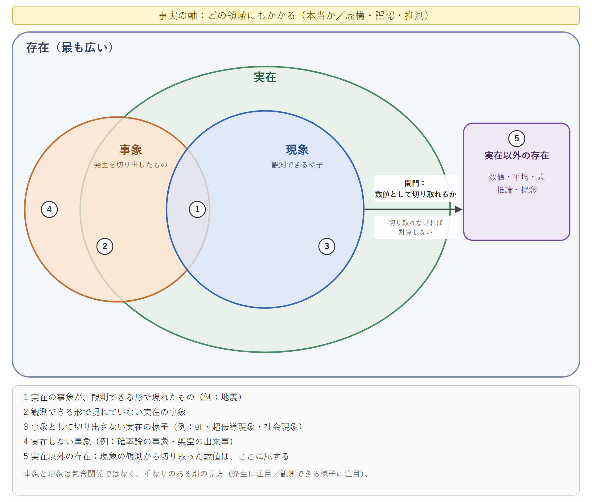

# NRA-IDEにおける存在・事象・数値の層と判断経路
## 「除外」誤分類の検討記録から ― 二次稿

**文書状態：二次稿／非正典／未査読**  
**著者：M-Tokuni**  
**作成：2026年11月12日 21:53 JST**  
**前版：`NRA-IDE 判断経路・三段構成 一次稿/`（2026-11-12 19:04、保存・変更なし）**  
**英語版：`NRA_IDE_Judgment_Path_Paper_Draft2_2026_1112_2153_EN.md`（対で改訂する）**

> **読み方**：本稿は正典の改訂ではない。式（D1）〜（D4）は提案であり、正典の計算式ではない。参照コードと図は本稿と同じ事例IDで結ばれているが、三者が一致することは正しさの証明ではない。

---

## 要旨

本稿は、物理的な分離を評価上の「除外」として説明しようとして起きた誤分類を手がかりに、判断経路の層を整理する。存在（最も広い）、実在の事象と現象（発生と、観測できる様子）、数値（現象の観測から静的に切り取ったもの）の三層を区別し、事実を「本当かどうか」を問う軸として各層に重ねる。事象と現象は包含関係ではなく、重なりのある別の見方として扱う。式が立つのは数値の層だけであり、数値は存在するが、物理的な実在ではない（実在以外の存在である）。この区別から、次の規律を導く。現象を数値として切り取れないなら計算しない。欠損部分を推論で埋めてはいけない。数値から事象へ遡って読まない。履歴には区切り目があるが途切れはなく、新規の系列はリセットではなく、戻ることはない。評価上の除外は評価の層の規則であり、実在の分離とは層が違う。正典（AXIOMS v2.5、FORMULA）との照合状況を節ごとに示し、未照合・未決の項目を残す。

**キーワード**：存在、実在、事象、現象、事実、数値の切り取り、欠損、除外、分離、履歴の区切り目、評価の層、研究の層

---

## 0. 一次稿からの変更点

| id | 変更 | 理由 |
|---|---|---|
| CH-01 | 「事実・事象」の一括表記をやめ、事実（真偽の軸）と事象（発生）を分けた | 語の用途が違う（付録A） |
| CH-02 | 「現実の〜」の大半を「実在の」「物理的な」に置き換えた | 「現実」は目の前の状況の認識を言う語 |
| CH-03 | 型の表（EventReference・Measurement 等を並列）を三層の構造に置き換えた | 層の違うものを並べたため、「事実か」と「数値化できるか」の二本の軸が混ざっていた |
| CH-04 | 平均値の誤りを「事実ではない」から「事実だが事象ではない」に改めた | 計算が正しい平均値は事実である |
| CH-05 | 逆導出A/Bの議論を外し、「欠損部分を推論で埋めてはいけない」の一文にした | 本稿の主題に必要な範囲に限る |
| CH-06 | 研究の層での問いの移動を、逆導出Bと明確に別のものとした | 逆導出Bは同じ評価対象の計器への経路で定義される |
| CH-07 | 履歴を「区切り目はあるが途切れない」で書き直した | 「新規」がリセットと読まれるのを防ぐ |
| CH-08 | 初期考察「除外についての考察」を旧仮説扱いせず、評価の層で成立する考察として位置づけた | 考察本文は分離を扱っていない。誤分類は後の適用で起きた |
| CH-09 | FORMULA §0.5.1〜0.5.4 との照合結果を本文に入れた | 一次稿は照合可能な項目まで未検証としていた |
| CH-10 | 事例IDを CASE-01〜11 に振り直し、論文・コード・図で統一した | 一次稿では三者のIDが一致していなかった |
| CH-11 | 事象と現象を、親子の樹形図ではなく、重なりのある集合図（図4）で表した。事象は実在の下位とは限らないとした（実在しない事象がある） | 現象は事象に含まれず（虹・超伝導現象・社会現象）、事象は実在に限らない（確率論の事象・架空の出来事）。「実在の中で起きた発生」という限定は、使い分けより狭かった |
| CH-12 | 「実在しない存在」「存在するが実在しない」を、「実在以外の存在」「存在するが、物理的な実在ではない」に改めた | 日常の日本語では「実在する」は「実際に存在する」に近く、「存在するが実在しない」は矛盾に読める |
| CH-13 | 付録C（参考技術：イベントソーシング）を追加し、「履歴付き状態変数（仮称）」は別の検討事項ファイルに分けた（B-06） | 既存技術を本稿の定義に混ぜず、未確定の設計候補を辞書・本文に入れないため |
| CH-14 | コードに種別の宣言（`allowed_kinds`）と理由コード `KIND_NOT_ALLOWED` を加え、層の対応と「説明用コード」であることをコメントに書いた | 平均を宣言済みの規則の中で入力に使うことを認める §4.2 と、コードの動作を一致させるため。統計値を `NOT_QUANTIFIABLE` と呼ぶ名前の不一致も解消 |

## 1. 語の使い分け

| id | 語 | 核心 | 本稿での使い方 |
|---|---|---|---|
| T-01 | 事実 | 本当かどうか（対：虚構・誤認・うわさ） | どの層にもかかる真偽の軸 |
| T-02 | 事象 | 発生・生起。分析・処理の対象として切り出した出来事 | 第二層。本稿が扱うのは実在の事象。実在しない事象（確率論の事象・架空の出来事）もある |
| T-03 | 現象 | 顕在化・観測可能性。目に見える働き・様子 | 第二層。実在が観測できる形で現れたもの。事象に含まれるとは限らない |
| T-04 | 現実 | 目の前の状況の認識 | 本稿では術語として使わない（「現実的制約」など一般語のみ） |
| T-05 | 実在 | 物理的・客観的に本物か。あるかないか（狭い） | 物理的に本物として起きた・あること |
| T-06 | 存在 | 物理・数学・観念・過去・未来を含む上位概念（量子学・仏教のレベルで広い） | 第一層。律環公理「存在は生成である。」の存在 |

図4は集合図である。親子の樹形図ではなく、重なりのある包含で描く。

- 存在は最も広く、実在を含む（入れ子）。
- 事象と現象は、一方が他方に含まれるのではなく、部分的に重なる。
- 事象は実在の下位に限らない。実在の外にも事象がある。
- 現象は、実在が観測できる形で現れた様子なので、実在の内側にある。
- 数値は、存在の内側・実在の外側（実在以外の存在）にある。現象から数値へは関門を通る（3節）。
- 事実は領域ではなく、図の全体にかかる真偽の軸である（図の上部の帯）。

| 図の番号 | 領域 | 例 |
|---|---|---|
| 1 | 実在の事象が、観測できる形で現れたもの | 地震 |
| 2 | 観測できる形で現れていない実在の事象 | — |
| 3 | 事象として切り出さない実在の様子 | 虹・超伝導現象・社会現象 |
| 4 | 実在しない事象 | 確率論の事象・架空の出来事 |
| 5 | 実在以外の存在 | 数値・平均・式・推論・概念 |

**例**：「地震が起きた」という事実を確認する。「地震」という物理事象のエネルギーを計算する。「地震」という自然現象のメカニズムを説明する。

## 2. 三層：存在・事象・数値

### 2.1 第一層：存在

存在は最も広い。実在するものだけでなく、数・式・概念・過去・未来も存在に含まれる。実在の外にも存在がある（実在以外の存在）。律環公理「存在は生成である。」（AXIOMS §2）の存在は、この広い意味で読む。

### 2.2 第二層：実在の事象と現象

事象は、発生・生起を、分析・処理の対象として切り出したものである。本稿が扱うのは、実在の中で起きた事象（実在の事象）であり、分離・融合・破断・付加・除去がこれにあたる。確率論の事象や架空の出来事のように、実在しない事象もある。

現象は、実在が観測できる形で現れた様子である。虹、超伝導現象、社会現象のように、一つの事象として切り出さない現象がある。逆に、観測できる形で現れない実在の事象もある。事象と現象は、一方が他方に含まれる関係ではなく、「発生に注目するか」「観測できる様子に注目するか」という、重なりのある別の見方である（図4）。同じ地震を、事象としてそのエネルギーを計算することも、現象としてそのメカニズムを説明することもできる。

どちらも数値化が難しい。起きている事象や現象の全体を、一つの数値で表すことはできない。

### 2.3 第三層：数値

数値は、現象の観測から静的に切り取ったものである。状態と存続のあいだを一点で切り取ったものが数値であり、切り取りが連続すると数値の変動になる。ここで初めて計算ができる。

数値は存在するが、物理的な実在ではない（実在以外の存在である）。計器が20 mmを示したことは事実であり得るが、「20」そのものが物理的な実体として実在するわけではない。

**正典との照合（照合済み）**：AXIOMS §2 は「存在は静的実体ではなく、履歴を伴って連続する生成である。静止は生成過程の一時的切り取りにすぎず」とする。数値を静的な切り取りとする本稿の見方は、これに対応する。FORMULA §0.5.2 は、更新番号 $n$ を「事象の順序」とし、観測事象 $\mathrm{Ev}_n$ の値 $o_n$ を射影規則 $\sigma$ で $\delta_n$ へ移す。$\delta_n$ の列が、本稿でいう切り取りの連続にあたる。どの切り取りを使うかは評価宣言 $\mathsf{Decl}$ と $\sigma$ が固定し、宣言の異なる評価は比較しない（FORMULA §0.5.1）。同じ事象でも、切り取り方が違えば別の評価になる。

### 2.4 事実の軸

事実は層ではなく、各層に重なる真偽の軸である。「その事象は本当に起きたか」「その数値は本当に示されたか」「その計算は正しいか」は、どれも事実の問いである。事実でないものは、虚構・誤認・うわさ・推測である。記録であることや数値であることは、事実でないことを意味しない。

**正典との照合（照合済み）**：辞書・FORMULA §0.5.2 の「観測事象（型：事象の記録）」は、事象を処理の対象として切り出したものという T-02 の用法に合う。問うべきは「記録か事象か」ではなく、「その事象は事実か」である。

## 3. 第二層から第三層への関門：数値として切り取れるか

目の前の現象を、数値として切り取れるとは限らない。切り取れないなら、計算しない。代わりの数値を置いて計算を進めない。

**正典との照合（照合済み・部分）**：FORMULA §0.5.2 は、対象・単位・時点・出所のいずれかが不明な事象、値が不正または非有限な事象を一次式へ入れず `CONFESSION` とし、観測チャネルから値が得られないだけの場合は `NOT_OBSERVABLE` と欠損理由を示す。本稿の関門（参照コードの `NOT_QUANTIFIABLE`・`KIND_NOT_ALLOWED`）と正規状態との対応は、次のように読める。

| id | 関門で止まる状況 | 対応する正典の扱い | 状態 |
|---|---|---|---|
| G-01 | 観測経路から値が得られない | `NOT_OBSERVABLE`＋欠損理由 | 照合済み |
| G-02 | 値はあるが単位・対象・出所が不明、または非有限 | `CONFESSION` | 照合済み |
| G-03 | 現象の様子の記述はあるが、数値の切り取りがない | 正典に直接の規定なし | 未照合 |

理由コードは正規状態名ではない。正規状態への写像は、評価宣言の欠測処理（FORMULA §0.5.1）に従う。

## 4. 第三層の中の規律

### 4.1 欠損部分を推論で埋めてはいけない

必須の入力が欠けているとき、推論で埋めない。推論は存在するが、物理的な実在ではない。推論を事実の位置に置けば、事実でないものが計算の前提になる。欠けているものは欠けたまま扱い、依存する計算を止める。

必須の値が、既知の公理・定義・規則から厳密に計算できる場合は、穴埋めではない（中間考察 1604 §4 事例D）。ただし、その計算を実在の事象へ当てはめてよいかは、別に確かめる。

### 4.2 数値から事象へ遡って読まない

数値（第三層）から事象（第二層）へ遡るとき、存在の種類が入れ替わる。混同はここで起きる。

10・20・30の平均は20である。この計算が正しければ、「平均が20である」は事実である。しかし平均20は物理的な実在ではなく、事象でもない。どこかの時点・対象で「20」という発生が起きたわけではない。誤りは「実在以外の存在を、実在の事象として扱う」ことである。

平均を事前に固定した射影規則の中で中途計算に使うことは、これとは別であり、妨げない。判定の主語は一次式の比であり、平均ではない。参照コードでは、数値の入力に入れてよい種別を評価前に宣言する（`allowed_kinds`）。宣言のない平均を数値の入力に入れると `KIND_NOT_ALLOWED` で止め、宣言済みなら通す。通っても、平均が一回の事象になるわけではない。事象の位置に置けば、CASE-02 として止まる。

### 4.3 一次資料と事実の軸

論文が一次資料であっても、その主張が正しいとは限らない。「論文がその主張を公表した」ことと、「その主張が正しい」ことは、別の事実の問いである。主張が後に反証されても、公表されたという記録は残す。記録を常に無制限に保持できるという保証はなく、法令・権限・保持期間の制約は別に扱う。

## 5. 履歴の区切り目：区切り目はあるが途切れない

### 5.1 三つの規律

1. **途切れない**：分岐・融合は履歴の区切り目である。区切り目の後も、履歴は区切り目より前とつながっている。
2. **新規はリセットではない**：区切り目から各構成の新規系列が始まる。新規系列は、区切り目より前の履歴を来歴として受け継ぐ。区切り目より前に生じた変化（残留ズレ・劣化を含む）を持ち越し、0から始めない。出発点の状態は区切り目の時点で測る。
3. **戻ることはない**：融合・再接合・外した要素を再び付けることは、区切り目より前の状態への復帰ではなく、新しい区切り目である。

過去は今は実在しなくても、存在として消えない。区切り目の規律は、このことの言い換えである。

### 5.2 履歴グラフ（提案式）

$$
G_H=(V_H,E_H) \tag{D1}
$$

$V_H$ は区切り目と系列の記録、$E_H$ は先行・継承の関係である。共有された来歴を重複して数えないため、系列の算術和では表さない。

$$
H_0\xrightarrow{\mathrm{split}}(H_1,H_2),\qquad
(H_1,H_2)\xrightarrow{\mathrm{merge}}H_3,\qquad
\mathrm{Lineage}(H_3)\supseteq\{H_0,H_1,H_2\} \tag{D2}
$$

（D2）は先行・継承関係の図式であり、履歴の演算を定義するものではない。$H_3$ は $H_0$ への復帰ではない。

### 5.3 正典との照合

| id | 本稿 | 正典 | 状態 |
|---|---|---|---|
| H-01 | 新規はリセットではない | τ非自然回復（AXIOMS §7）、復元劣化（§8）。$\lambda$ と $p$ は評価中に減らない（FORMULA §0.5.3–0.5.4） | 照合済み・整合 |
| H-02 | 出発点を区切り目の時点で測る | 付加した要素の $\tau^{[e]}_0$ は加えた時点のCause-Side測定で定める（FORMULA §0.5.4） | 照合済み・整合 |
| H-03 | 戻ることはない | 外した要素を戻すときは改めて付加として扱う（辞書「構造要素の除去」） | 照合済み・整合 |
| H-04 | 分離は実在の事象 | 構造要素の除去は $\mathsf{Active}_n$ の更新として事象に記録する（FORMULA §0.5.3–0.5.4）。評価上の不採用ではない | 照合済み・整合 |
| H-05 | 分離では両方の枝に後続がある | 正典は評価対象の側だけを扱い、外れた側の後続を追う規定を持たない（否定もしない） | 正典の規定外 |
| H-06 | 融合で新規系列が始まる | 付加は評価の中で $\mathsf{Active}_n$ を更新する。新規計算になるのは直列 $\min_e$ で除去を扱う場合の宣言変更 | 未決（系列の新規と計算の新規を分けて書く必要） |

## 6. 評価の層と研究の層

### 6.1 評価上の除外（評価の層）

除外とは、取得済みの観測値を「今回の計算には含めない」と評価前に宣言することである。観測値が取得されたことは事実のまま残る。初期考察「除外についての考察」（2026-11-12）が示した四条件は、評価の層の規則として成立する。

| id | 条件 | 正典との関係 |
|---|---|---|
| X-01 | 基準を評価前に固定する | 評価宣言は評価の結果で書き換えない（FORMULA §0.5.1） |
| X-02 | 評価の出力から基準へ戻る経路を作らない | AXIOMS §14 |
| X-03 | 除外した観測値を記録に残す（「偽だった」ではなく「今回は使わない」） | 初期考察の提案 |
| X-04 | 結論の範囲を使った観測値に限る | 初期考察の提案 |

欠損と除外は、計算から見れば同じ穴だが、記録は別勘定にする。欠損は取得できなかったもの、除外は取得できたが使わないと宣言したものである（初期考察 §4）。同じ観測値が繰り返し除外されることに気づけるよう、累計除外回数を持つ（初期考察 §5）。

**層の違い**：評価上の除外は評価の層の操作であり、実在の分離（第二層の事象）とは層が違う。分離を除外の例として扱い始めた時点で、分類を見直すべきであった（CASE-01）。

### 6.2 研究の層での問いの移動

検討の途中で、問いが「分類Xは対象に適合するか」から「分類Xを成立させる条件は何か」へ移ることがある。これは研究の層で起きる移動である。

逆導出Bは「評価出力から、同じ評価対象の計器へ戻る経路」として定義される（AXIOMS §14）。研究の層で問いが移ることは、この定義に当たらない。両者は似て非なるものであり、明確に別である。本稿は研究の層の移動を逆導出と呼ばない。

研究の層の規律として、問いが移ったときは移ったことを記録し、新しい問いとして扱う。元の問いが達成されたことにはしない。仮説の修正や新しい問いの発見そのものは妨げない。

なお、評価の層で、除外基準のような評価規則を前回の評価出力を見て変えることは、6.1 の X-02 に反する。研究の層の移動とは別の問題である。

## 7. 停止と新評価

### 7.1 停止の範囲

必須の根拠が欠けているとき、止めるのはその根拠に依存する計算と結論の確定だけである。実在の事象は計算の停止と関係なく進む。観測、記録、独立に可能な計算、履歴の保存は続ける。停止は「対象が存在しない」ことの証明ではない。

$$
\neg\mathrm{Established}(P_j)\Longrightarrow\mathrm{StopDependentEvaluation}(j) \tag{D3}
$$

### 7.2 新評価

停止した評価を、後から得た根拠で「成功」に書き換えない。新しい評価IDで評価し直し、旧評価へ接続する。

**正典との照合（照合済み）**：FORMULA §0.5.1 は「$\mathsf{Decl}$ は評価の結果によって書き換えない。事後の検証結果は、当該評価の前件を遡及的に書き換えず、次の評価スナップショットへ反映する」とする。本節はこれと同じ原則である。

$$
\mathrm{Established}(P'_k)\land
\bigl(\mathrm{Closure}(F_k)\cap\mathrm{Consulted}(j)=\varnothing\bigr)\land
\mathrm{DeclaredBeforeEvaluation}(k)
\Longrightarrow\mathrm{EligibleToStart}(k) \tag{D4}
$$

$F_k$ は新評価 $k$ の根拠、$\mathrm{Closure}$ はその依存先すべて、$\mathrm{Consulted}(j)$ は旧評価 $j$ が参照した記録である。新しい根拠が旧根拠の再引用であれば独立ではない（CASE-08）。（D4）は審査へ進める条件であり、実行の許可や不可逆状態の解除を意味しない。

## 8. 記録の最小単位

| id | フィールド | 意図 |
|---|---|---|
| F-01 | `case_id`・`evaluation_id` | 事例と評価を特定する。新評価は新ID |
| F-02 | `inquiry` | 研究の層の問い。移ったら新しい問いとして記録 |
| F-03 | `rule_id`・`rule_version`・`declared_at` | 評価の層の規則と、その固定時刻 |
| F-04 | `kind` | 事象の記録・数値・統計・推論・操作申告 |
| F-05 | `support` | 事実の軸（支持・反証・未確認） |
| F-06 | `subject`・`unit`・`source` | 何についての、どの単位の、どこからの記録か |
| F-07 | `dependencies` | 根拠の依存。独立性の判定に使う |
| F-08 | `previous_evaluation_id` | 旧評価との接続 |
| F-09 | `series_id`・`boundary`・`predecessor_ids`・`start_basis` | 履歴の区切り目と来歴 |

記録は追記のみとし、訂正は新しい記録として加える。

## 9. 事例

論文・参照コード・図で同じIDを使う。

| id | 状況 | 期待する判定（コードの理由コード） | 節 | 図 |
|---|---|---|---|---|
| CASE-01 | 評価上の除外を、実在の分離として扱う | 停止（`OPERATION_CLASS_MISMATCH`） | 6.1 | 図1・図3 |
| CASE-02 | 平均値を事象として扱う／宣言のない種別（平均など）を数値の入力に入れる | 停止（`NOT_AN_EVENT`／`KIND_NOT_ALLOWED`）。宣言済みなら数値の入力として通る | 4.2 | 図1・図4 |
| CASE-03 | 必須入力が欠けている／推論で埋めた | 停止（`REQUIRED_INPUT_MISSING`／`INFERENCE_IN_PLACE_OF_FACT`） | 4.1 | 図1 |
| CASE-04 | 分岐・融合の区切り目 | 来歴を保持、途切れ・リセット・復帰を拒否 | 5 | 図2 |
| CASE-05 | 研究の層で問いが移る | 停止し新しい問いとして記録（`INQUIRY_CHANGED`） | 6.2 | 図1・図3 |
| CASE-06 | 規則が評価開始前に固定されていない／宣言と違う規則で実行 | 停止（`RULE_NOT_PREFIXED`／`RULE_CHANGED`） | 6.1 | 図1 |
| CASE-07 | 誤りを含む一次資料 | 主張は停止（`RECORD_CONTRADICTED`）、公表の記録は保持 | 4.3 | 図1 |
| CASE-08 | 停止後に新しい根拠が届く | 独立なら審査へ、再引用なら停止（`EVIDENCE_NOT_INDEPENDENT`） | 7.2 | 図1 |
| CASE-09 | 現象の様子はあるが数値の切り取りがない | 停止（`NOT_QUANTIFIABLE`） | 3 | 図1 |
| CASE-10 | 事象の記録と数値がそろっている | 後段の専門審査へ（真偽は未確定） | 3 | 図1 |
| CASE-11 | 複数の不備が同時にある | 理由をすべて列挙して停止 | 7.1 | 図1 |

**検証上の制約**：コードの試験が通っても、宣言された条件をコードが満たすことの一部確認にすぎない。記録が事実か、分類が実在に対応するかを、試験は証明しない。

## 10. 正典との照合状況

| id | 照合先 | 状態 | 本文 |
|---|---|---|---|
| K-01 | AXIOMS §2 律環公理の「存在」、「静止は生成過程の一時的切り取り」 | 照合済み（広い意味で読む。切り取りの見方と対応） | 2.1, 2.3 |
| K-02 | FORMULA §0.5.1 評価宣言の固定と事後結果の扱い | 照合済み | 2.3, 6.1, 7.2 |
| K-03 | FORMULA §0.5.2 観測事象・射影・CONFESSION・NOT_OBSERVABLE | 照合済み（一部未照合：G-03） | 2.3, 2.4, 3 |
| K-04 | FORMULA §0.5.3–0.5.4 構造要素の付加・除去、$\mathsf{Active}_n$ | 照合済み（H-05 は正典の規定外、H-06 は未決） | 5.3 |
| K-05 | AXIOMS §7・§8 | 照合済み | 5.3 |
| K-06 | AXIOMS §14 逆導出の定義 | 照合済み（研究の層の移動は該当しない） | 6.2 |
| K-07 | AXIOMS §2 履歴非同一性・§4 履歴蓄積と、区切り目の規律 | 未照合 | — |
| K-08 | AXIOMS §11「欠損情報」が除外を含むか | 未照合（初期考察 §7） | — |

## 11. 未決事項

| id | 項目 |
|---|---|
| U-01 | 分離・融合の成立条件。単なる接触・関係の変化・構造要素の除去との違い |
| U-02 | 系列の新規と計算の新規の関係（H-06） |
| U-03 | 現象の様子を数値に切り取れない場合の正規状態への写像（G-03） |
| U-04 | 除外が回復の裏口になる懸念：蓄積したズレに寄与する観測値を外すと比が下がって見える（初期考察 §6-1） |
| U-05 | 危険側の除外の非対称：比を小さく見せる除外に追加条件が要るか（初期考察 §6-4） |
| U-06 | 基準の境界付近の幅（初期考察 §6-5） |
| U-07 | 除外の規則と台帳そのものを除外の対象外として固定すること（初期考察 §6-6） |
| U-08 | 根拠の独立性の定義。本稿は依存先の重なりだけで判定しており、同一の情報源から別経路で得た記録は検出しない |
| U-09 | 「履歴付き状態変数（仮称）」の採否・名称・構造。既存の対象状態・評価状態・経路履歴との重なりを最初に確かめる（B-06 の Q-01） |

## 12. 結論

存在・事象・数値は層が違い、事実はそのすべてにかかる真偽の軸である。式が立つのは数値の層だけであり、数値は存在するが、物理的な実在ではない。事象と現象は包含関係ではなく、重なりのある別の見方である。現象を数値として切り取れないなら計算しない。欠損部分を推論で埋めてはいけない。数値から事象へ遡って読まない。履歴には区切り目があるが途切れはなく、新規はリセットではなく、戻ることはない。評価上の除外は評価の層の規則であり、実在の分離とは層が違う。研究の層で問いが移ることは逆導出とは別のものであり、移ったことを記録して新しい問いとして扱う。

---

## 付録A：用語

| id | 語 | 英語 | 意味 | 混同してはならないもの |
|---|---|---|---|---|
| A-01 | 事実 | fact | 本当かどうか。全層にかかる軸 | 記録であること・数値であること |
| A-02 | 事象 | event | 発生を分析の対象として切り出したもの。実在の事象のほか、実在しない事象（確率論の事象・架空の出来事）がある。本稿が扱うのは実在の事象 | 数値・統計・推論。現象（包含関係ではなく、重なりのある別の見方） |
| A-03 | 現象 | phenomenon | 実在が観測できる形で現れた様子。事象に含まれるとは限らない（虹・超伝導現象・社会現象） | 数値（切り取りの後のもの）。事象の下位概念 |
| A-04 | 現実 | （固定訳なし） | 目の前の状況の認識 | 実在 |
| A-05 | 実在 | reality | 物理的・客観的に本物としてあること | 存在（より広い） |
| A-06 | 存在 | existence | 物理・数学・観念・過去・未来を含む上位概念 | 実在 |
| A-07 | 数値の切り取り | numeric cut | 現象の観測から静的に切り取った値。連続すると変動になる | 事象 |
| A-08 | 区切り目 | boundary | 分岐・融合などで新規系列が始まる点。履歴は途切れない | 履歴の断絶・リセット |
| A-09 | 来歴 | lineage | 区切り目を越えて受け継がれる先行の履歴 | 新規系列の初期化 |
| A-10 | 評価上の除外 | evaluation exclusion | 取得済みの観測値を今回の計算に含めないと評価前に宣言すること | 実在の分離、欠損 |
| A-11 | 停止 | stop | 欠けた根拠に依存する計算と結論の確定を止めること | 実在の事象の停止、非存在の証明 |
| A-12 | 実在以外の存在 | existence other than reality | 存在のうち、実在を除いた部分。数・式・平均・推論・概念。数値の切り取りもここに属する | 「実在しない＝存在しない」という読み方 |

英語では reality が「現実」と「実在」の両方を含むため、英文で「現実」の意味に reality を使わない。actuality は使わない。

## 付録B：参照資料

| id | 資料 | 扱い |
|---|---|---|
| B-01 | 初期考察「除外についての考察」（2026-11-12、M-Tokuni） | リポジトリ外。評価の層の考察として参照（6.1） |
| B-02 | `nra-core/foundations/NRA-IDE：事象の分岐・融合と計算成立境界（定義検討記録）2026-1112-1604.md` | 中間考察。事例D・照合課題を参照 |
| B-03 | `NRA-IDE 判断経路・三段構成 一次稿/`（2026-11-12 19:04） | 前版。変更点は 0節 |
| B-04 | `theory/AXIOMS.md` v2.5 §2・§7・§8・§14、`FORMULA.md` §0.5.1–0.5.4 | 照合先（2026-11-12 にリポジトリ内で照合） |
| B-05 | `local_reports/2026-11-12_judgment_path_term_alignment.md` | 語の照合表 |
| B-06 | `nra-core/foundations/NRA-IDE：履歴付き状態変数（仮称）の検討事項（設計候補・未確定）2026-1112-2319.md` | 8節の記録の最小単位と関係する未確定の設計候補（付録C） |

## 付録C：参考技術 ― イベントソーシング（Event Sourcing）（参考・参照先）

追記：2026-11-12 23:19 JST。本付録は本稿の主張の根拠ではなく、8節の記録の設計を考えるときの参考である。

**分類：既存技術（ソフトウェアアーキテクチャ）。NRA-IDEの定義ではない。**

**定義**：アプリケーションの状態変更を、イベントとして順次記録し、その記録を処理することで対象の状態を再構成する設計手法。イベントの記録は原則として追記方式で保持し、過去の状態変更を直接上書きせず、訂正や取り消しも新しいイベントとして記録する。

**主な構成要素**：ドメインイベント（状態変更を表す記録）、イベントストア（イベントを永続保存する記録領域）、イベントストリーム（対象ごとのイベントの順序付き系列）、プロジェクション（イベントの系列から導出される状態や参照用データ）、リプレイ（イベントを再処理して状態を再構成する操作）。

**適用上の境界**

1. 記録されるイベントは、実在の事象そのものではなく、ソフトウェア内部のイベントオブジェクト（記録）である。
2. 記録の存在は、その記録が主張する事象が事実であることを保証しない。
3. イベントの完全な保存も、観測されなかった実在の事象まで保存できたことを意味しない。

**本稿との関係**：追記のみの保存（8節）、訂正を新しい記録として加えること（4.3、8節）、依存先をたどる再検証（7.2）の実装上の参考になる。ただし、本稿の事象・存在・履歴の区切り目（2節、5節）と同一の概念ではない。イベントソーシングでは、イベントストアがシステム内の正式な情報源（system of record）になる。この説明を、「記録は事象を指すものであり、事象そのものではない」という本稿の見方（2.2、2.4）へ直接置き換えない。

**参照先**

| id | 資料 | 確認した内容（2026-11-12） |
|---|---|---|
| C-01 | Microsoft Learn, "Event Sourcing Pattern - Azure Architecture Center"（ページ内の更新日 2026-09-25） https://learn.microsoft.com/en-us/azure/architecture/patterns/event-sourcing | 追記のみのストアに行為の系列を保存すること、イベントの不変性、イベント列の再生による状態の再構成、訂正は補償イベントで行うこと。誤ったイベントが残ること、スキーマ変更が難しいことが課題として書かれている |
| C-02 | Martin Fowler, "Event Sourcing"（2005-12-12） https://martinfowler.com/eaaDev/EventSourcing.html | 定義の一文 "Capture all changes to an application state as a sequence of events." を確認した。対象はアプリケーションの状態変更である |

確認したのは上記ページの記述の範囲である。両資料とも、実在の事象の全履歴を観測・保存する理論ではない。

関連する未確定の設計候補「履歴付き状態変数（仮称）」は、B-06 の検討事項に分けて記録した。名称も未確定のため、辞書には載せていない。
