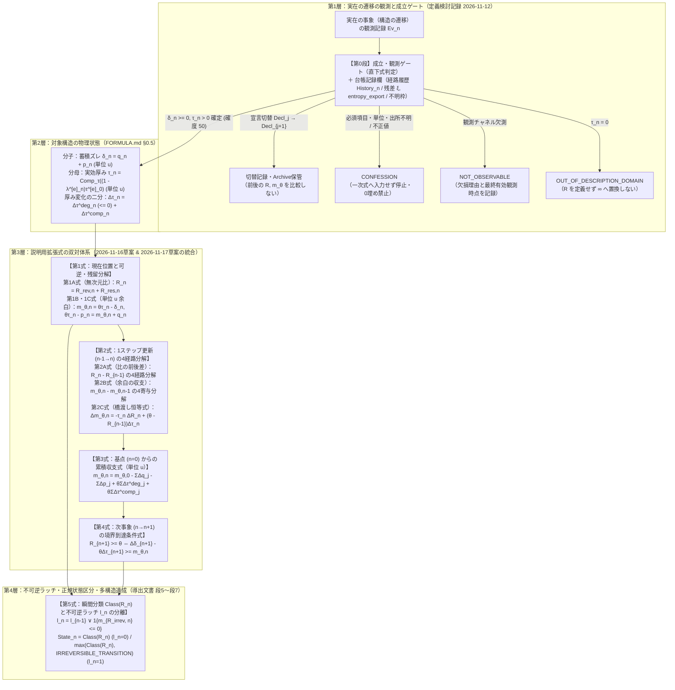

# NRA-IDE 説明用拡張式体系 — 基礎式からの双対展開と境界・履歴の定式化

> **位置付け**：本書は、正典（[theory/AXIOMS.md](../../theory/AXIOMS.md) v2.5、[FORMULA.md](../../FORMULA.md) v2.2）、[theory/NRA-IDE_Primary_Formula_Derivation_Bilingual.md](../../theory/NRA-IDE_Primary_Formula_Derivation_Bilingual.md) v1.1、および [dictionary/NRA-IDE_Dictionary_JP.md](../../dictionary/NRA-IDE_Dictionary_JP.md) に準拠し、先行する [開放系_境界接近比の増分分解_論文草案_2026-11-16.md](./開放系_境界接近比の増分分解_論文草案_2026-11-16.md)（無次元比 $R_n$ の展開）と [境界余白の収支による説明用拡張式_2026-11-17.md](./境界余白の収支による説明用拡張式_2026-11-17.md)（単位 $u$ の閾値余白 $m_{\theta,n}$ の展開）を、1つの双対的な説明用拡張式体系として統合した参照文書である。
> 数式の移項・通分・符号・入れ子に関する配置規則は、辞書置き場の [NRA-IDE数式配置の5大鉄則（式の文法）.md](../../dictionary/NRA-IDE数式配置の5大鉄則（式の文法）.md) に従う。唯一の律環公理、一次式、二次式、正規状態、閾値、不可逆ラッチを変更しない。

---

## 1. 数式の前に置く全体体系図（4階層×2座標系×4時間断面）

基礎式 $R_n = \delta_n/\tau_n$ は最小表現であるため、1本の式だけで「内訳・経過・余白・境界到達・履歴ラッチ・不明の遮断」をすべて説明しようとすると文面の補足が肥大化する。そこで、数式を提示する前に以下の**4階層フロー図**と**双対配置表**によって各式の役割分担を固定する。



| 説明したい問い（時間断面と役割） | 無次元比の座標系（$R_n$ 空間：比率の位置） | 単位 $u$ の座標系（$m_{\theta,n}$ 空間：閾値 $\theta$ までの余白収支） |
|---|---|---|
| **0. 計算に入れてよいか（入口ゲート）** | 【第0段】直下式ゲート判定＋台帳記録欄（`CONFESSION` / `NOT_OBSERVABLE` / `OUT_OF_DESCRIPTION_DOMAIN` の分離） | 同左（評価宣言 $\mathsf{Decl}_j$ の同一性もここで確認） |
| **1. いまどこか・作用を除けばどこまで戻るか（現在 $n$）** | **第1A式**：$R_n = R_{\mathrm{rev},n} + R_{\mathrm{res},n}$ | **第1B・1C式**：$m_{\theta,n} = \theta\tau_n - \delta_n$、$\theta\tau_n - p_n = m_{\theta,n} + q_n$ |
| **2. 直前の更新で何が効いたか（$n-1 \to n$）** | **第2A式**：$R_n - R_{n-1}$ の4経路分解（11/16草案 式3） | **第2B式**：$m_{\theta,n} - m_{\theta,n-1}$ の4寄与分解（11/17草案 式9）<br>**第2C式**：両者を結ぶ橋渡し恒等式 |
| **3. 基点から何が積み上がったか（$0 \to n$）** | （分母 $\tau_j$ が動くため各ステップの比の列として保持） | **第3式**：初期余白 $m_{\theta,0}$ からの4寄与の累積収支（単位 $u$ で完全加法） |
| **4. 次の事象でいつ境界に達するか（$n \to n+1$）** | $R_{n+1} \ge \theta$ | **第4式**：$\Delta\delta_{n+1} - \theta\Delta\tau_{n+1} \ge m_{\theta,n}$ |
| **5. 余白が正に戻っても制限が続くのはなぜか（履歴と状態）** | **第5式**：瞬間分類 $\mathrm{Class}(R_n)$ と不可逆ラッチ $\ell_n = \ell_{n-1} \lor \mathbf{1}\{m_{R_{\mathrm{irrev}},n} \le 0\}$ による正規状態 $\mathsf{State}_n$ の決定 |

---

## 2. NRA-IDE完全準拠・説明用拡張式体系

### 2.0 前提と差分の向き（1回のみ固定）
- 同一の評価宣言 $\mathsf{Decl}_j$ 内の構造更新番号 $n$（$n=1,2,\dots$、評価開始時の基点は $n=0$）を扱う。
- 演算子 $\Delta$ はすべて**後退差分** $\Delta x_n = x_n - x_{n-1}$（現在値 $-$ 直前値）を表す（[NRA-IDE_Dictionary_JP.md](../../dictionary/NRA-IDE_Dictionary_JP.md) §2.4）。したがって、量が増えれば正（$>0$）、減れば負（$<0$）となる。

---

### 2.1 【第0段】計算成立・観測ゲートと「残差・不明」の台帳分離（直下式）

実在の事象（構造の遷移）を二次的手段として観測した記録 $\mathrm{Ev}_n$ に対し、物理状態・評価状態・経路履歴・残差・不明を1つの数値に混ぜず、以下の**名前付き記録欄（台帳）**に分離して保持する（辞書「[判定用十分状態](../../dictionary/NRA-IDE_Dictionary_JP.md#decision-sufficient-state)」$Z_n$ の拡張記録）。

```text
【更新番号 n の台帳記録欄】
  - declaration_id          : 評価宣言識別子 Decl_j（基準状態・破断様式・単位 u・σ・Alloc・Comp_τ・閾値を固定）
  - event_history           : 経路履歴 History_n = History_{n-1} ⊕ Ev_n（追記のみ、順序と形を保持）
  - target_physical_state   : 対象状態 Phys_n = (q_n, p_n, (λ^[e]_n)_{e ∈ Active_n})
  - evaluation_state        : 評価状態（不可逆ラッチ l_n = irreversible_latched）
  - uncarried_remainder     : 離散遷移で持ち越さない残差 entropy_export（AXIOMS §4.5）および補完式残差 ξ_n（FORMULA §5）
  - required_unknowns       : 計算に必須だが未確定の項目集合（確度 < 50：0や推論値での穴埋め厳禁）
  - declared_out_of_scope   : 評価宣言で考慮不要（対象外）と明示した項目集合
```

各更新番号 $n$ では、数式へ値を代入する前に次の**直下式命令（1番号＝1条件＝1遷移）**を上から順に実行する。

```text
10 対象・単位・評価宣言 Decl_j・固定閾値 θ の対応を確認する。
11 IF 比較する評価宣言が異なる (Decl_j != Decl_{j-1}): GOTO 90
20 IF 必要な対象・単位・出所・時点・ドメイン規則が不明（required_unknowns ≠ 空）: GOTO 91
30 IF 既知の入力に不正値・非有限値・負値（δ < 0 または τ < 0）がある: GOTO 91
40 IF 必要な観測チャネルから値が得られない（欠測）: GOTO 92
50 IF 実効厚みが 0 (τ_n = 0): GOTO 93
60 確定した δ_n >= 0, τ_n > 0（確度 50）を用いて第1式〜第5式を計算する。GOTO 99
90 評価宣言の切替（Decl_j → Decl_{j+1}）として記録し、前後の R・m_θ を比較・減算しない。END
91 CONFESSION を出力する。影響する計算を停止し、値を推論で補完しない（ラッチ l は保持）。END
92 NOT_OBSERVABLE と欠損理由・最終有効観測時点を記録する。0・安定・安全で補完しない。END
93 OUT_OF_DESCRIPTION_DOMAIN を出力する。R を定義せず、∞ や RUPTURE_BOUNDARY へ置換しない。END
99 END
```

---

### 2.2 【第1式】現在位置の双対表現（無次元比 $R_n$ と 単位 $u$ の閾値余白 $m_{\theta,n}$）

`FORMULA.md` §0.5 の定義
$\delta_n = q_n + p_n\ (q_n, p_n \ge 0)$、
$\tau_n = \mathrm{Comp}_\tau\bigl((\tau^{[e]}_n)_{e\in\mathsf{Active}_n}\bigr)\ (\tau^{[e]}_n = (1-\lambda^{[e]}_n)\tau^{[e]}_0)$
および固定閾値 $\theta \in \{R_{\mathrm{warn}}, R_{\mathrm{handoff}}, R_{\mathrm{irrev}}, 1.0\}$ に対し、次が成り立つ。

$$
\boxed{
\begin{aligned}
\text{【第1A式：境界接近比の可逆・残留分解（無次元）】}\quad
R_n &= \frac{\delta_n}{\tau_n}
= \underbrace{\frac{q_n}{\tau_n}}_{R_{\mathrm{rev},n}\text{（可逆接近分）}}
+ \underbrace{\frac{p_n}{\tau_n}}_{R_{\mathrm{res},n}\text{（残留接近分）}} \\[8pt]
\text{【第1B式：閾値余白（単位 }u\text{）】}\quad
m_{\theta,n} &= \theta\tau_n - \delta_n = \theta\tau_n - q_n - p_n = \tau_n(\theta - R_n) \\[6pt]
\text{【第1C式：可逆成分を0とした固定比較（単位 }u\text{）】}\quad
\theta\tau_n - p_n &= m_{\theta,n} + q_n
\end{aligned}
}
\tag{1}
$$

- **式(1)が直接説明する内容**：
  - $\tau_n > 0$ のため、$m_{\theta,n} > 0 \iff R_n < \theta$、$m_{\theta,n} = 0 \iff R_n = \theta$、$m_{\theta,n} < 0 \iff R_n > \theta$ が同値である。$\theta = 1.0$ のとき $m_{1.0,n} = \tau_n - \delta_n = M_\tau$（残存吸収余白）に一致する。
  - 一時的に狭まり条件が去れば戻る受け止め幅（一時的な可逆成分 $q^{\mathrm{temp}}_n \ge 0$、`FORMULA.md` §0.5.3）は実効厚み $\tau_n$ から差し引かず、作用 $a_n$ に計上して $q_n$ に含める。
  - 構造要素の付加がない限り $\tau_n$ は増えず $p_n$ は減らないため、付加なしには残留接近分 $R_{\mathrm{res},n}$ は下がらず、作用解除時の余白 $\theta\tau_n - p_n$ は増えない。

---

### 2.3 【第2式】1ステップ更新（$n-1 \to n$）における4経路分解の双対表現と橋渡し恒等式

ステップ $n-1$ から $n$ への実効厚みの変化 $\Delta\tau_n = \tau_n - \tau_{n-1}$ を、「旧構成 $\mathsf{Active}_{n-1}$ のままでの劣化による厚み変化 $\Delta\tau^{\mathrm{deg}}_n$」と「構成更新による厚み変化 $\Delta\tau^{\mathrm{comp}}_n$」へ二分する。

$$
\Delta\tau^{\mathrm{deg}}_n = \mathrm{Comp}_\tau\bigl((\tau^{[e]}_n)_{e\in\mathsf{Active}_{n-1}}\bigr) - \tau_{n-1} \le 0,
\qquad
\Delta\tau^{\mathrm{comp}}_n = \tau_n - \mathrm{Comp}_\tau\bigl((\tau^{[e]}_n)_{e\in\mathsf{Active}_{n-1}}\bigr)
\tag{2.0}
$$

$\tau_{n-1} > 0$ かつ $\tau_n > 0$ のとき、無次元比の前後差（第2A式）、単位 $u$ の閾値余白の前後差（第2B式）、および両者を結ぶ橋渡し恒等式（第2C式）が同時に成り立つ。

$$
\boxed{
\begin{aligned}
\text{【第2A式：境界接近比の前後差（増分）の4経路分解（無次元）】}\\
R_n - R_{n-1}
&= \underbrace{\frac{\Delta q_n}{\tau_n}}_{\text{①作用進入項}}
+ \underbrace{\frac{\Delta p_n}{\tau_n}}_{\text{②残留進入項 }(\ge 0)}
+ \underbrace{R_{n-1}\frac{-\Delta\tau^{\mathrm{deg}}_n}{\tau_n}}_{\text{③劣化縮小項 }(\ge 0)}
+ \underbrace{\left(-R_{n-1}\frac{\Delta\tau^{\mathrm{comp}}_n}{\tau_n}\right)}_{\text{④構成変化項}} \\[10pt]
\text{【第2B式：閾値余白の前後差（収支）の4寄与分解（単位 }u\text{）】}\\
m_{\theta,n} - m_{\theta,n-1}
&= \underbrace{-\Delta q_n}_{\text{①可逆成分の前後差による寄与}}
  \underbrace{-\Delta p_n}_{\text{②残留増分による寄与 }(\le 0)}
  \underbrace{+\theta\Delta\tau^{\mathrm{deg}}_n}_{\text{③旧構成の厚み変化による寄与 }(\le 0)}
  \underbrace{+\theta\Delta\tau^{\mathrm{comp}}_n}_{\text{④構成更新による寄与}} \\[10pt]
\text{【第2C式：比の前後差と余白の前後差を結ぶ橋渡し恒等式（単位 }u\text{）】}\\
m_{\theta,n} - m_{\theta,n-1}
&= -\tau_n(R_n - R_{n-1}) + (\theta - R_{n-1})\Delta\tau_n
\end{aligned}
}
\tag{2}
$$

- **式(2)が直接説明する内容**：
  - 無負荷・待機状態（$\delta_{n-1}=0 \iff R_{n-1}=0$）で器だけが劣化（$\Delta\tau^{\mathrm{deg}}_n < 0$）した場合、第2A式の③劣化縮小項は $0$ となるが、第2C式の第2項 $(\theta - 0)\Delta\tau_n$ を通じて、第2B式の③には $+\theta\Delta\tau^{\mathrm{deg}}_n < 0$ として余白の減少がそのまま現れる。
  - 逆に、すでにズレ $\delta_{n-1}>0$ が入っている状態で器が削られると、第2B式で余白が線形に削られると同時に、第2A式の③劣化縮小項によって比率 $R_n$ が非線形に押し上げられる。

---

### 2.4 【第3式】基点（$n=0$）からの累積収支式（単位 $u$）

同じ評価宣言・同じ固定閾値 $\theta$ のもとで、第2B式を $j=1$ から $n$ まで足し合わせる。

$$
\boxed{
m_{\theta,n}
= m_{\theta,0}
- \sum_{j=1}^{n}\Delta q_j
- \sum_{j=1}^{n}\Delta p_j
+ \theta\sum_{j=1}^{n}\Delta\tau^{\mathrm{deg}}_j
+ \theta\sum_{j=1}^{n}\Delta\tau^{\mathrm{comp}}_j
}
\tag{3}
$$

- **式(3)が直接説明する内容**：
  - 評価開始時の基点（$n=0$）を動かさずに測ることで、初期余白 $m_{\theta,0} = \theta\tau_0 - \delta_0$ のうち、どれだけを累積残留ズレ $\sum_{j=1}^n \Delta p_j \ge 0$ と累積劣化損失 $-\theta\sum_{j=1}^n \Delta\tau^{\mathrm{deg}}_j \ge 0$ が恒久的に消費し、どれだけを構造要素の付加 $\theta\sum_{j=1}^n \Delta\tau^{\mathrm{comp}}_j$ で補ったかが、単位 $u$ の収支台帳として完全に保存される。

---

### 2.5 【第4式】次事象（$n \to n+1$）に対する境界到達条件式

次の更新で $\tau_{n+1} > 0$ のとき、閾値 $\theta$ に到達または超過する必要十分条件は次で表される。

$$
\boxed{
R_{n+1} \ge \theta
\iff
m_{\theta,n+1} \le 0
\iff
\Delta\delta_{n+1} - \theta\Delta\tau_{n+1} \ge m_{\theta,n}
\iff
\Delta q_{n+1} + \Delta p_{n+1} - \theta\Delta\tau^{\mathrm{deg}}_{n+1} - \theta\Delta\tau^{\mathrm{comp}}_{n+1} \ge m_{\theta,n}
}
\tag{4}
$$

- **式(4)が直接説明する内容**：
  - 次の事象の発生時刻や大きさを予測するのではなく、現在確定している余白 $m_{\theta,n}$（右辺）に対し、「次ステップでのズレ増加 $\Delta\delta_{n+1}$ と、厚み減少 $-\Delta\tau_{n+1}$ に重み $\theta$ を掛けた量の和（左辺）」が $m_{\theta,n}$ 以上になれば境界 $\theta$ に達するという同値条件を示す。

---

### 2.6 【第5式】瞬間分類 $\mathrm{Class}(R_n)$ と不可逆ラッチ $\ell_n$ による正規状態区分 $\mathsf{State}_n$（導出文書 段5〜段7準拠）

瞬間的な比率・余白の位置と、過去の到達履歴（不可逆ラッチ $\ell_n$）を分離して保持する。

$$
\ell_n = \ell_{n-1} \lor \mathbf{1}\{R_n \ge R_{\mathrm{irrev}}\}
= \ell_{n-1} \lor \mathbf{1}\{m_{R_{\mathrm{irrev}},n} \le 0\}
\tag{5.0}
$$

瞬間分類 $\mathrm{Class}(R_n) \in \{\mathtt{PERMIT},\ \mathtt{BOUNDARY\_WARNING},\ \mathtt{HANDOFF\_REQUIRED},\ \mathtt{IRREVERSIBLE\_TRANSITION},\ \mathtt{RUPTURE\_BOUNDARY}\}$ に順序
$\mathtt{PERMIT} < \mathtt{BOUNDARY\_WARNING} < \mathtt{HANDOFF\_REQUIRED} < \mathtt{IRREVERSIBLE\_TRANSITION} < \mathtt{RUPTURE\_BOUNDARY}$
を置くと、正規状態区分 $\mathsf{State}_n$ は次で定まる。

$$
\boxed{
\mathsf{State}_n =
\begin{cases}
\mathrm{Class}(R_n) & (\ell_n = 0) \\[4pt]
\max\bigl(\mathrm{Class}(R_n),\ \mathtt{IRREVERSIBLE\_TRANSITION}\bigr) & (\ell_n = 1)
\end{cases}
}
\tag{5.1}
$$

#### 応用領域への接続規則（相転移・橋とダム・経済と物理世界）

1. **相転移（氷 $\to$ 水 $\to$ 水蒸気）への適用（導出文書 第3部 段6）**：
   相 $j$（例：氷の固体構造を維持する評価宣言 $\mathsf{Decl}_j$）において $\mathsf{State}_n = \mathtt{RUPTURE\_BOUNDARY}$（$m_{1.0,n} \le 0$：融解境界到達）に至ったとき、評価 $j$ を終了して保管記録へ追記する。
   $$
   \mathsf{Archive} \leftarrow \mathsf{Archive} \oplus \bigl(\mathsf{Decl}_j,\ \mathsf{History}^{(j)},\ Z^{(j)}_{\mathrm{final}}\bigr),
   \qquad
   \mathsf{Decl}_j \longrightarrow \mathsf{Decl}_{j+1}
   \tag{5.2}
   $$
   そのうえで遷移位相 $\mathrm{Phase}$ を次の相（水）へ更新し、新しいCause-Side測定で定めた宣言厚み $\tau^{(j+1)}_0$ を持つ新評価 $\mathsf{Decl}_{j+1}$ を開始する。旧評価 $j$ と新評価 $j+1$ の $R$ は比較しない。

2. **橋の破断・ダムの劣化決壊への適用**：
   - **橋梁（活荷重＋疲労・塩害腐食）**：車両通過後に可逆成分 $q_n \to 0$ となっても、第1A式の残留接近分 $R_{\mathrm{res},n} = p_n/\tau_n$ の上昇と第1C式の作用解除時余白 $\theta\tau_n - p_n$ の減少により、塑性変形と断面欠損の蓄積が常時開示される。
   - **ダム（渇水期の堤体劣化＋豪雨貯水）**：渇水期で水圧作用 $q_{n-1} = 0$（$\delta_{n-1}=0 \implies R_{n-1}=0$）であっても、堤体劣化 $\Delta\tau^{\mathrm{deg}}_n < 0$ が進行すれば第2B式の $+\theta\Delta\tau^{\mathrm{deg}}_n < 0$ によって閾値余白 $m_{\theta,n}$ が直接減少するため、豪雨到来前に受け止め幅の縮小を警報できる。

3. **経済至上主義（Effect-Side短期利益）と物理世界（Cause-Side資源・人材・設備）の階層制約式（AXIOMS §12, §14）**：
   物理世界の各基盤構造 $i \in \{1,\dots,K\}$（資源・人材・設備・環境）の物理余白 $m^{(i)}_{\theta,n}$ に、Effect-Sideの帳簿上の短期利益を足し合わせて相殺することは逆導出Aとして厳禁される。通常の自律稼働・拡大が許可される条件は、全基盤 $i$ について必須不明がなく、かつ状態区分が委譲点未満であることに限られる。
   $$
   \mathsf{AutonomousPermit}_n
   = \prod_{i=1}^{K}
     \mathbf{1}\Bigl\{
       \mathrm{required\_unknowns}^{(i)}_n = \text{空}
       \ \land\ 
       \mathsf{State}^{(i)}_n \in \bigl\{\mathtt{PERMIT},\ \mathtt{BOUNDARY\_WARNING}\bigr\}
     \Bigr\} \in \{0, 1\}
   \tag{5.3}
   $$
   いずれか1つの基盤 $i$ でも $\mathsf{State}^{(i)}_n \in \{\mathtt{HANDOFF\_REQUIRED}, \mathtt{IRREVERSIBLE\_TRANSITION}, \mathtt{RUPTURE\_BOUNDARY}\}$（または `CONFESSION` / `OUT_OF_DESCRIPTION_DOMAIN`）となった場合は $\mathsf{AutonomousPermit}_n = 0$ となり、短期利益の大小にかかわらず Fail-Closed 原則（`AXIOMS.md` §12）により自律判断・自律操作・拡大を停止し、構造証言を継続する。

---

## 3. 精査・解消記録および有理数検算結果

本書の定式化にあたり、初案に対する二視点＋俯瞰視点の精査で検出した7項目（S-01〜S-07）はすべて下表のとおり本書で解消済みである。

| ID | 格付け | 初案での問題点 | 本書での解消内容 | 状態 |
|---|---|---|---|---|
| **S-01** | 維持 | 委譲状態名を `PRE_BOUNDARY_HANDOFF` と記述 | 正典 `AXIOMS.md` §11.1・`axioms.json`・辞書 L608・参照実装に合わせ `HANDOFF_REQUIRED` に統一 | **解消完了** |
| **S-02** | 維持 | $q_n, p_n$ に対し大文字 $Q_n, P_n, T_n$ を導入（大小文字区別禁止違反） | 大文字略記を全廃し、第3式を $\sum_{j=1}^n \Delta q_j$ 等の総和記号で直接表記 | **解消完了** |
| **S-03** | 維持 | $\theta\tau_n-p_n$ に逆向きのラベル `floor` を付与、独自ラッチ $b_n$ を創設 | 11/17草案 式(13)どおり $\theta\tau_n - p_n = m_{\theta,n} + q_n$ とし、導出文書 段5の $\mathrm{Class}(R_n)$ と $\ell_n$ に統一 | **解消完了** |
| **S-04** | 維持 | 余白収支式から $-\rho_{\mathrm{safety}}(\epsilon^{\mathrm{noise}}_n)$ を直接減算（$\rho$ 衝突＋恒等式破壊） | 余白収支式は厳密な恒等式のまま保ち、残差 $\xi$・`entropy_export`・不明は第0段の台帳記録欄へ分離 | **解消完了** |
| **S-05** | 維持 | ゲート判定を並列の波括弧で記述し、`NOT_OBSERVABLE` と `CONFESSION` の順序が一部逆転 | 11/17草案 L300–315 および検算スクリプトと完全一致する直下式（第0段 10〜99）へ統一 | **解消完了** |
| **S-06** | 格下げ | 相転移の評価切替を上付き $\mathsf{Decl}^{(\mathrm{Ice})}$ で記述 | 導出文書 第3部 段6の正規記法（$\mathsf{Decl}_j \to \mathsf{Decl}_{j+1}$、$\mathsf{Archive}$ への追記）に統一 | **解消完了** |
| **S-07** | 格下げ | 多構造の添字に $^{(v)}$ を使い、`FAIL_CLOSED` を状態名と同列に記述 | 辞書 §4.1 の他構造添字 $^{(i)}$ に統一し、正規状態 $\mathsf{State}^{(i)}_n$ と運用原則 Fail-Closed を分離 | **解消完了** |

### 検算結果の記録
- [open_system_R_decomposition_check_20261116.py](./open_system_R_decomposition_check_20261116.py) 実行：全恒等式が有理数で厳密一致（`OK`）。
- [boundary_margin_balance_check_20261117.py](./boundary_margin_balance_check_20261117.py) 実行：全18グループ・16,525件の確認条件がすべて成立（`all_passed: true`）。
- 本書第2C式の橋渡し恒等式 $m_{\theta,n} - m_{\theta,n-1} = -\tau_n(R_n - R_{n-1}) + (\theta - R_{n-1})\Delta\tau_n$ および $R_{n-1}=0$ 時の境界挙動についても Python `fractions.Fraction` により厳密一致を確認済み。

---

## 参照文書

- [NRA-IDE数式配置の5大鉄則（式の文法）.md](../../dictionary/NRA-IDE数式配置の5大鉄則（式の文法）.md)
- [theory/AXIOMS.md](../../theory/AXIOMS.md) (v2.5) / [theory/axioms.json](../../theory/axioms.json) (v2.5)
- [FORMULA.md](../../FORMULA.md) (v2.2)
- [theory/NRA-IDE_Primary_Formula_Derivation_Bilingual.md](../../theory/NRA-IDE_Primary_Formula_Derivation_Bilingual.md) (v1.1)
- [dictionary/NRA-IDE_Dictionary_JP.md](../../dictionary/NRA-IDE_Dictionary_JP.md) / [dictionary/NRA-IDE_Dictionary_EN.md](../../dictionary/NRA-IDE_Dictionary_EN.md)
- [開放系_境界接近比の増分分解_論文草案_2026-11-16.md](./開放系_境界接近比の増分分解_論文草案_2026-11-16.md)
- [境界余白の収支による説明用拡張式_2026-11-17.md](./境界余白の収支による説明用拡張式_2026-11-17.md)
