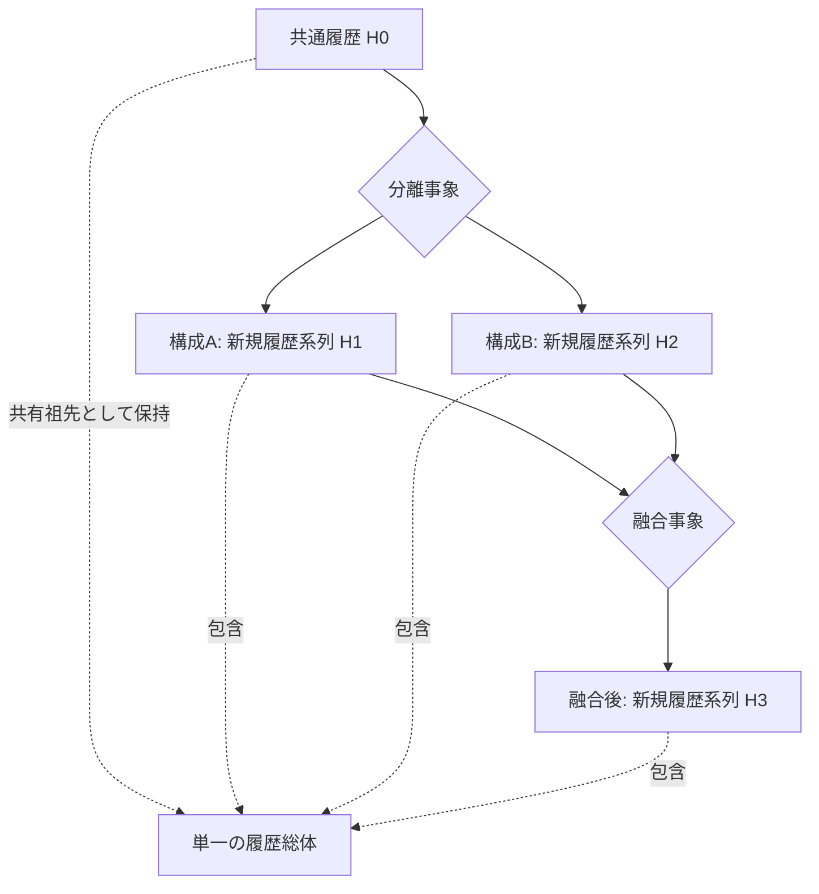

# NRA-IDE：事象の分岐・融合と計算成立境界（定義検討記録）

- 記録日時：2026-11-12 16:04 JST
- 推奨配置：`nra-core/foundations/`
- 状態：**未確定・非正典の定義検討文書**（実装・正式定義の変更を承認しない）
- 対照：`theory/AXIOMS.md` v2.5、`FORMULA.md` v2.2、`REPOSITORY_OVERVIEW.md`、`nra-core/README.md`（2026-11-12 GitHub 現行デフォルトブランチを確認）
- 目的：本会話で確定した問題設定と未確定部分を分離し、「センサー故障＝除外」という例へ戻って基本概念を混同することを防ぐ。

## 0. 最重要の境界（冒頭で必ず確認する）

1. **現実事象が一次**。センサー・記録装置・評価・計算は現実事象の可視化や記述のための二次的手段であり、事象を生成したり消去したりする判定権限を持たない。
2. **現実の分離と、評価の除外は別**。分離は事象・関係の変化。評価上の除外は評価規則の適用範囲の変更であって、現実の物理的分離を意味しない。
3. **分岐では各構成に新しい履歴系列が始まり、融合では融合後の新しい系列が始まる**。元の履歴を消したり「元へ戻した」ことにはしない。
4. **履歴総体は一つ**。これは各系列が数値的に足し算できるという意味ではない。共有祖先を重複して数えないこと、系列間の関係を保つことが重要。
5. **新しい要素を加える操作は新規計算の起点になる**。分岐・融合時の各新規計算については、計算ごとの対象宣言・規則・状態を明示し、過去の計算結果を書き換えない。
6. **許容範囲と欠損停止は異なる**。値の範囲内判定と、事実・理由の不存在を補完することを同一視しない。
7. **結論を成立させる目的で前提・採否・規則を調整しない**。NRA-IDEの逆導出A/Bの正典定義との照合が必要。

## 1. 議論で確認された区分と、残る未確定事項

| 項目 | 本会話で採用する位置づけ | 残る検証課題 |
|---|---|---|
| 事象 | 現実に起きる変化・分離・融合・作用 | 同一性の定義、事象境界 |
| 履歴総体 | 分岐した各系列と接続事象を包含する単一の総体 | 事象を完全に捉える形式モデルの適否 |
| 分離 | 構成が分かれ、各構成に後続履歴が生じる | 何をもって分離が成立したとするか |
| 融合 | 複数系列から融合後の新規履歴を始める | 単なる接触との区別、成立判定 |
| 加える | 新規計算の開始を伴う | 計算対象・評価宣言の再設定規則 |
| 除外 | 評価範囲・情報採用の処理としてのみ暫定的に使用 | 現行FORMULAの「構造要素の除去」とどう区別・接続するか |
| 計測 | 事象を認識する二次的手段 | 欠測を現実の履歴欠損と誤認しない実装 |

**注意：** 現行 `FORMULA.md` §0.5.3–0.5.4 は、構造要素の付加・除去を `Active_n` の更新とする正規計算上の取り扱いを既に記載している。ここでの「現実の分離を除外と呼ばない」という整理を、その既存定義の否定や自動改訂と扱わない。両者の用語境界は正式な照合課題である。

## 2. 図式：概念モデル（正典式ではない）

この図は「履歴の分岐・融合」を表す概念図であり、律環螺旋・二重ゆらぎの形状を示すものではない。時間は事象に沿って前進し、融合後も旧履歴は保持される。枝を後から「足す」演算図ではない。

## 3. 数学的記述候補（**提案式・未検証**）

### 3.1 履歴の接続性

事象集合を `V`、履歴的な先行・接続関係を `E_h` とし、`G_h=(V,E_h)` と記す。この記述は例示的なモデル候補であって、現実の全事象に対する完全性を証明しない。

同一の総体について系列 `H_0,H_1,H_2,H_3` を記述する場合、共有過去を重複して数えず、次を「系列集合の包含関係」の候補表現とする。

$$
\mathcal{H}=H_0\cup H_1\cup H_2\cup H_3\cup E_{\mathrm{split}}\cup E_{\mathrm{merge}}
\tag{1}
$$

**式(1)の `∪` は集合の和集合であり、数値の加算ではない**。`E_split`、`E_merge` は分離・融合事象の集合。履歴の完全保存を現実のセンサーやデータベースで保証できる、という意味でもない。

### 3.2 新規計算との区別

分離後の構成 A・B と融合後の構成 C の計算を、それぞれ `C_A`, `C_B`, `C_C` と区別する。

$$
C_A=\operatorname{Eval}(D_A,F_A),\qquad
C_B=\operatorname{Eval}(D_B,F_B),\qquad
C_C=\operatorname{Eval}(D_C,F_C)
\tag{2}
$$

`D` は計算開始前の評価宣言、`F` はその計算に適用する根拠・入力を表す記号。各評価宣言が独立に成立する必要があり、履歴総体が単一であることから評価関数の同一性は導かれない。`Eval` は**今回の整理用の仮記号**であり、正規の IDE の `R=δ/τ` を置換しない。

### 3.3 計算成立と許容範囲・欠損の境界

特定の評価 `j` において、必要入力と適用規則の成立が確認済みであることを `P_j` と表す。出力 `f_j(x)` の許容集合を評価前に固定した `T_j` とする。

$$
P_j\ \land\ \bigl(\forall x\in X_j,\ f_j(x)\in T_j\bigr)
\quad\Longrightarrow\quad
\text{当該許容判定は成立}
\tag{3}
$$

`X_j` は**事実・規則に基づいて厳密に証明された**入力の可能集合に限る。単に値が欠けていることから `X_j` を都合よく設定してはならない。式(3)が示すのは *当該判定* の成立であり、欠損値そのものの確定でも、原因の唯一性の証明でもない。

$$
\neg\operatorname{Established}(P_j)
\quad\Longrightarrow\quad
\text{当該計算の成立は未確定（必要に応じ停止）}
\tag{4}
$$

ここでの `Established` は、事実・規則の成立確認を表すメタ述語の仮記号。式(4)から直ちに正規状態 `CONFESSION` を一律に導出しない。実際の状態分類は `AXIOMS.md` と `FORMULA.md` の欠測、入力不正、観測不能の区分に従う。

## 4. 境界事例（将来のAIによる蒸し返しを防ぐ）

### 事例A：センサーが3基あり、1基が故障

- **現実**：機器の故障、観測の失敗、運用上の切り替え等が起きた可能性がある。これらを事象として調べる。
- **二次的記述**：センサーの値を評価に使用するかどうかは観測・計算系の判断。
- **禁止する飛躍**：「センサーを不採用にした」→「現実の事象の履歴が一つ失われた」、または「残り2基の正常が確定した」。
- **注記**：これは検証例にすぎず、理論の対象をセンサー系に限定しない。

### 事例B：枝を切り離す

- 物理的な分離事象が生じ、残存構成と切り離された構成に後続の履歴が生じる。
- 分離が自然発生か人為かで原因を区別する。適切・不適切は分離の存在事実と独立に評価する。
- 履歴を一つの総体に保持することは、両系列の状態量を数値的に加算できることを意味しない。

### 事例C：別々の構成が融合

- 融合の成立時点以降、新しい計算宣言と履歴系列を設けるという今回の検討案。
- 過去の履歴を融合後の履歴で上書きしない。「元に戻った」とは言わない。
- 単なる接触や相互作用を融合と判定するための条件は未確定。

### 事例D：10条件中9条件が確定

- 残る1条件が独立の必須条件で未確定なら、全成立とは言えない。
- 残る条件が既知の公理・定義・規則から**厳密に計算・証明可能**なら、逐次操作を省略しても穴埋めではない。
- その数式を現実事象に適用する妥当性まで別途確認する。計算の正しさは事象への適用を自動的に保証しない。

## 5. 逆導出の再発防止

今回の議論で生じた問題は、最初から「除外を成立させる」ことを目的とし、誤った分類の可能性を十分に検証しなかったこと。したがって、以下を記録上の再検討トリガーとする。

- ある用語の成立に合わせて条件を追加し始めたら、**当初の事象分類を再審査**する。
- 原因が一つしか残らないという結論でも、候補集合の網羅性、許容基準の事前固定、必須事実の成立を別々に確認する。
- 「逆算」と呼ばれる探索行為のうち、形式的に一意・確定できた範囲だけを計算成立とし、未確定は不明として残す。
- 記録上の「推定・未確定」を「事実・正規定義」へ格上げしない。

## 6. 正典との照合が必要な事項

1. `AXIOMS.md` §2 の履歴非同一性、§4 の履歴蓄積と、今回の「履歴総体は一つ」という条件の関係。
2. `FORMULA.md` §0.5.3–0.5.4 の `Active_n` における構造要素の**除去**と、今回の「分離・分岐」の関係。用語や計算開始条件に緊張がある可能性がある。
3. `FORMULA.md` §0.5.1 の評価宣言を、新規計算開始時にどう再宣言するか。不可逆状態や事象の参照を失わない条件。
4. `AXIOMS.md` §10–11 の `NOT_OBSERVABLE`、`CONFESSION` 等の区分と、許容判定の一般式（3）をどう整合させるか。
5. `AXIOMS.md` §14 の逆導出A/Bに、今回の「用語・問題設定の誤分類」をどう関連づけるか。**誤分類そのものを正典上の逆導出と断定しない**。
6. 履歴グラフ候補が分離・融合・並行性を十分に表現できるか。完備性、時間順序、同一事象の識別方法は未検証。

## 7. 運用上の境界

- この文書は**検討記録**であり、第二公理・新しい正規式・新しい正規状態を創設しない。
- `FORMULA.md` の既存定義、`theory/AXIOMS.md`、`theory/axioms.json`、正規参照実装を変更していない。
- 提案式(1)–(4)は正典の計算式ではない。検証完了まで実装の判定根拠に使用しない。
- 新規セッションで参照する際は、**第0節・第4節・第6節から読む**。これを読まずに「センサー故障の除外」を理論の中心とする議論を再開しない。

## 参照先

- https://github.com/M-Tokun/NRA-IDE/blob/master/theory/AXIOMS.md
- https://github.com/M-Tokun/NRA-IDE/blob/master/FORMULA.md
- https://github.com/M-Tokun/NRA-IDE/blob/master/REPOSITORY_OVERVIEW.md
- https://github.com/M-Tokun/NRA-IDE/blob/master/nra-core/README.md

